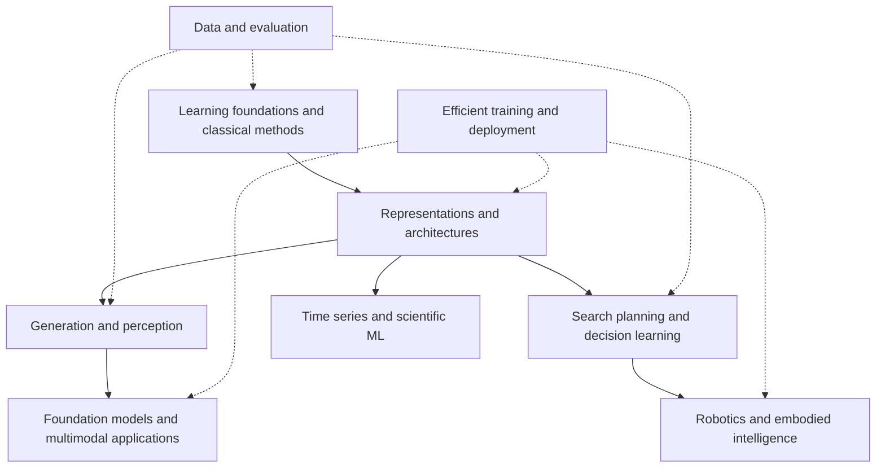

# AI · Overview & Knowledge Map

!!! abstract "Broad coverage, focused study"
    Distinguish foundations, methods, tasks and systems, then choose an implementation track. P0 is shared foundation, P1 major-method literacy, P2 specialization. A comprehensive map is not a requirement to complete every topic.

## Structure

| Module | Coverage | First pass |
|---|---|---|
| Foundations and classical ML | Probability/optimization, generalization, data, linear/kernel/tree/ensemble methods, clustering and reduction | Diagnose gaps and build a sound baseline |
| Representation and paradigms | Embeddings, transfer, self-supervision, contrast/masking/teachers, continual/active/federated learning | Explain supervision and compare feature use |
| Architectures | MLP, CNN, RNN, Transformer, SSM, MoE and efficient attention | Structural trade-offs and one implementation |
| Graphs and geometry | Message passing, graph Transformers, symmetry/equivariance, points and relations | Purpose first; GCN after selecting graphs |
| Generation | Autoregression, VAE, GAN, normalizing flows, diffusion, flow matching and discrete generation | Objectives and sampling; optional 2D experiments |
| Vision, multimodality and space | Classification, detection, segmentation, video, audio/language alignment, depth/points, NeRF/3DGS | Tasks and metrics before 3D depth |
| Search and decision learning | Search, constraints, knowledge, RL, imitation/offline learning, world models and skills | Prediction vs. action; reuse robot practice |
| Time series and scientific AI | Forecasts/anomalies, transfer, PINNs, neural operators and inverse problems | Reuse signals/systems experience and classical baselines |
| Efficient systems | Reproducibility, profiling, quantization/distillation/pruning, parallelism, runtimes and deployment | Measure resources on an existing model |
| Evaluation and trustworthy AI | Data quality, calibration, uncertainty, OOD, explanations, privacy/safety and bias | Use throughout every project |

AI covers transferable methods; existing sections retain LLM lifecycle and robot-loop detail rather than duplicate courses.

## Resource selection

Continue Lee/Karpathy as existing backbones. Use **CS231n** for vision and representations and **MIT 6.S184** for generation. Enter graph/RL courses only after selecting those directions; use official walkthroughs for small experiments.

Each topic normally has one primary entry and one necessary practical/reference entry. Topics follow a consistent cognitive loop: **Knowledge Map $\to$ Core Mechanistic Intuition $\to$ Selected Entries $\to$ Controlled Guided Experiment $\to$ Check-Yourself Reflection**. Intuition anchors the concepts, experiments verify the code, and self-checks test deep understanding. Sources, scope and difficulty checked **2026-10-18**; names and popularity counts alone are not quality evidence.

The original [checklist](../checklist.md) remains a historical record. Track later ability through explain/reproduce/independently-improve evidence.
