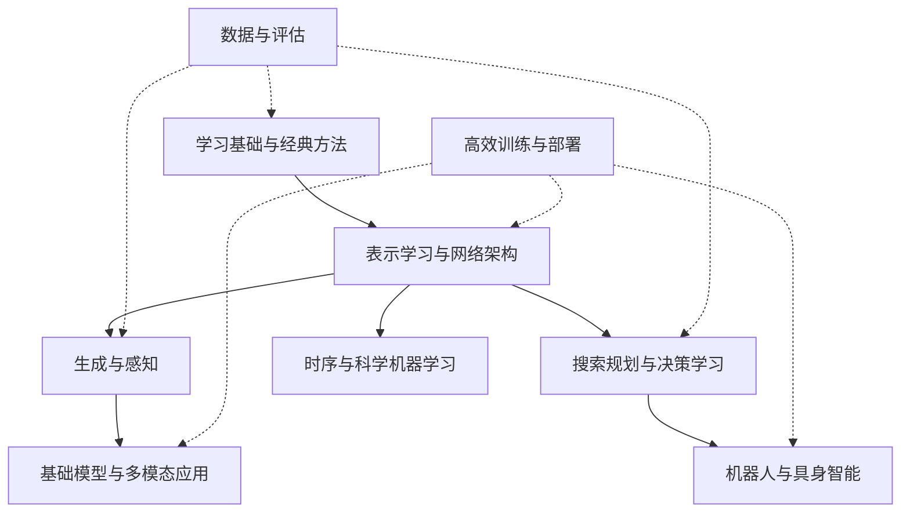

# AI · 全貌与知识地图

!!! abstract "覆盖系统全面，学习少而精"
    先认识基础、方法、任务和系统的关系，再选一条实现路线。P0 为共享基础，P1 为需要认识的主要方法，P2 为方向深入；知识地图完整不等于每个专题都必修。

## 整体结构

| 模块 | 应当覆盖什么 | 第一轮到什么程度 |
|---|---|---|
| 学习基础与经典 ML | 概率与优化、泛化、数据、线性/核/树/集成、聚类与降维 | 诊断缺口，做一个可靠基线 |
| 表示学习与学习范式 | 嵌入、迁移、自监督、对比/掩码/教师、持续/主动/联邦学习 | 理解信号来源，做一次特征使用对比 |
| 网络架构 | MLP、CNN、RNN、Transformer、SSM、MoE、高效注意力 | 认识结构取舍，沿一套代码实现 |
| 图与几何学习 | 消息传递、图 Transformer、对称/等变、点云与关系结构 | 认识用途，图方向再做 GCN |
| 生成建模 | 自回归、VAE、GAN、normalizing flow、扩散、流匹配与离散生成 | 先比较目标与采样，二维实验选做 |
| 视觉、多模态与空间 | 分类、检测、分割、视频、语音/语言对齐、深度/点云、NeRF/3DGS | 任务与指标全貌，三维后深入 |
| 搜索规划与决策学习 | 搜索、约束、知识表示、RL、模仿/离线学习、世界模型与技能 | 分清预测与行动；机器人实践沿已有路线 |
| 时序与科学 AI | 时序预测/异常、基础模型迁移、PINN、神经算子与反问题 | 连接你的信号与系统经验，保留经典基线 |
| 高效训练与工程 | 实验复现、性能、量化/蒸馏/剪枝、并行、运行时与部署 | 在一个已有模型上测资源 |
| 评估与可信 AI | 数据质量、校准、不确定性、OOD、解释、隐私安全与偏差 | 所有项目都用，不放到最后再补 |

AI 栏目维护跨任务的基础与方法；LLM 生命周期和机器人闭环细节沿已有两个栏目深入，同一知识不重复建课。

## 教程如何精选

已有主线继续使用李宏毅与 Karpathy。视觉和表示方向复用 **CS231n**；生成方向复用 **MIT 6.S184**。图和 RL 的主课仅在选定方向后进入；工程小实验优先使用官方教程。

每个专题原则上只列一个主入口与一个必要的实践/查阅入口。各专题统一遵循认知闭环：**知识地图 $\to$ 核心机制直觉 $\to$ 精选入口 $\to$ 受控跟随实验 $\to$ 认知自测思考**。用机制建立直觉，用实验验证代码，用自测检验深度理解。来源、课程范围与难度核对日期：2026-10-18；不将品牌、星数或模型名当作质量证据。

原有 [checklist](../checklist.md)保留作历史学习记录。后续能力用“能解释、能复现、能独立改进”的实际证据记录。
