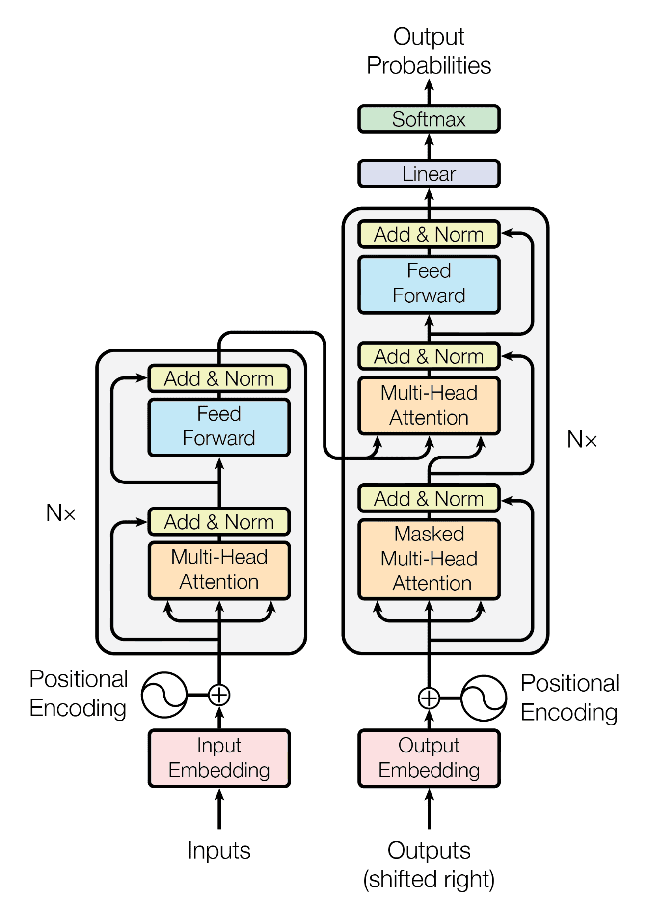

# Transformer

网络架构专题。先理解 token、向量、注意力、位置与残差，再跟一个小实现；不要从原论文开始承担全部前置知识。

| 层次 | 主题 | 验收 |
|---|---|---|
| P1 | 自注意力、Q/K/V、位置、残差、归一化 | 画数据流并解释 Tensor 形状 |
| P2 | ViT、跨模态、长上下文、稀疏/线性注意力 | 明确任务与资源再做比较 |
| P2 | MoE 与高效实现 | 区分条件计算、架构变体与内核优化 |

## 精选入口

-   :material-code-braces:{ .lg .middle } __实现主线 · Karpathy Zero to Hero__

    ---

    沿 makemore 到 GPT 纯手写代码，掌握输入嵌入、自注意力矩阵与残差流架构。

    [:octicons-arrow-right-24: 访问实现主线](https://karpathy.ai/zero-to-hero.html)

-   :material-video:{ .lg .middle } __几何直觉 · 3Blue1Brown 动画解析__

    ---

    全球顶尖数学动画，生动拆解 Query、Key、Value 向量与高维特征交互。

    [:octicons-arrow-right-24: 观看动画解析](https://www.youtube.com/watch?v=wjZofJX0v4M)

## 核心机制直觉 · 软路由与张量流动

- **本质直觉**：自注意力不是黑盒魔术，而是<strong>基于内容的动态加权信息检索（软路由）</strong>。每个 token 生成 Query（我想寻找什么信息）和 Key（我具备什么特征），通过点积评分得到关联度分布，最后对 Value（我的实际信息载荷）加权聚合。
- **最小张量骨架**：
    - 输入嵌入：$X \in \mathbb{R}^{B \times T \times D}$
    - 线性投影：$Q = X W_Q,\; K = X W_K,\; V = X W_V \in \mathbb{R}^{B \times T \times D}$
    - 注意力权重图：$A = \text{Softmax}\left(\frac{Q K^T}{\sqrt{d_k}}\right) \in \mathbb{R}^{B \times T \times T}$（将全序列任意两两位置显式全连接）
    - 特征聚合与输出：$O = A V W_O \in \mathbb{R}^{B \times T \times D}$
- **代价权衡**：$O(T^2)$ 带来全局无衰减的长程依赖捕捉能力；但在自回归生成阶段，计算量逐渐让位于访存带宽瓶颈，缓存历史 key/value 的 **KV Cache** 显存占用随并发与序列长度线性膨胀。

## 认知自测 · 关键思考

- [ ] 注意力公式除以 $\sqrt{d_k}$ 的数学必要性是什么？当向量维度 $d_k$ 很大（如 128）且未归一化时，Softmax 梯度会发生什么？
- [ ] 自回归 Decoder 中的因果掩码（Causal Mask）在矩阵乘法层面如何生效？为什么不能只靠训练损失来防止“偷看未来”？
- [ ] 为什么说 Pre-LN（在 Attention/FFN 之前归一化）相比原始 Transformer 论文中的 Post-LN（在残差之后归一化）能使深层梯度的流动更加健康稳定？

先完成小实现，再按问题回访原论文或下面的历史收藏。

## 相关专题

-   __架构地图__

    ---

    CNN、Transformer、SSM、GNN 的计算范式对比

    [:octicons-arrow-right-24: 进入](../ARCHITECTURES/architectures.md)

-   __AI 全貌__

    ---

    AI 知识地图与模块关系

    [:octicons-arrow-right-24: 进入](../ai.md)

原有阅读收藏（按需查阅）

## __入门__

-   :material-file:{ .lg .middle } __Attention is all you need 论文__ 

    ---

    [:octicons-arrow-right-24: <a href="https://arxiv.org/abs/1706.03762" target="_blank"> 传送门 </a>](#)

-   :material-youtube:{ .lg .middle } __Attention is all you need 解读✅__ 

    ---

    [:octicons-arrow-right-24: <a href="https://www.bilibili.com/video/BV1pu411o7BE/?spm_id_from=333.1387.collection.video_card.click&vd_source=5a427660f0337fedc22d4803661d493f" target="_blank"> 传送门 </a>](#)

## __深入__

-   :fontawesome-brands-bilibili:{ .lg .middle } __超强动画，一步一步深入浅出解释Transformer原理！🏆__ 

    ---

    讲得很好！

    [:octicons-arrow-right-24: <a href="https://www.youtube.com/watch?v=4Bdc55j80l8" target="_blank"> 传送门 </a>](#)

-   :fontawesome-brands-bilibili:{ .lg .middle } __Attention is all you need 解读 (中文)__ 

    ---
    并不很严谨，但是有助于感性认知。

    [:octicons-arrow-right-24: <a href="https://www.bilibili.com/video/BV14m421u7EM/?spm_id_from=333.337.search-card.all.click&vd_source=5a427660f0337fedc22d4803661d493f" target="_blank"> 传送门 </a>](#)

-   :fontawesome-brands-bilibili:{ .lg .middle } __注意力机制的本质|Self-Attention|Transformer|QKV矩阵__ 

    ---

    [:octicons-arrow-right-24: <a href="https://www.bilibili.com/video/BV1dt4y1J7ov/?spm_id_from=333.788.recommend_more_video.0&vd_source=5a427660f0337fedc22d4803661d493f" target="_blank"> 传送门 </a>](#)

## __实践__

-   :material-file:{ .lg .middle } __annotated-transformer__ 

    ---

    [:octicons-arrow-right-24: <a href="http://nlp.seas.harvard.edu/annotated-transformer" target="_blank"> 笔记 </a>](#)

    [:octicons-arrow-right-24: <a href="https://github.com/harvardnlp/annotated-transformer" target="_blank"> 代码 </a>](#)

-   :material-file:{ .lg .middle } __transformer tutorial🎯🏆__ 

    ---

    [:octicons-arrow-right-24: <a href="https://medium.com/towards-data-science/all-you-need-to-know-about-attention-and-transformers-in-depth-understanding-part-1-552f0b41d021" target="_blank"> 理论 1 </a>](#)

    [:octicons-arrow-right-24: <a href="https://medium.com/towards-data-science/all-you-need-to-know-about-attention-and-transformers-in-depth-understanding-part-2-bf2403804ada" target="_blank"> 理论 2 </a>](#)

    [:octicons-arrow-right-24: <a href="https://medium.com/towards-data-science/build-your-own-transformer-from-scratch-using-pytorch-84c850470dcb" target="_blank"> 实战教程 </a>](#)

