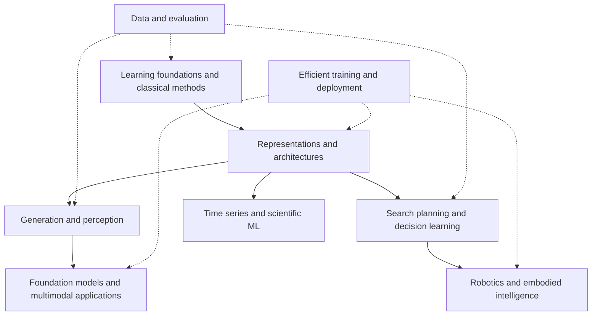

# AI · Overview & Knowledge Map

!!! abstract "Broad coverage, focused study"
    Distinguish foundations, methods, tasks and systems, then choose an implementation track. P0 is shared foundation, P1 major-method literacy, P2 specialization. A comprehensive map is not a requirement to complete every topic.

-   :material-rocket-launch:{ .lg .middle } __Get Started · Two Weeks__

    ---

    A 14-day plan worked back from common role requirements: training, architectures, evaluation, and a GPU / Jetson / MCU quantisation project.

    [Start here](GET-STARTED/get-started.md)

-   :material-map-marker-path:{ .lg .middle } __Roadmap · Learning Path__

    ---

    Background-aware sequencing, skip verified foundations, and choose 1–2 hands-on projects.

    [View Roadmap](ROADMAP/roadmap.md)

-   :material-compass-outline:{ .lg .middle } __Frontiers · Concept Index__

    ---

    Place trending terminology back into context, distinguishing architectures, objectives and systems.

    [Explore Index](FRONTIERS/frontiers.md)

-   :material-brain:{ .lg .middle } __Foundation Models · Overview__

    ---

    Full LLM lifecycle: architecture, post-training, multimodality, RAG, tool agents and inference.

    [Enter Foundation Models](../FOUNDATION-MODELS/OVERVIEW/overview.md)

-   :material-robot-outline:{ .lg .middle } __Embodied AI · Overview__

    ---

    Closed-loop robotics: embodiment, state estimation, planning/control, policies and sim-to-real.

    [Enter Embodied AI](../EMBODIED-INTELLIGENCE/OVERVIEW/overview.md)

## Structure

| Module | Coverage | First pass |
|---|---|---|
| [Foundations and classical ML](FOUNDATIONS/foundations.md) | Probability/optimization, generalization, data, linear/kernel/tree/ensemble methods, clustering and reduction | Diagnose gaps and build a sound baseline |
| [Representation and paradigms](REPRESENTATION/representation.md) | Embeddings, transfer, self-supervision, contrast/masking/teachers, continual/active/federated learning | Explain supervision and compare feature use |
| [Architectures](ARCHITECTURES/architectures.md) | MLP, CNN, RNN, Transformer, SSM, MoE and efficient attention | Structural trade-offs and one implementation |
| [Graphs and geometry](GNN/gnn.md) | Message passing, graph Transformers, symmetry/equivariance, points and relations | Purpose first; GCN after selecting graphs |
| [Generation](GENERATIVE-MODELING/generative-modeling.md) | Autoregression, VAE, GAN, normalizing flows, diffusion, flow matching and discrete generation | Objectives and sampling; optional 2D experiments |
| [Vision, multimodality and space](CV/cv.md) | Classification, detection, segmentation, video, audio/language alignment, depth/points, NeRF/3DGS | Tasks and metrics before 3D depth |
| [Search and decision learning](DECISION-LEARNING/decision-learning.md) | Search, constraints, knowledge, RL, imitation/offline learning, world models and skills | Prediction vs. action; reuse robot practice |
| [Time series and scientific AI](SCIENTIFIC-AI/scientific-ai.md) | Forecasts/anomalies, transfer, PINNs, neural operators and inverse problems | Reuse signals/systems experience and classical baselines |
| [Efficient systems](SYSTEMS/systems.md) | Reproducibility, profiling, quantization/distillation/pruning, parallelism, runtimes and deployment | Measure resources on an existing model |
| [Evaluation and trustworthy AI](EVALUATION/evaluation.md) | Data quality, calibration, uncertainty, OOD, explanations, privacy/safety and bias | Use throughout every project |

AI covers transferable methods; existing sections retain LLM lifecycle and robot-loop detail rather than duplicate courses.

## Resource selection

Continue Lee/Karpathy as existing backbones. Use **CS231n** for vision and representations and **MIT 6.S184** for generation. Enter graph/RL courses only after selecting those directions; use official walkthroughs for small experiments.

Each topic normally has one primary entry and one necessary practical/reference entry. Topics follow a consistent cognitive loop: **Knowledge Map $\to$ Core Mechanistic Intuition $\to$ Selected Entries $\to$ Controlled Guided Experiment $\to$ Check-Yourself Reflection**. Intuition anchors the concepts, experiments verify the code, and self-checks test deep understanding. Sources, scope and difficulty checked **2026-10-18**; names and popularity counts alone are not quality evidence.

The original [checklist](checklist.md) remains a historical record. Track later ability through explain/reproduce/independently-improve evidence.

Earlier bookmarks (optional references, not parallel required courses)

!!! note "PART A: BASICS"
    This part serves as the foundation.

{width=100%}

**__GET STARTED__**

-  :material-book:{ .lg .middle } __Little Book of Deep Learning ✅🏆__

    ---

    [:octicons-arrow-right-24: <a href="https://fleuret.org/francois/lbdl.html" target="_blank"> Portal </a>](#)

-  :material-book:{ .lg .middle } __Deep Learning：Foundations and Concepts 🏆__

    ---

    [:octicons-arrow-right-24: <a href="https://www.bishopbook.com/" target="_blank"> Portal </a>](#)

**__HANDS-ON__**

-   :simple-nvidia:{ .lg .middle } __NVIDA CUDA🏆__

    --- 

    [:octicons-arrow-right-24: <a href="https://docs.nvidia.com/cuda/cuda-installation-guide-microsoft-windows/" target="_blank"> Portal </a>](#) 

-   :simple-pytorch:{ .lg .middle } __PyTorch🏆__

    --- 

    [:octicons-arrow-right-24: <a href="https://pytorch.org/" target="_blank"> Portal </a>](#)

-   :simple-tensorflow:{ .lg .middle } __TensorFlow🏆__

    --- 

    [:octicons-arrow-right-24: <a href="https://www.tensorflow.org/" target="_blank"> Portal </a>](#)

-   :simple-keras:{ .lg .middle } __KERAS 🏆__

    --- 

    [:octicons-arrow-right-24: <a href="https://keras.io/" target="_blank"> Portal </a>](#) 

-   :hugging:{ .lg .middle } __HUGGING FACE 🏆__

    --- 

    [:octicons-arrow-right-24: <a href="https://huggingface.co/" target="_blank"> Portal </a>](#)

!!! note "PART B: ADVANCED TOPICS"
    This part is the advanced content.

**__ADVANCED TOPICS__**

**Geometry, Representations & Generative Modeling**

| Topic | First understand | Guided experiment |
|---|---|---|
| [Overview and path](GENERATIVE-MODELING/generative-modeling.md) | Representations, architectures and generation | One MIT course for diffusion and flow matching |
| [Manifolds and latent spaces](GENERATIVE-MODELING/MANIFOLDS/manifolds.md) | Low-dimensional structure and geometry | G1 Swiss roll reduction |
| [Diffusion models](GENERATIVE-MODELING/DIFFUSION/diffusion.md) | Noise, denoising, scores and sampling | G2 2D denoising/generation |
| [Flow matching](GENERATIVE-MODELING/FLOW-MATCHING/flow-matching.md) | Probability paths, vector fields and ODEs | G3 transport and trajectories |

Read concepts first, then choose experiments. Start geometry with diagrams/CPU; use the same MIT 6.S184 notes, videos and labs for diffusion and flow matching. Topic pages connect to foundation models and embodied intelligence.

**__REINFORCEMENT LEARNING__**

-   :fontawesome-brands-bilibili:{ .lg .middle } __李宏毅-Reinforcement Learning🎯🏆__ 

    ---

    Notes: In Chinese

    Easy for beginners to understand.

    [:octicons-arrow-right-24: <a href="https://www.bilibili.com/video/BV1XP4y1d7Bk/?spm_id_from=333.337.search-card.all.click&vd_source=5a427660f0337fedc22d4803661d493f" target="_blank"> Portal </a>](#)

-   :fontawesome-brands-square-github:{ .lg .middle } __Easy RL🎯✅🏆__ 

    ---

    Notes: In Chinese
    This project should be taken as the notes of 李宏毅-Reinforcement Learning.

    [:octicons-arrow-right-24: <a href="https://datawhalechina.github.io/easy-rl/#/" target="_blank"> Portal </a>](#)

-   :material-web:{ .lg .middle } __Deep Reinforcement Learning: Fundamentals, Research, and Applications🎯🏆__ 

    ---

    [:octicons-arrow-right-24: <a href="https://deepreinforcementlearningbook.org/" target="_blank"> Portal </a>](#)

-   :material-web:{ .lg .middle } __UCL Course on RL🎯🏆__ 

    ---

    [:octicons-arrow-right-24: <a href="https://www.davidsilver.uk/teaching/" target="_blank"> Portal </a>](#)

-   :material-web:{ .lg .middle } __CS285: Deep Reinforcement Learning__ 

    ---

    [:octicons-arrow-right-24: <a href="http://rail.eecs.berkeley.edu/deeprlcourse/" target="_blank"> Portal </a>](#)

    [:octicons-arrow-right-24: <a href="https://www.youtube.com/playlist?list=PL_iWQOsE6TfX7MaC6C3HcdOf1g337dlC9" target="_blank"> Video </a>](#)

-   :material-web:{ .lg .middle } __Reinforcement Learning: An Introduction__ 

    ---

    [:octicons-arrow-right-24: <a href="http://incompleteideas.net/book/RLbook2018.pdf" target="_blank"> Portal </a>](#)

-   :fontawesome-brands-bilibili:{ .lg .middle } __Reinforcement Learning__ 

    ---

    [:octicons-arrow-right-24: <a href="https://space.bilibili.com/59807853/channel/collectiondetail?sid=908186" target="_blank"> Portal </a>](#)

<!-- ### __FEDERATED LEARNING__

**__MULTI-AGENT SYSTEMS__**

**__GRAPH NEURAL NETWORKS__**

**__ONLINE LEARNING__ -->**

