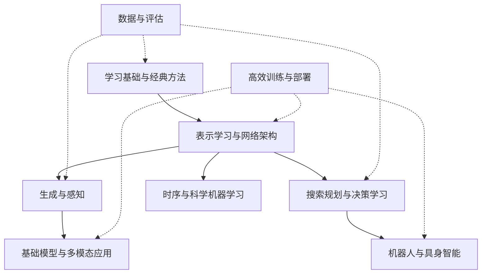
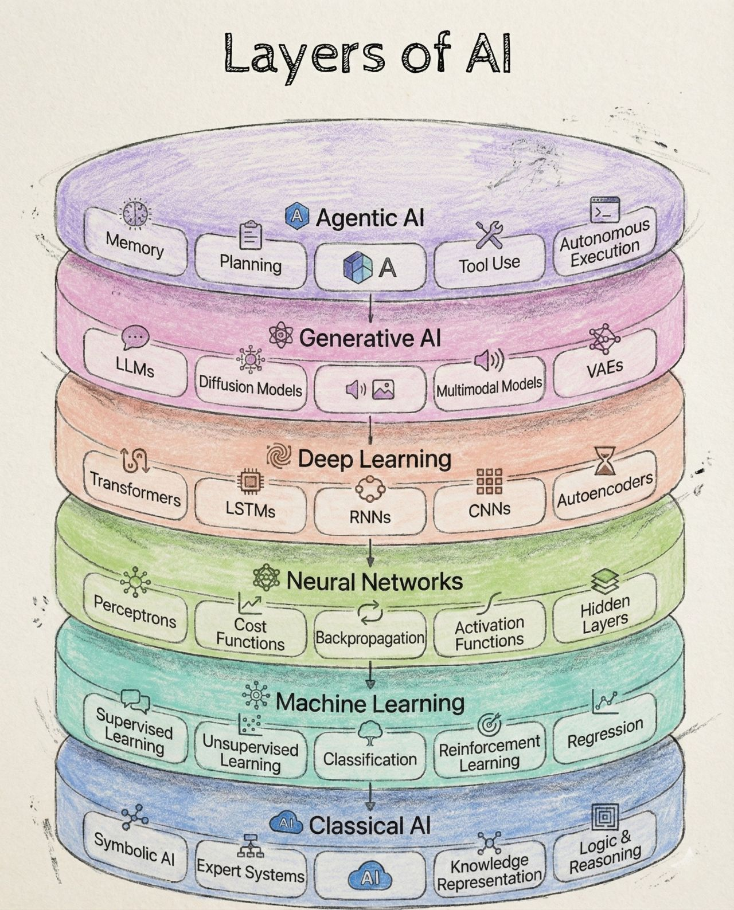

# AI · 全貌与知识地图

!!! abstract "覆盖系统全面，学习少而精"
    先认识基础、方法、任务和系统的关系，再选一条实现路线。P0 为共享基础，P1 为需要认识的主要方法，P2 为方向深入；知识地图完整不等于每个专题都必修。

-   :material-rocket-launch:{ .lg .middle } __Get Started · 两周速成__

    ---

    从常见岗位要求倒推的 14 天计划：训练调试、主流架构、评估，到 GPU / Jetson / MCU 量化部署的作品。

    [开始速成](GET-STARTED/get-started.md)

-   :material-map-marker-path:{ .lg .middle } __Roadmap · 学习路线__

    ---

    按背景诊断缺口、控制推进节奏、选一到两个体验项目，不盲目打卡。

    [查看路线](ROADMAP/roadmap.md)

-   :material-compass-outline:{ .lg .middle } __Frontiers · 前沿技术索引__

    ---

    把最新热门术语放回知识地图，厘清架构、目标、任务与系统约束。

    [查阅索引](FRONTIERS/frontiers.md)

-   :material-brain:{ .lg .middle } __Foundation Models · 基础模型__

    ---

    大语言模型全生命周期：架构、后训练适配、多模态、RAG、Agent 与推理系统。

    [进入基础模型全貌](../FOUNDATION-MODELS/OVERVIEW/overview.md)

-   :material-robot-outline:{ .lg .middle } __Embodied AI · 具身智能__

    ---

    机器人闭环：空间本体、感知状态估计、规划控制、学习型策略与虚实迁移。

    [进入具身智能全貌](../EMBODIED-INTELLIGENCE/OVERVIEW/overview.md)

## 整体结构

| 模块 | 应当覆盖什么 | 第一轮到什么程度 |
|---|---|---|
| [学习基础与经典 ML](FOUNDATIONS/foundations.md) | 概率与优化、泛化、数据、线性/核/树/集成、聚类与降维 | 诊断缺口，做一个可靠基线 |
| [表示学习与学习范式](REPRESENTATION/representation.md) | 嵌入、迁移、自监督、对比/掩码/教师、持续/主动/联邦学习 | 理解信号来源，做一次特征使用对比 |
| [网络架构](ARCHITECTURES/architectures.md) | MLP、CNN、RNN、Transformer、SSM、MoE、高效注意力 | 认识结构取舍，沿一套代码实现 |
| [图与几何学习](GNN/gnn.md) | 消息传递、图 Transformer、对称/等变、点云与关系结构 | 认识用途，图方向再做 GCN |
| [生成建模](GENERATIVE-MODELING/generative-modeling.md) | 自回归、VAE、GAN、normalizing flow、扩散、流匹配与离散生成 | 先比较目标与采样，二维实验选做 |
| [视觉、多模态与空间](CV/cv.md) | 分类、检测、分割、视频、语音/语言对齐、深度/点云、NeRF/3DGS | 任务与指标全貌，三维后深入 |
| [搜索规划与决策学习](DECISION-LEARNING/decision-learning.md) | 搜索、约束、知识表示、RL、模仿/离线学习、世界模型与技能 | 分清预测与行动；机器人实践沿已有路线 |
| [时序与科学 AI](SCIENTIFIC-AI/scientific-ai.md) | 时序预测/异常、基础模型迁移、PINN、神经算子与反问题 | 连接你的信号与系统经验，保留经典基线 |
| [高效训练与工程](SYSTEMS/systems.md) | 实验复现、性能、量化/蒸馏/剪枝、并行、运行时与部署 | 在一个已有模型上测资源 |
| [评估与可信 AI](EVALUATION/evaluation.md) | 数据质量、校准、不确定性、OOD、解释、隐私安全与偏差 | 所有项目都用，不放到最后再补 |

AI 栏目维护跨任务的基础与方法；LLM 生命周期和机器人闭环细节沿已有两个栏目深入，同一知识不重复建课。

## 教程如何精选

已有主线继续使用李宏毅与 Karpathy。视觉和表示方向复用 **CS231n**；生成方向复用 **MIT 6.S184**。图和 RL 的主课仅在选定方向后进入；工程小实验优先使用官方教程。

每个专题原则上只列一个主入口与一个必要的实践/查阅入口。各专题统一遵循认知闭环：**知识地图 $\to$ 核心机制直觉 $\to$ 精选入口 $\to$ 受控跟随实验 $\to$ 认知自测思考**。用机制建立直觉，用实验验证代码，用自测检验深度理解。来源、课程范围与难度核对日期：2026-10-18；不将品牌、星数或模型名当作质量证据。

原有 [checklist](checklist.md)保留作历史学习记录。后续能力用“能解释、能复现、能独立改进”的实际证据记录。

历史资源收藏（按需回访，不作为并行课程清单）

!!! note "第一部分：基础"
    这部分作为基础。

**__基础知识__**

-  :material-book:{ .lg .middle } __深度学习的小画书 ✅🏆__

    ---

    [:octicons-arrow-right-24: <a href="https://fleuret.org/francois/lbdl.html" target="_blank"> 传送门 </a>](#)

-  :material-book:{ .lg .middle } __深度学习：基础与概念 🏆__

    ---

    [:octicons-arrow-right-24: <a href="https://www.bishopbook.com/" target="_blank"> 传送门 </a>](#)

-   :fontawesome-brands-square-github:{ .lg .middle } __大白话讲明白AI 🏆__

    --- 

    [:octicons-arrow-right-24: <a href="https://space.bilibili.com/505885185/lists" target="_blank"> 传送门 </a>](#)

**__实践__**

-   :simple-nvidia:{ .lg .middle } __NVIDA CUDA🏆__

    --- 

    [:octicons-arrow-right-24: <a href="https://docs.nvidia.com/cuda/cuda-installation-guide-microsoft-windows/" target="_blank"> 传送门 </a>](#) 

-   :simple-pytorch:{ .lg .middle } __PyTorch🏆__

    --- 

    [:octicons-arrow-right-24: <a href="https://pytorch.org/" target="_blank"> 传送门 </a>](#)

-   :simple-tensorflow:{ .lg .middle } __TensorFlow🏆__

    --- 

    [:octicons-arrow-right-24: <a href="https://www.tensorflow.org/" target="_blank"> 传送门 </a>](#)

-   :simple-keras:{ .lg .middle } __KERAS 🏆__

    --- 

    [:octicons-arrow-right-24: <a href="https://keras.io/" target="_blank"> 传送门 </a>](#) 

-   :hugging:{ .lg .middle } __HUGGING FACE 🏆__

    --- 

    [:octicons-arrow-right-24: <a href="https://huggingface.co/" target="_blank"> 传送门 </a>](#)

!!! note "第二部分：高级主题"
    这部分是进阶内容。

**__高级主题__**

**几何表示与生成建模**

| 主题 | 先理解什么 | 跟随实验 |
|---|---|---|
| [专题全貌与路线](GENERATIVE-MODELING/generative-modeling.md) | 表示、架构与生成方法的关系 | 一套 MIT 主课串起扩散与流匹配 |
| [流形与潜空间](GENERATIVE-MODELING/MANIFOLDS/manifolds.md) | 高维中的低维结构、表示与几何 | G1：Swiss roll 降维 |
| [扩散模型](GENERATIVE-MODELING/DIFFUSION/diffusion.md) | 加噪、去噪、score 与采样 | G2：二维去噪与生成 |
| [流匹配](GENERATIVE-MODELING/FLOW-MATCHING/flow-matching.md) | 概率路径、向量场与 ODE 生成 | G3：分布搬运与轨迹可视化 |

先读概念，再按兴趣选做。流形部分以图示和 CPU 实验起步；扩散与流匹配共用 MIT 6.S184 的讲义、视频与 Labs。与基础模型和具身智能通过专题内链接衔接。

**__强化学习__**

-   :fontawesome-brands-bilibili:{ .lg .middle } __李宏毅-强化学习🎯🏆__ 

    ---

    [:octicons-arrow-right-24: <a href="https://www.bilibili.com/video/BV1XP4y1d7Bk/?spm_id_from=333.337.search-card.all.click&vd_source=5a427660f0337fedc22d4803661d493f" target="_blank"> 传送门 </a>](#)

-   :fontawesome-brands-square-github:{ .lg .middle } __Easy RL🎯✅🏆__ 

    ---

    [:octicons-arrow-right-24: <a href="https://datawhalechina.github.io/easy-rl/#/" target="_blank"> 传送门 </a>](#)

-   :material-web:{ .lg .middle } __深度强化学习-基础、研究与应用🎯🏆__ 

    ---

    [:octicons-arrow-right-24: <a href="https://deepreinforcementlearningbook.org/" target="_blank"> 传送门 </a>](#)

-   :material-web:{ .lg .middle } __UCL 强化学习课程🎯🏆__ 

    ---

    [:octicons-arrow-right-24: <a href="https://www.davidsilver.uk/teaching/" target="_blank"> 传送门 </a>](#)

-   :material-web:{ .lg .middle } __CS285: 深度强化学习__ 

    ---

    [:octicons-arrow-right-24: <a href="http://rail.eecs.berkeley.edu/deeprlcourse/" target="_blank"> 传送门 </a>](#)

    [:octicons-arrow-right-24: <a href="https://www.youtube.com/playlist?list=PL_iWQOsE6TfX7MaC6C3HcdOf1g337dlC9" target="_blank"> 视频 </a>](#)

-   :material-web:{ .lg .middle } __强化学习: 介绍__ 

    ---

    [:octicons-arrow-right-24: <a href="http://incompleteideas.net/book/RLbook2018.pdf" target="_blank"> 传送门 </a>](#)

-   :fontawesome-brands-bilibili:{ .lg .middle } __强化学习__ 

    ---

    [🔗 <a href="https://space.bilibili.com/59807853/channel/collectiondetail?sid=908186" target="_blank"> 传送门 </a>](#)

<!-- ### __联邦学习__

**__多智能体系统__**

**__图神经网络__**

**__在线学习__ -->**

