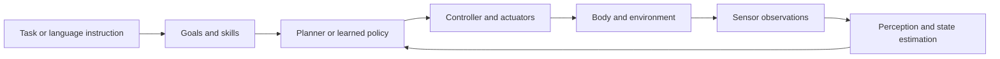

# Embodied Intelligence · Overview

!!! abstract "Understand the system first"
    Learn why each component exists and how components work together. Use videos, diagrams and lightweight simulation before detailed derivations and training.

## Robotics and embodied intelligence

Robotics studies sensing, motion and physical interaction. Embodied intelligence studies agents completing tasks through a body interacting with an environment. Robots are an important platform; learned policies are one family of methods.

| Component | Question | Example |
|---|---|---|
| Body, kinematics and dynamics | What can move, how do joints relate to the end effector, and how do forces affect motion? | Arm workspace |
| Perception | What is present and where is the target? | Detect objects on a table |
| State estimation | What state explains incomplete, noisy observations? | Fuse encoders and IMU |
| Planning | Which states or actions should be followed? | Obstacle-avoiding path |
| Control | How should execution be corrected using feedback? | Adjust velocity toward a target |
| Policy | Which action follows from observation, state or goal? | Joint targets or end-effector displacement |
| Software and simulation | How are components connected and experiments repeated? | ROS 2 messages, frames and replay |
| Evaluation and deployment | When does the task succeed or fail? | Success, collision, timeout and latency |

This diagram explains responsibilities. Real systems can combine components and mix learned and classical methods.

## How learning methods relate

| Method | Source of behavior | First-pass lesson |
|---|---|---|
| Classical planning and control | Models, objectives, constraints and control laws | A feedback baseline |
| Imitation / behavior cloning | Expert observation-action demonstrations | Coverage gaps can cause closed-loop failures |
| Reinforcement learning | Interaction and rewards | Reward design, exploration and training cost matter |
| VLA | Pretrained vision-language capabilities and robot action data | Understand modalities, action representation and adaptation |
| World model | Environment observations, states and actions | Prediction is distinct from a policy and task success |

## Primary course and later practice

| Role | Selected resource | Fit | Scope |
|---|---|---|---|
| Robot motion backbone | [Modern Robotics](https://modernrobotics.northwestern.edu/), textbook, videos and code | Builds on your linear algebra, geometry and systems experience with consistent notation | Preview and chapter introductions first; selected chapters 2–6 next; planning/control as needed |
| Later robot-learning practice | [LeRobot tutorial](https://huggingface.co/spaces/lerobot/robot-learning-tutorial) | Concepts, data, training and execution share an ecosystem | Concepts first; E3 after PyTorch and action-interface checks; VLA training later |

**Selection evidence:** Modern Robotics is required by [UIUC ECE470](https://publish.illinois.edu/ece470-intro-robotics/syllabus-spring-2025-2/) and appears in [robotics community learning discussions](https://www.reddit.com/r/robotics/comments/1hgcqwg). Its mathematical depth fits an engineering background; its emphasis is motion/control, with vision and learning studied later.

LeRobot is a newer official practice ecosystem with evolving tools. It is selected for workflow continuity, not presented as a decades-established course. Record versions and allow environment-debugging time.

Use official ROS 2 tutorials only for E1 software practice, and one PythonRobotics example for E2; neither is an additional full course to complete.

## Exploration E0: dissect a task

Choose navigation to a point or an arm picking an object. Watch a demonstration and identify:

1. Body, sensors and available actions.
2. Differences between goals, observations and estimated state.
3. Which component chooses actions and which executes them.
4. Success, failure, timeout and recovery definitions.

**Completion:** draw a feedback loop and distinguish localization, detection, planning, control and policy learning. Full SLAM or VLA training is not required.

## Later directions

Perception and estimation, planning and control, robot software, robot learning and edge deployment are possible specializations. Explore components on small tasks first, then select one body and task for deeper work.

[Next: roadmap](../ROADMAP/roadmap.md) · [Projects](../PROJECT-BASED-LEARNING/project-based-learning.md) · [Foundation overview](../../FOUNDATION-MODELS/OVERVIEW/overview.md)
