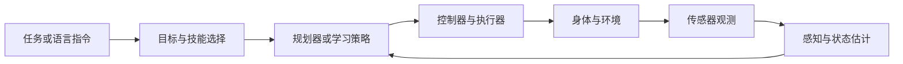

# 具身智能 · 全貌导读

!!! abstract "第一遍先理解系统"
    看懂机器人为什么需要各个模块，以及模块如何配合。先通过视频、图示和轻量仿真建立直觉，再深入推导与训练。

## 从机器人到具身智能

机器人学研究感知、运动与物理交互；具身智能关注智能体如何通过身体与环境交互并完成任务。机器人是重要载体，学习型策略是其中一类方法。

| 模块 | 回答什么 | 简单例子 |
|---|---|---|
| 本体、运动学与动力学 | 能动哪里？关节和末端怎样联系？力怎样影响运动？ | 机械臂的工作空间 |
| 感知 | 环境有什么、目标在哪？ | 相机检测桌面物体 |
| 状态估计 | 从不完整、有噪声的观测推断自身或环境状态 | 融合编码器与 IMU 估计位置 |
| 规划 | 要经过哪些状态或动作？ | 绕开障碍的路径 |
| 控制 | 怎样根据误差修正执行？ | 持续调整速度到达目标 |
| 策略 | 给定观测、状态或目标，选择什么动作？ | 输出关节目标或末端位移 |
| 软件与仿真 | 数据和算法怎样连接，如何重复实验？ | ROS 2 消息、坐标、录制回放 |
| 评估与部署 | 是否稳定完成任务，在哪些条件下失败？ | 成功率、碰撞、超时和时延 |

这是解释模块职责的示意图。实际系统可以合并部分模块，也可以使用学习与经典方法的组合。

## 学习方法之间的关系

| 方法 | 从哪里获得行为 | 第一遍理解什么 |
|---|---|---|
| 经典规划与控制 | 人定义模型、目标、约束与控制规律 | 可解释的反馈基线 |
| 模仿学习 / 行为克隆 | 人类或专家演示的观测与动作 | 数据覆盖不足会导致闭环失败 |
| 强化学习 | 与环境交互获得奖励 | 奖励、探索和训练成本影响结果 |
| VLA | 预训练视觉语言能力与机器人动作数据 | 输入模态、动作表示和适配数据 |
| 世界模型 | 环境中的观测、状态与动作序列 | 预测不等于策略，也不等于任务成功 |

## 主课与后续实践

| 定位 | 选定资源 | 为什么适合你 | 学习边界 |
|---|---|---|---|
| 机器人运动基础主课 | [Modern Robotics](https://modernrobotics.northwestern.edu/) 的教材、配套视频与代码 | 你的线性代数、几何和系统经验可以衔接；同一套符号贯通运动学、规划和控制 | 第一遍读 Preview 与章节导览，第二遍做第 2–6 章选定内容；规划/控制按任务补 |
| 后续机器人学习实践 | [LeRobot 的 Robot Learning 教程](https://huggingface.co/spaces/lerobot/robot-learning-tutorial) | 同一生态提供概念、数据、训练和执行入口，减少跨框架拼接 | 先读概念；PyTorch 与动作接口检查通过后再做 E3，不要求立即训练 VLA |

**选择依据：**Modern Robotics 是 [UIUC ECE470](https://publish.illinois.edu/ece470-intro-robotics/syllabus-spring-2025-2/) 指定教材，也反复出现在[机器人社区学习讨论](https://www.reddit.com/r/robotics/comments/1hgcqwg)中。它的数学深度适合工程背景，但重点是运动与控制，视觉和学习仍需后续补充。

LeRobot 是较新的官方实践生态，文档与工具在持续演进；这里依据工作流完整性选择它，不把“新课程”直接称为已有长期口碑的经典课。按教程记录版本，并为环境调试预留时间。

ROS 2 官方入门仅作为 E1 的软件练习说明，PythonRobotics 仅取一个 E2 例子；它们不增加为两门需要全部学完的课程。

## 体验 E0：拆解一个任务

选择“移动到指定位置”或“机械臂抓取物体”之一，看演示并写下：

1. 本体、传感器和可执行动作是什么？
2. 目标、观测、估计状态有什么区别？
3. 哪个模块选择动作，哪个模块执行动作？
4. 成功、失败、超时和恢复怎样定义？

**完成标准：**能画闭环，并区分定位、检测、规划、控制和策略学习。暂时不要求实现 SLAM 或训练 VLA。

## 后续可选方向

感知与估计、规划与控制、机器人软件系统、机器人学习、端侧部署都可以独立深入。第一轮用同一个小任务体验模块；之后选择一个本体和任务积累完整项目。

[下一步：学习路线](../ROADMAP/roadmap.md) · [跟随式项目](../PROJECT-BASED-LEARNING/project-based-learning.md) · [基础模型导论](../../FOUNDATION-MODELS/OVERVIEW/overview.md)
