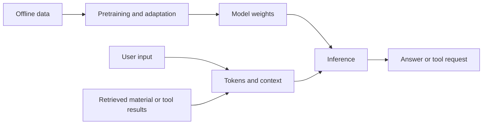

# Foundation Models · Overview

!!! abstract "First-pass goal"
    Explain how a system works and what each component does. Derivations, independent implementations and large-scale training come later.

## Build a vocabulary

| Concept | Meaning | Example |
|---|---|---|
| ML / deep learning | Learn parameters from data; deep learning uses multilayer neural networks | Image classification |
| Foundation model | A broadly pretrained model adaptable to multiple tasks | Language or vision adaptation |
| LLM | A language-sequence model; common generative LLMs predict successive tokens | Answers, summaries and code |
| Token / embedding | A discrete processing unit / its numeric vector representation | English vs. Chinese tokenization |
| Transformer | An architecture using attention and other sequence-processing components | Context-dependent representations |
| Pretraining / fine-tuning | Learn broad capabilities / adapt parameters using task data | SFT or LoRA on domain examples |
| RAG | Retrieve material and include it in context | Website Q&A with sources |
| Tool calling / agent | Execute interfaces / organize models, tools and task steps | Query records, then call a plotting tool |
| VLM / VLA | Vision-language processing / its connection to robot actions | Image Q&A / manipulation |
| World model | Predict environment dynamics under actions | Compare potential outcomes |

## Training and use

Training updates parameters; inference uses them. RAG supplies external material; tools execute programs. Understand these roles before combining them.

## Primary overview: Hung-yi Lee's GenAI introduction

**Follow one introductory course:** the [official course page](https://speech.ee.ntu.edu.tw/~hylee/genai/2024-spring.php) provides Chinese lectures, slides and assignments. Start with lecture 1, then 6–10 for training, agents and Transformers, and 12 for evaluation. Revisit other lectures as needed.

**Fit:** your mathematics, signal-processing and engineering experience provide a base; the immediate gap is the model-domain vocabulary and system picture. Use the 2024 edition consistently for concepts and current official documentation for software details.

**Optional intuition aid:** if attention remains unclear, watch [3Blue1Brown's visual Transformer explanation](https://www.youtube.com/watch?v=wjZofJX0v4M). This supplements one concept rather than adding another full introductory course.

## Next primary course: Karpathy's implementation path

Use [Neural Networks: Zero to Hero](https://karpathy.ai/zero-to-hero.html) to connect concepts to code. Check PyTorch first, watch micrograd if needed, then the first two makemore lectures and the GPT implementation. Do not jump directly into the GPT video.

The author specifies Python programming and introductory mathematics as prerequisites. Your engineering background helps; assess PyTorch through practice. [Community learning advice](https://www.reddit.com/r/learnmachinelearning/comments/1vu96aa/completed_andrew_ngs_ml_course_whats_the_best/) also places it after introductory study. Difficulty here follows the author's prerequisites rather than popularity alone.

**Two backbone courses only.** Use HF documentation when loading or adapting models. If you prefer text, [Raschka's book and code](https://github.com/rasbt/LLMs-from-scratch) can replace the Karpathy implementation track; choose one rather than study both.

## Exploration F0

1. Inspect tokenization of a short English and Chinese passage.
2. Compare a bare question, a question with reference material, and a request for evidence.
3. Ask a question absent from the material; inspect unsupported answers.
4. Sketch a document assistant and label data, retrieval, model, tools and evaluation.

**Completion:** explain prompting, RAG, fine-tuning and tool calling; distinguish fluency from correctness.

## Explore directions before specializing

| Direction | Main question | Project |
|---|---|---|
| Applications and agents | How can workflows be made useful and verifiable? | F2 document assistant |
| Model algorithms | How do data and training improve capabilities? | F4 small GPT and adaptation |
| Inference systems | How can quality and performance fit resource constraints? | F5 inference comparison |
| Multimodality and robotics | How do observations, language and actions connect? | F3 vision; embodied E3–E4 |

World models, multi-agent systems, large-scale pretraining and distributed parallelism are advanced electives. Use project experience and target roles to choose depth later.

[Next: roadmap](../ROADMAP/roadmap.md) · [Projects](../PROJECT-BASED-LEARNING/project-based-learning.md) · [Embodied overview](../../EMBODIED-INTELLIGENCE/OVERVIEW/overview.md)
