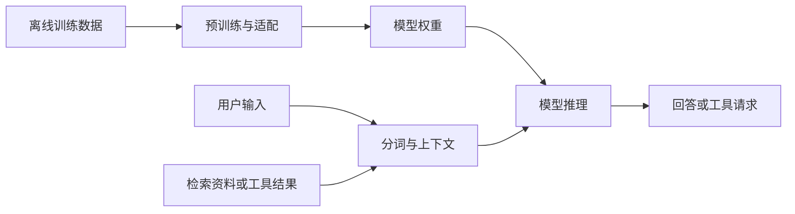

# 基础模型 · 全貌导读

!!! abstract "这一轮的目标"
    先能解释一个系统如何工作、各模块解决什么问题。数学推导、独立写模型和大规模训练留到后续阶段。

## 先建立概念

| 概念 | 简介 | 具体例子 |
|---|---|---|
| 机器学习 / 深度学习 | 从数据中调整模型参数；深度学习使用多层神经网络 | 从图片和标签学习分类 |
| 基础模型 | 在广泛数据上预训练、可以适配多个任务的模型 | 将预训练模型适配到问答或视觉任务 |
| LLM | 处理语言序列的模型；常见生成式 LLM 逐步预测后续 token | 生成回答、摘要或代码 |
| token / 嵌入 | token 是离散处理单位；嵌入将其映射成数值向量 | 比较中英文分词结果 |
| Transformer | 利用注意力等模块处理序列的神经网络架构 | 根据上下文计算 token 表示 |
| 预训练 / 微调 | 前者建立通用能力，后者用任务数据调整参数 | 使用领域样例进行 SFT 或 LoRA |
| RAG | 回答前检索资料，并把相关材料放进上下文 | 查询个人笔记并附来源 |
| 工具调用 / Agent | 调用程序接口；Agent 组织模型、工具与任务流程 | 查询传感器数据后调用绘图工具 |
| VLM / VLA | 视觉语言模型处理图像与语言；VLA 进一步连接机器人动作 | 看图问答 / 按指令操作物体 |
| 世界模型 | 学习环境动态，预测状态或观测如何随动作变化 | 比较不同动作可能导致的结果 |

## 训练与使用是两条流程

训练更新参数，推理使用参数。RAG 提供外部材料，工具调用执行程序。先分清各自作用，再考虑如何组合。

## 主课：李宏毅《生成式人工智能导论》

**第一轮只跟这一门导论：**[官方课程页](https://speech.ee.ntu.edu.tw/~hylee/genai/2024-spring.php)提供中文视频、课件与作业入口。先看第 1 讲建立范围，再看第 6–10 讲串起训练、Agent 与 Transformer，最后看第 12 讲理解评估；其余按问题回访。

<strong>适合你的原因：</strong>你已有数学、信号与工程经验，目前需要补齐模型领域的概念和整体关系。中文系统讲解能减少跨资源拼接，先弄清流程，再进入实现。该课程采用 2024 版作为固定导论材料，具体软件操作查当前官方文档。

<strong>可选直觉补充：</strong>只有注意力机制看不明白时，再看 [3Blue1Brown 的 Transformer 可视化](https://www.youtube.com/watch?v=wjZofJX0v4M)。它是单个概念的辅助解释，不再要求额外学完整套神经网络导论。

## 下一门主课：Karpathy 的实现路线

导论之后用 [Neural Networks: Zero to Hero](https://karpathy.ai/zero-to-hero.html) 将概念变成代码。先做 PyTorch 小检查，再按需看 micrograd，依次跟 makemore 的前两讲和 GPT 实现；不要从 GPT 视频直接跳入。

作者明确要求 Python 编程和入门数学。你的数学与工程经历有帮助，PyTorch 熟悉程度则用实验判断。[社区的学习建议](https://www.reddit.com/r/learnmachinelearning/comments/1vu96aa/completed_andrew_ngs_ml_course_whats_the_best/)也将其用于基础课程之后的实践；这里依据课程前置要求安排难度，不以单个推荐或星数判定质量。

<strong>本栏只有两门主课。</strong>HF 文档用于加载和适配时查阅；喜欢文字逐步推导时，可用 [Raschka 的书与代码](https://github.com/rasbt/LLMs-from-scratch)替代 Karpathy 实现部分，二选一，无须重复学两套。

## 概念体验 F0

1. 选一段中英文，查看分词结果，记录 token 与字符的区别。
2. 对同一个问题，分别只给问题、补充资料、要求列出依据，比较回答。
3. 给模型一个资料中没有答案的问题，检查它是否承认信息不足。
4. 画资料问答系统，标出资料、检索、模型、工具和评估的位置。

<strong>完成标准：</strong>能解释 Prompt、RAG、微调和工具调用的作用；不把流畅回答等同于正确答案。

## 认识方向，暂不急于选择

| 方向 | 日常核心问题 | 对应实践 |
|---|---|---|
| 应用与智能体 | 怎样把模型接入流程并验证结果？ | F2 资料问答 |
| 模型算法 | 怎样通过数据与训练改善能力？ | F4 小型 GPT 与适配 |
| 推理系统 | 怎样在资源限制下保持效果与性能？ | F5 推理对比 |
| 多模态与机器人 | 怎样连接观测、语言与动作？ | F3 视觉体验；具身 E3–E4 |

世界模型、多智能体、大规模预训练和分布式并行作为进阶选修。先完成体验，再结合兴趣、项目表现和目标岗位选择主线。

[下一步：学习路线](../ROADMAP/roadmap.md) · [跟随式项目](../PROJECT-BASED-LEARNING/project-based-learning.md) · [具身智能导论](../../EMBODIED-INTELLIGENCE/OVERVIEW/overview.md)
