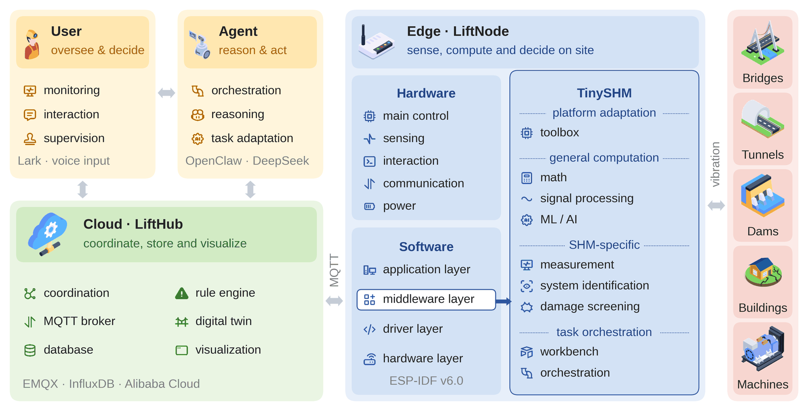
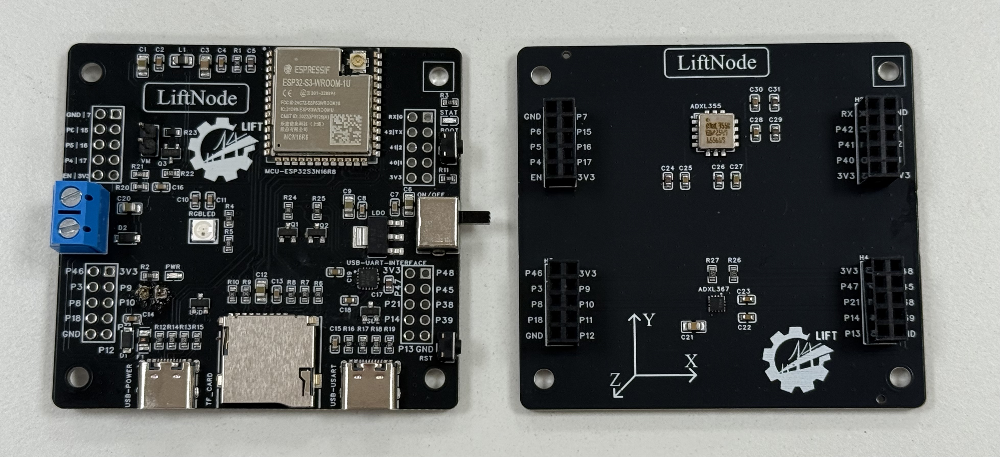
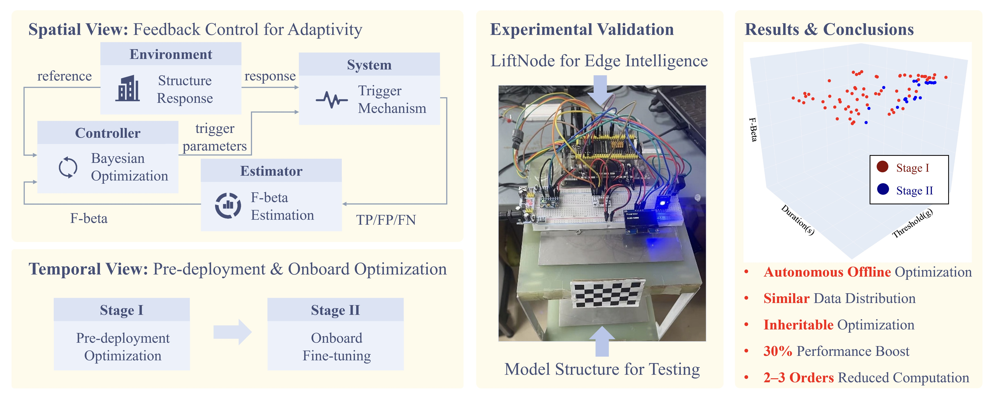
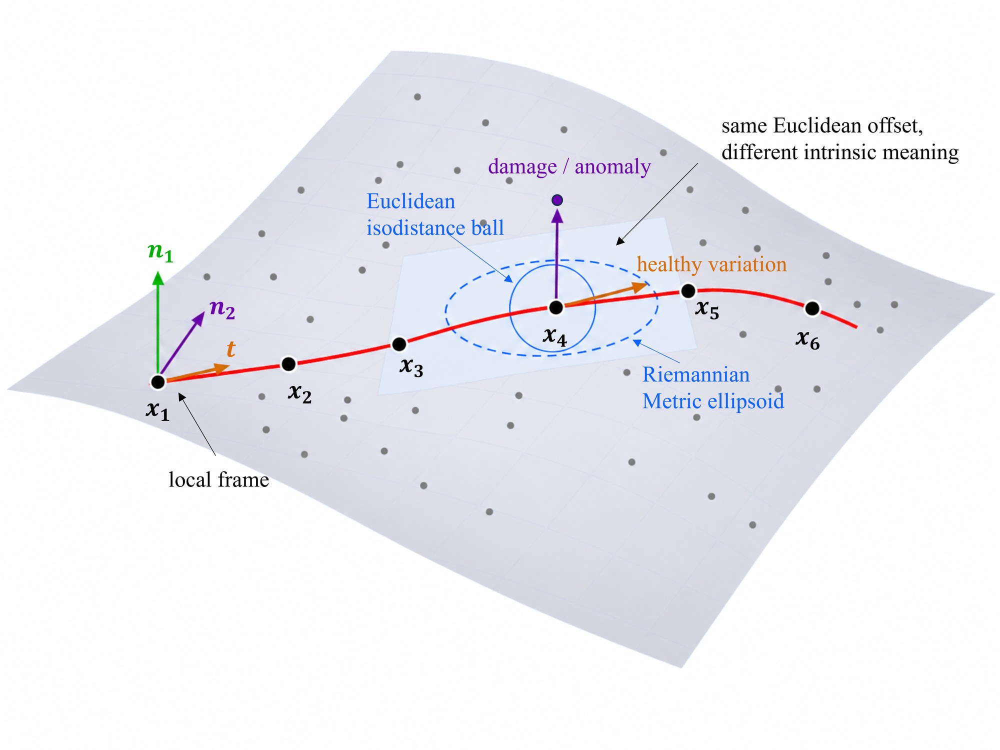
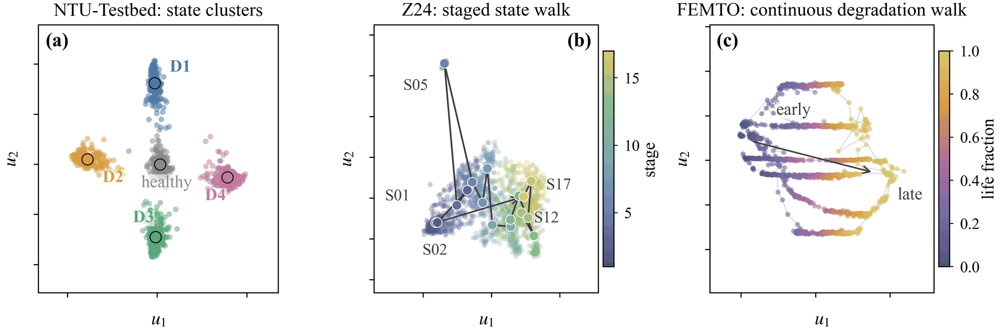
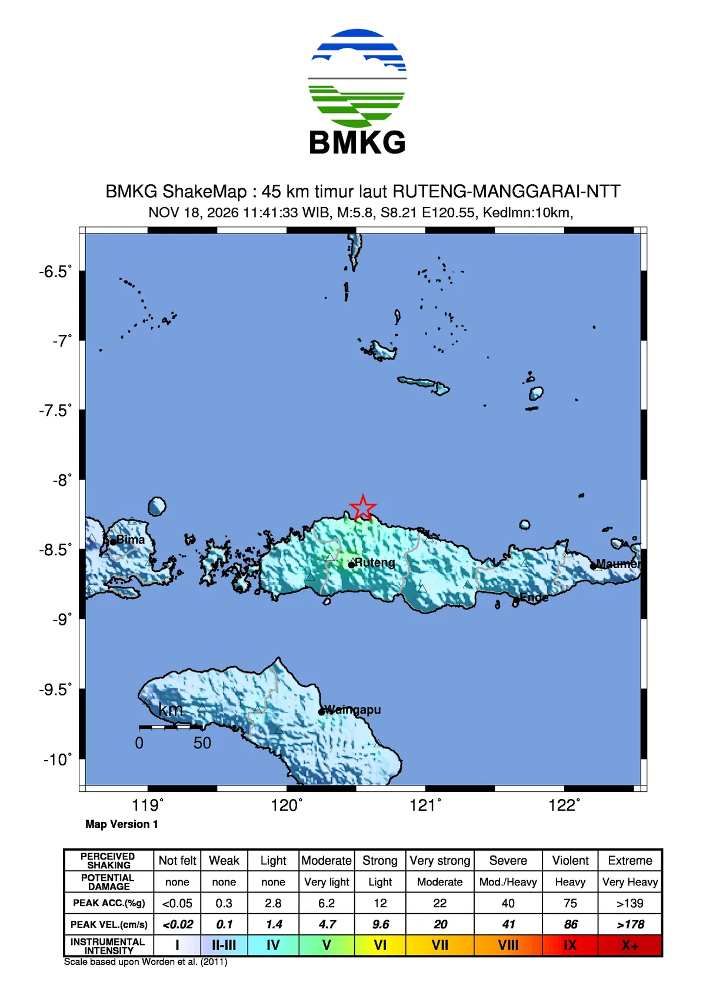

# __PH.D. STUDIES__

{width=100%}

## __Research Overview__

!!! info "RESEARCH TOPICS -- PUSHING STRUCTURAL HEALTH MONITORING TO THE EDGE DEVICES"
    My Ph.D. research topic is __Distributed Edge Intelligence Framework for IoT-based Structural Health Monitoring__, with a focus on developing a distributed edge-intelligence enabling framework for resource-constrained, low-cost edge devices, to promote a paradigm shift from cloud to edge and from knowledge-driven to AI-driven (especially agent-driven) approaches, and to apply it to typical IoT-based structural health monitoring applications.

!!! info "KEY TASKS"
    - IoT System Development: Edge Device (MCU Level, Low-cost & Resource-constrained) and Cloud Platform Development
    - Distributed Edge Intelligence Enabling Framework Development: TinySHM (Vector & Matrix Operations / Digital Signal Processing / Machine Learning & Artificial Intelligence Libraries)
    - Structural Health Monitoring Applications: Measurement / System Identification / Damage Detection / Damage Localization / Damage Evaluation

{width=100%}

-   :material-file:{ .lg .middle } __Review Paper - Ubiquitous Computing and Intelligence in IoT-based Structural Health Monitoring (From Edge to Cloud)__

    ---

    **Cui, S.**, Fu, Y.*, Fu, H., & Shen, W. (2026). Edge-to-Cloud Computing and Intelligence for IoT-based Structural Health Monitoring: A Comprehensive Review. Advanced Engineering Informatics. 

    [:octicons-arrow-right-24: <a href="https://doi.org/10.1016/j.aei.2025.104300" target="_blank"> DOI </a>](#)

## __I IoT-based SHM System Development__

{width=100%}

### __1.1 Edge Device__

!!! note "Edge Device Development"
    To achieve edge intelligence computing, we have developed two types of MCU nodes, based on STM32 and ESP32. These nodes have high-performance edge computing capabilities and can be used in IoT, smart home, smart city, and other application scenarios. The current development focus is on ESP32.

-   :simple-github:{ .lg .middle } __LiftNode_ESP32🎯🏆__

    ---

    MCU IoT Node with High Performance Edge Computing, Based on ESP32

    <!-- ROLLBACK (github link hidden): [:octicons-arrow-right-24: <a href="https://github.com/Shuaiwen-Cui/LiftNode_ESP32.git" target="_blank"> Code </a>](#) -->

    [:octicons-arrow-right-24: <a href="http://www.cuishuaiwen.com:8100/" target="_blank"> Online Doc (Hosted on Personal Server) </a>](#)

    <!-- ROLLBACK (github link hidden): [:octicons-arrow-right-24: <a href="https://shuaiwen-cui.github.io/LiftNode_ESP32/" target="_blank"> Online Doc (Hosted on Github Pages) </a>](#) -->

<video autoplay loop muted playsinline preload="metadata" aria-label="LiftNode exploded-view animation" poster="../LIFTNODE-EXPLODED-en.jpg" style="display:block;width:100%;aspect-ratio:16/9;border-radius:12px;background:#0b0e14;box-shadow:0 12px 32px rgba(0,0,0,.25)"><source src="../LIFTNODE-EXPLODED-en.mp4" type="video/mp4"></video>

*LiftNode mechanical assembly: lid lifts → walls unfold → main board, sensor extension board, BMS and battery separate layer by layer · <a href="http://www.cuishuaiwen.com:8100/HARDWARE-ESP/MECHANICAL/mechanical/" target="_blank">interactive 3D model</a>*

<!-- <iframe width="800" height="450" src="https://www.youtube-nocookie.com/embed/O2b3-Bjhhws" frameborder="0" allowfullscreen></iframe> -->

<!-- Main Control Board

{width=100%}

Extension Board

{width=100%} -->

Node Design

{width=100%}

{width=100%}

PCB Design

{width=100%}

Sensor Streaming Demo

<iframe width="800" height="450" src="https://www.youtube-nocookie.com/embed/f1rnn7kyeOM" frameborder="0" allowfullscreen></iframe>

Sensor Synchronization Demo

<iframe width="800" height="450" src="https://www.youtube-nocookie.com/embed/IdZ6cGDO1go" frameborder="0" allowfullscreen></iframe>

### __1.2 Cloud Platform__

-   :simple-github:{ .lg .middle } __LiftHub 🎯🏆__

    ---

    Acts as the server-side to interact with LiftNode, providing data storage and analysis functions.

    <!-- ROLLBACK (github link hidden): [:octicons-arrow-right-24: <a href="https://github.com/Shuaiwen-Cui/LiftHub.git" target="_blank"> Code </a>](#) -->

    [:octicons-arrow-right-24: <a href="http://www.cuishuaiwen.com:8200/" target="_blank"> Online Doc (Hosted on Personal Server) </a>](#)

    <!-- ROLLBACK (github link hidden): [:octicons-arrow-right-24: <a href="https://shuaiwen-cui.github.io/LiftHub/" target="_blank"> Online Doc (Hosted on Github Pages) </a>](#) -->

## __II Distributed Edge Intelligence Framework for Resource-Constrained Devices__

TinySHM is MCU-native middleware between the board drivers and SHM applications. It covers acquisition, signal processing, system identification, damage screening and on-device learning, and runs without Linux or Python.

{width=100%}

!!! note "Nine Modules"
    - Platform Adaptation: TinyToolbox
    - General Computation: TinyMath / TinyDSP / TinyAI
    - SHM Specific: TinyMeasurement / TinySysID / TinyDamage
    - Task Orchestration: TinyBench / TinyOrch

On-Device Training (TinyAI)

{width=100%}

{width=100%}

On-Node System Identification (TinySysID)

{width=100%}

-   :simple-github:{ .lg .middle } __TinySHM🎯🏆__

    ---

    Currently Supported Platforms:

    - ESP32

    <!-- ROLLBACK (github link hidden): [:octicons-arrow-right-24: <a href="https://github.com/Shuaiwen-Cui/TinySHM.git" target="_blank"> Code </a>](#) -->

    [:octicons-arrow-right-24: <a href="http://www.cuishuaiwen.com:8300/" target="_blank"> Online Doc (Hosted on Personal Server) </a>](#)

    <!-- ROLLBACK (github link hidden): [:octicons-arrow-right-24: <a href="https://shuaiwen-cui.github.io/TinySHM/" target="_blank"> Online Doc (Hosted on Github Pages) </a>](#) -->

## __III ML/AI-Powered Algorithms for Structural Health Monitoring__

The algorithms progress from decisions on a single node, to rule-based cooperation across nodes, to coordination learned from data.

### __3.1 Single-Node Intelligence__

#### Smart Adaptive Trigger Sensing Powered by Edge Intelligence and Digital Twin for Energy-Efficient Wireless Structural Health Monitoring

🏷️ SHM Category: **Measurement** / System Identification / Damage Detection / Damage Localization / Damage Evaluation

- Trigger Sensing
- Closed-Loop Feedback Control
- Edge Intelligence
- Bayesian Optimization

-   :material-file:{ .lg .middle } __Conference Paper - 13th International Conference on Structural Health Monitoring of Intelligent Infrastructure (SHMII-13)__

    ---

    **Cui, S.**, Yu, X., & Fu, Y.* (2025). Smart adaptive triggering strategy for edge intelligence enabled energy-efficient sensing. In *Proceedings of the 13th International Conference on Structural Health Monitoring of Intelligent Infrastructure (SHMII-13)*, pp. 609–616. Graz, Austria: Verlag der TU Graz. (🏆 **Best Conference Paper Award** 1st/202)

    [:octicons-arrow-right-24: <a href="https://doi.org/10.3217/978-3-99161-057-1-094" target="_blank"> DOI </a>](#)

-   :material-file:{ .lg .middle } __Journal Paper - Mechanical System and Signal Processing__

    ---

    **Cui, S.**, Fu, Y.*, Fu, H., Yu, X., & Shen, W. (2025). Smart Adaptive Trigger Sensing Powered by Edge Intelligence and Digital Twin for Energy-Efficient Wireless Structural Health Monitoring.  Mechanical Systems and Signal Processing, Volume 241, 2025, 113537.

    [:octicons-arrow-right-24: <a href="https://doi.org/10.1016/j.ymssp.2025.113537" target="_blank"> DOI </a>](#)

-   :material-file:{ .lg .middle } __Singapore Provisional Patent Application - 10202502426R__

    ---

    Adaptive Triggering Mechanism for Time-Series Data Sensing on Edge Devices, Singapore provisional patent application number 10202502426R, 2025

#### On-Board Modal Identification and Learning on a Microcontroller Node

🏷️ SHM Category: **Measurement** / **System Identification** / Damage Detection / Damage Localization / Damage Evaluation

- Operational Modal Analysis
- On-Device Training
- TinySHM

{width=100%}

-   :material-file:{ .lg .middle } __Manuscript Under Review__

    ---

    **Cui, S.**, Fu, Y.*, Wang, Y., & Fu, H. Decisions beside data: LiftNode and TinySHM for AIoT-native learning and system identification in infrastructure monitoring. Manuscript under review.

### __3.2 Multi-Node Cooperation (Rule-Based Coordination)__

**- Adaptive edge intelligence for rapid structural condition assessment using a wireless smart sensor network**

🏷️ SHM Category: **Measurement** / System Identification / **Damage Detection** / Damage Localization / Damage Evaluation

- Data-driven Anomaly Detection
- Gaussian Process Regression (GPR)
- Stochastic Process Control (SPC)

{width=100%}

-   :material-file:{ .lg .middle } __Journal Paper - Engineering Structures__

    ---

    **Cui, S.**, Hoang, T., Mechitov, K., Fu, Y.*, & Spencer Jr, B. F. (2025). Adaptive edge intelligence for rapid structural condition assessment using a wireless smart sensor network. Engineering Structures, 326, 119520.

    [:octicons-arrow-right-24: <a href="https://doi.org/10.1016/j.engstruct.2024.119520" target="_blank"> DOI </a>](#)

### __3.3 Multi-Node Collaboration (Learned Coordination)__

**- Learned-Support Collaborative System Identification (LCSI)**

🏷️ SHM Category: Measurement / **System Identification** / Damage Detection / Damage Localization / Damage Evaluation

- Gateway-Node Collaboration
- Communication-Efficient Identification

{width=100%}

**- Manifold Dynamics**

🏷️ SHM Category: Measurement / **System Identification** / **Damage Detection** / **Damage Localization** / **Damage Evaluation**

- Healthy-Only Learning
- Learned Diagnostic State
- Leaf-Gateway Representation

{width=100%}

State trajectories on three validation systems (visualization only)

{width=100%}

## __IV Teaching and Pedagogical Research__

### ArduinoNode

A simple WSN node developed for SHM teaching, based on Arduino UNO R4 WIFI, successfully used in the APESS2025 Summer School held at The Hong Kong Polytechnic University.

-   :simple-github:{ .lg .middle } __APESS2025_ARDUINONODE__

    ---

    SHM Teaching WSN Node Based on Arduino UNO R4 WIFI

    [:octicons-arrow-right-24: <a href="https://github.com/Shuaiwen-Cui/APESS2025_ArduinoNode.git" target="_blank"> Code </a>](#)

    [:octicons-arrow-right-24: <a href="https://shuaiwen-cui.github.io/APESS2025_ArduinoNode/" target="_blank"> Online Doc </a>](#)

-   :material-file:{ .lg .middle } __Journal Paper - IEEE Transactions on Education__

    ---

    **Cui, S.**, Fu, Y.*, Xia, Y., Zhang Q., & Li, S. (2026). A Class-Lab-Field Pedagogical Framework for Structural Health Monitoring using Ultra-Low-Cost Wireless IoT Prototypes. IEEE Transactions on Education. 

    [:octicons-arrow-right-24: <a href="https://doi.org/10.1109/TE.2026.3717462" target="_blank"> DOI </a>](#)

## __V Field Deployment and Engineering Applications__

### __Flores, Indonesia__

In November 2026, two LiftNodes were deployed at RSUD Aeramo hospital in Flores to support continuous, remote monitoring of aftershocks.

-   [{ loading=lazy width=1600 height=1200 }](deployment/liftnode-deployment-team.webp)

    **Deployment team**

-   [{ loading=lazy width=1080 height=1920 }](deployment/liftnode-staircase-two-nodes.webp)

    **Two-node staircase deployment**

-   [{ .deployment-detail loading=lazy width=1280 height=960 }](deployment/liftnode-column.webp)

    **Column location**

-   [{ .deployment-detail loading=lazy width=1280 height=720 }](deployment/liftnode-stair-landing.webp)

    **Stair landing**

<figure markdown="span">
  [{ loading=lazy width=1340 height=420 style="width:100%;height:auto;" }](deployment/flores-staircase-mode-shapes.gif)
  <figcaption>Staircase survey · Two-point candidate mode-shape animation</figcaption>
</figure>

  [:material-newspaper-variant-outline: NTU CEE News · 15 Nov 2026](https://www.ntu.edu.sg/cee/news/ntu-cee-researchers-conduct-field-deployment-in-flores--indonesia){ .md-button }

#### __Real field data, independently cross-checked__

On **18 November 2026**, LiftNode **000** at RSUD Aeramo hospital automatically captured and saved a clear, three-axis vibration record, which was then **successfully retrieved remotely**. Its timing is consistent with the nearby **M5.8 earthquake reported by Indonesia’s BMKG**, demonstrating the system working in the field.

<figure markdown="span">
  <h5>Official earthquake report</h5>
  [{ loading=lazy width=1200 height=1698 }](deployment/flores-20261118-bmkg.jpg)
  <figcaption><strong>M5.8 · 12:41:33</strong> · Origin time, UTC+8 Official ShakeMap: <a href="https://www.bmkg.go.id/gempabumi/20261118114412" target="_blank" rel="noopener noreferrer">BMKG</a> · 10 km depth</figcaption>
</figure>

<figure markdown="span" class="field-event-figure">
  <h5>Our sensor’s field recording</h5>
  [{ loading=lazy width=800 height=600 }](deployment/flores-20261118-waveform-psd.svg)
  <figcaption><strong>Node 000 · 12:42:07.502</strong> · Trigger time, UTC+8 Measured waveforms and spectra · Click to enlarge</figcaption>
</figure>

**Why about 35 seconds later?** The hospital is approximately **100 km from the epicentre**. Seismic waves take tens of seconds to travel that distance; the observed interval is consistent with that timescale and also includes the time needed to reach the sensor’s trigger threshold.

**What the data show.** Clear motion on all three axes, followed by a gradual decay, provides usable waveforms for further analysis. Automatic detection, local storage and remote data recovery all worked in this field example. The earthquake catalogue provides independent timing and location context; it is not a direct waveform comparison.

**Edge AI, beyond the lab.** A small neural network runs directly on the sensor to assess the recorded vibration, even without an internet connection. For this event, the on-node model returned **“Earthquake” with a model score of 92.1%**. For me, this deployment marks the first time my research in edge computing and intelligence has moved from papers and laboratory experiments into real-world earthquake monitoring. The experimental AI result is saved alongside the waveform for review; **it never decides whether the data are kept**.

For researchers: processing notes and original data

- The plotted time histories combine the ADXL367 pre-trigger data and ADXL355 recording. Same-axis alignment is assumed; the current forced merge has not been independently validated. Spectra use **ADXL355 only** (Welch PSD in dB).
- The original file passed checksum and sensor-data integrity checks. Two ADXL355 timestamp gaps remain; these checks do not imply zero missing samples. Four startup samples are excluded from the displayed body and spectrum, but remain in the original file.
- This is a roughly 31-second saved window, including about one second before the trigger, rather than a complete earthquake-duration measurement. The official origin time and the threshold-trigger time are different observables, so their difference is not a precise phase travel-time measurement. Association is supported by timing and proximity; a reference-station waveform match is still pending.
- BMKG’s initial bulletin gives 12:41:32 and its updated report/ShakeMap gives 12:41:33, converted from WIB (UTC+7) to Flores / Singapore time (UTC+8). All times above use UTC+8. Hospital distance is approximate.

[BMKG official bulletin](https://www.bmkg.go.id/gempabumi/20261118114412) · [Download figure PNG](deployment/flores-20261118-waveform-psd.png) · [Vector SVG](deployment/flores-20261118-waveform-psd.svg) · [Native waveform TXT](deployment/000_20261118T124207502_T.txt)

