# __PH.D. STUDIES__

{width=100%}

## __Research Overview__

!!! info "RESEARCH TOPICS -- PUSHING STRUCTURAL HEALTH MONITORING TO THE EDGE DEVICES"
    My Ph.D. research topic is __Distributed Edge Intelligence Framework for IoT-based Structural Health Monitoring__, with a focus on developing a distributed edge-intelligence enabling framework for resource-constrained, low-cost edge devices, to promote a paradigm shift from cloud to edge and from knowledge-driven to AI-driven (especially agent-driven) approaches, and to apply it to typical IoT-based structural health monitoring applications.

!!! info "KEY TASKS"
    - IoT System Development: Edge Device (MCU Level, Low-cost & Resource-constrained) and Cloud Platform Development
    - Distributed Edge Intelligence Enabling Framework Development: TinySHM (Vector & Matrix Operations / Digital Signal Processing / Machine Learning & Artificial Intelligence Libraries)
    - Structural Health Monitoring Applications: Measurement / System Identification / Damage Detection / Damage Localization / Damage Evaluation

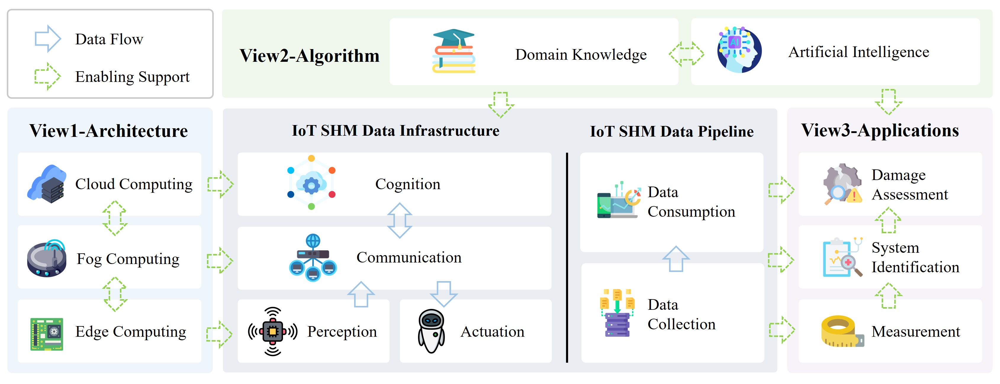{width=100%}

-   :material-file:{ .lg .middle } __Review Paper - Ubiquitous Computing and Intelligence in IoT-based Structural Health Monitoring (From Edge to Cloud)__

    ---

    **Cui, S.**, Fu, Y.*, Fu, H., & Shen, W. (2026). Edge-to-Cloud Computing and Intelligence for IoT-based Structural Health Monitoring: A Comprehensive Review. Advanced Engineering Informatics. 

    [:octicons-arrow-right-24: <a href="https://doi.org/10.1016/j.aei.2025.104300" target="_blank"> DOI </a>](#)

## __I IoT-based SHM System Development__

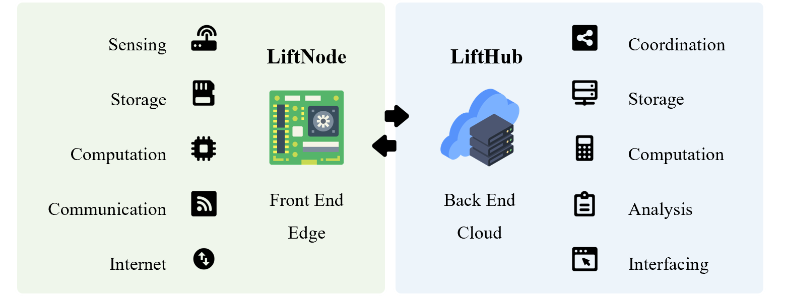{width=100%}

### __1.1 Edge Device__

!!! note "Edge Device Development"
    To achieve edge intelligence computing, we have developed two types of MCU nodes, based on STM32 and ESP32. These nodes have high-performance edge computing capabilities and can be used in IoT, smart home, smart city, and other application scenarios. The current development focus is on ESP32.

-   :simple-github:{ .lg .middle } __LiftNode_ESP32🎯🏆__

    ---

    MCU IoT Node with High Performance Edge Computing, Based on ESP32

    <!-- ROLLBACK (github link hidden): [:octicons-arrow-right-24: <a href="https://github.com/Shuaiwen-Cui/LiftNode_ESP32.git" target="_blank"> Code </a>](#) -->

    [:octicons-arrow-right-24: <a href="http://www.cuishuaiwen.com:8100/" target="_blank"> Online Doc (Hosted on Personal Server) </a>](#)

    <!-- ROLLBACK (github link hidden): [:octicons-arrow-right-24: <a href="https://shuaiwen-cui.github.io/LiftNode_ESP32/" target="_blank"> Online Doc (Hosted on Github Pages) </a>](#) -->

<!-- <iframe width="800" height="450" src="https://www.youtube-nocookie.com/embed/O2b3-Bjhhws" frameborder="0" allowfullscreen></iframe> -->

<!-- Main Control Board

{width=100%}

Extension Board

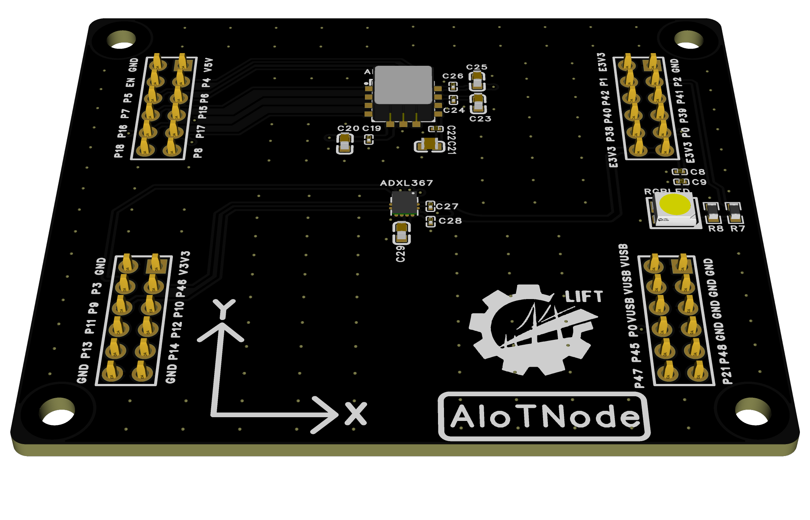{width=100%} -->

Node Design

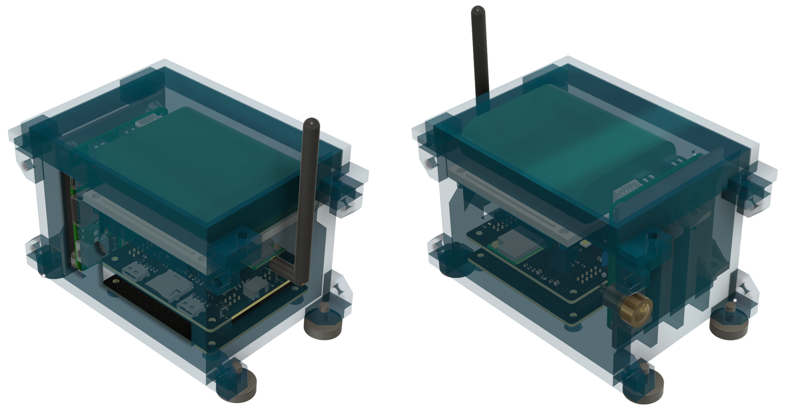{width=100%}

{width=100%}

PCB Design

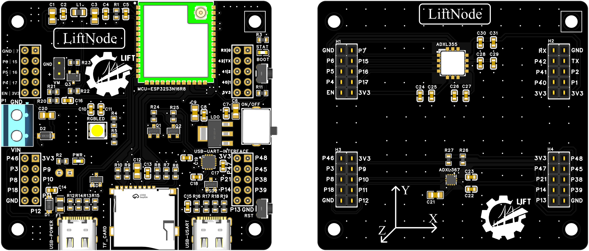{width=100%}

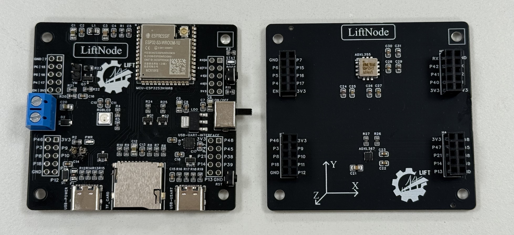{width=100%}

Sensor Streaming Demo

<iframe width="800" height="450" src="https://www.youtube-nocookie.com/embed/f1rnn7kyeOM" frameborder="0" allowfullscreen></iframe>

Sensor Synchronization Demo

<iframe width="800" height="450" src="https://www.youtube-nocookie.com/embed/IdZ6cGDO1go" frameborder="0" allowfullscreen></iframe>

### __1.2 Cloud Platform__

-   :simple-github:{ .lg .middle } __LiftHub 🎯🏆__

    ---

    Acts as the server-side to interact with LiftNode, providing data storage and analysis functions.

    <!-- ROLLBACK (github link hidden): [:octicons-arrow-right-24: <a href="https://github.com/Shuaiwen-Cui/LiftHub.git" target="_blank"> Code </a>](#) -->

    [:octicons-arrow-right-24: <a href="http://www.cuishuaiwen.com:8200/" target="_blank"> Online Doc (Hosted on Personal Server) </a>](#)

    <!-- ROLLBACK (github link hidden): [:octicons-arrow-right-24: <a href="https://shuaiwen-cui.github.io/LiftHub/" target="_blank"> Online Doc (Hosted on Github Pages) </a>](#) -->

## __II Distributed Edge Intelligence Framework for Resource-Constrained Devices__

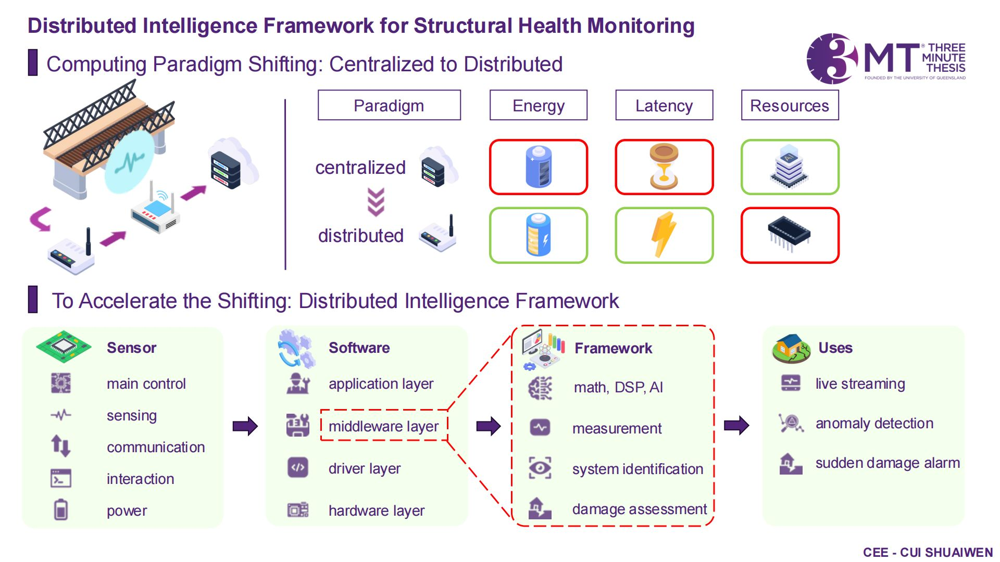{width=100%}

-   :simple-github:{ .lg .middle } __TinySHM🎯🏆__

    ---

    Currently Supported Platforms:

    - ESP32

    <!-- ROLLBACK (github link hidden): [:octicons-arrow-right-24: <a href="https://github.com/Shuaiwen-Cui/TinySHM.git" target="_blank"> Code </a>](#) -->

    [:octicons-arrow-right-24: <a href="http://www.cuishuaiwen.com:8300/" target="_blank"> Online Doc (Hosted on Personal Server) </a>](#)

    <!-- ROLLBACK (github link hidden): [:octicons-arrow-right-24: <a href="https://shuaiwen-cui.github.io/TinySHM/" target="_blank"> Online Doc (Hosted on Github Pages) </a>](#) -->

## __III Emerging ML/AI Powered Typical Structural Health Monitoring Applications__

!!! info "THREE LEVELS OF INTELLIGENCE"
    The applications progress from decisions made on a single node, to rule-based cooperation across nodes, to collaboration learned from data. Cooperation coordinates nodes through predefined rules and interfaces. Collaboration learns that coordination from data.

<table>
  <thead>
    <tr><th>SHM Task</th><th>Single-Node</th><th>Multi-Node Cooperation (Rule-Based)</th><th>Multi-Node Collaboration (Learned)</th></tr>
  </thead>
  <tbody>
    <tr><td><strong>Measurement</strong></td><td>Adaptive Trigger Sensing; On-Node Learning</td><td>-</td><td>-</td></tr>
    <tr><td><strong>System Identification</strong></td><td>On-Board Modal Identification</td><td>-</td><td>LCSI</td></tr>
    <tr><td><strong>Damage Assessment</strong></td><td>-</td><td>Rapid Condition Assessment</td><td>Manifold Dynamics</td></tr>
  </tbody>
</table>

### __3.1 Single-Node Independent Applications__

**- Smart Adaptive Trigger Sensing Powered by Edge Intelligence and Digital Twin for Energy-Efficient Wireless Structural Health Monitoring**

🏷️ SHM Category: **Measurement** / System Identification / Damage Detection / Damage Localization / Damage Evaluation

- Trigger Sensing
- Closed-Loop Feedback Control
- Edge Intelligence
- Bayesian Optimization

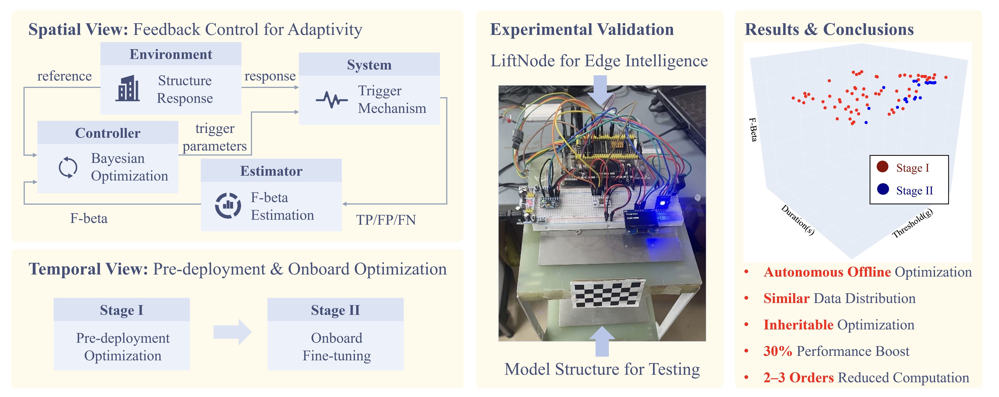

**Key Results**

- Under a common surrogate F3 objective, Stage II appended 20 evaluations instead of searching a 1,530-point grid, and reached 0.9396 against 0.9351 for the grid.

!!! note "Scope"
    Validated in the laboratory with one node and one acceleration axis on a five-storey frame. Long-term field validation, net energy saving, a complete MCU feedback-loop trace and the benefit of field recalibration are not established.

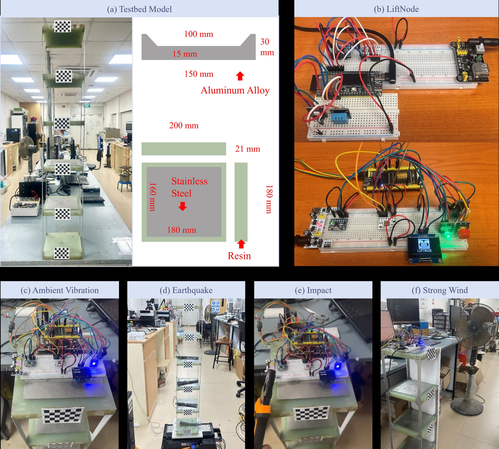{width=100%}

-   :material-file:{ .lg .middle } __Conference Paper - 13th International Conference on Structural Health Monitoring of Intelligent Infrastructure (SHMII-13)__

    ---

    **Cui, S.**, Yu, X., & Fu, Y.* (2025). Smart adaptive triggering strategy for edge intelligence enabled energy-efficient sensing. In *Proceedings of the 13th International Conference on Structural Health Monitoring of Intelligent Infrastructure (SHMII-13)*, pp. 609–616. Graz, Austria: Verlag der TU Graz. (🏆 **Best Conference Paper Award** 1st/202)

    [:octicons-arrow-right-24: <a href="https://doi.org/10.3217/978-3-99161-057-1-094" target="_blank"> DOI </a>](#)

-   :material-file:{ .lg .middle } __Journal Paper - Mechanical System and Signal Processing__

    ---

    **Cui, S.**, Fu, Y.*, Fu, H., Yu, X., & Shen, W. (2025). Smart Adaptive Trigger Sensing Powered by Edge Intelligence and Digital Twin for Energy-Efficient Wireless Structural Health Monitoring.  Mechanical Systems and Signal Processing, Volume 241, 2025, 113537.

    [:octicons-arrow-right-24: <a href="https://doi.org/10.1016/j.ymssp.2025.113537" target="_blank"> DOI </a>](#)

-   :material-file:{ .lg .middle } __Singapore Provisional Patent Application - 10202502426R__

    ---

    Adaptive Triggering Mechanism for Time-Series Data Sensing on Edge Devices, Singapore provisional patent application number 10202502426R, 2025

**- On-Board Modal Identification and Learning on a Microcontroller Node**

🏷️ SHM Category: **Measurement** / **System Identification** / Damage Detection / Damage Localization / Damage Evaluation

- Operational Modal Analysis
- On-Device Training
- TinySHM
- LiftNode

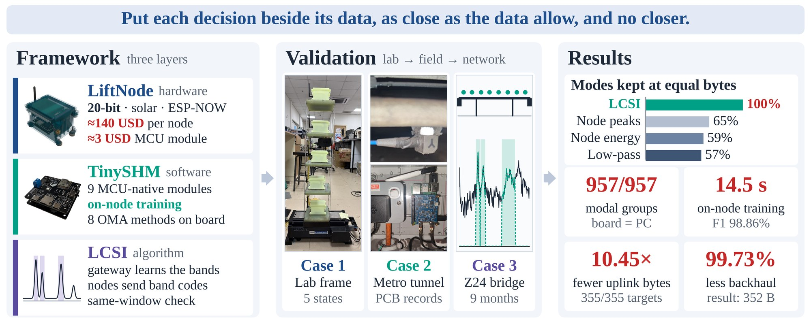{width=100%}

*In the graphical abstract, 100% and 10.45× refer to the held-out Z24 set with ±10% bands in steady operation. Case 2 photographs: Yu et al. (2026), [Measurement](https://doi.org/10.1016/j.measurement.2025.119308).*

**Key Results**

- Eight output-only modal estimators run on one ESP32-S3 LiftNode. All 957 target groups with a PC reference (960 planned) meet a frequency difference of at most 2% and a complex MAC of at least 0.95.
- On recorded metro-tunnel vibration, a 66-parameter classifier trains on the board in 14.5 s (18,000 windows, 40 epochs, 46.7 KiB peak TinyAI heap). Its F1 is 98.86%, against 98.78% for the PC-trained network.
- Feature extraction and inference take 2.33 ms per 1-s window.

!!! note "Scope"
    Both cases replay recorded data. They verify that the board reproduces the workstation, not physical modal accuracy or field damage detection. Tunnel labels come from automatic acceleration and audio thresholds, not annotated train events.

On-board modal identification on a four-storey frame

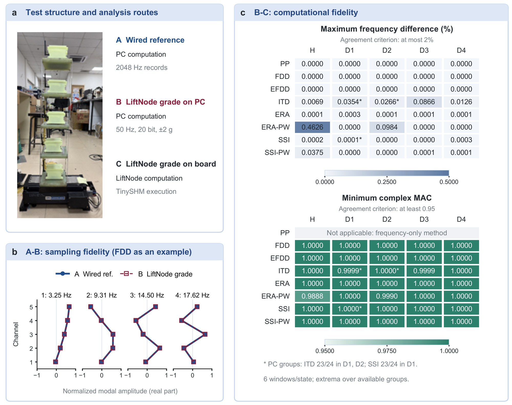{width=100%}

On-board inference on recorded tunnel vibration

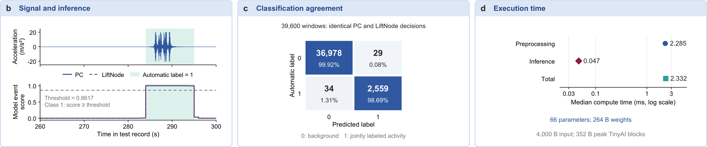{width=100%}

-   :material-file:{ .lg .middle } __Manuscript Under Review__

    ---

    **Cui, S.**, Fu, Y.*, Wang, Y., & Fu, H. Decisions beside data: LiftNode and TinySHM for AIoT-native learning and system identification in infrastructure monitoring. Manuscript under review.

### __3.2 Multi-Node Cooperation (Rule-Based Coordination)__

**- Adaptive edge intelligence for rapid structural condition assessment using a wireless smart sensor network**

🏷️ SHM Category: **Measurement** / System Identification / **Damage Detection** / Damage Localization / Damage Evaluation

- Data-driven Anomaly Detection
- Gaussian Process Regression (GPR)
- Stochastic Process Control (SPC)

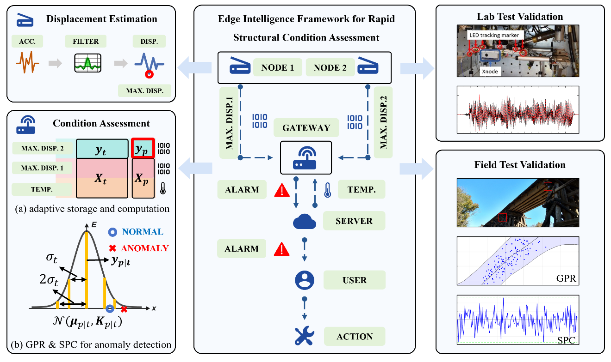{width=100%}

**Coordination:** Rule-based. Nodes compute displacement features, and the gateway combines them through a predefined command workflow.

**Contribution:** The reference-free displacement method comes from prior work. Hoang's doctoral research applied it on Xnode, developed the GPR-SPC formulation and collected the railroad-bridge records. My work adapts and optimizes these methods for microcontroller execution and organizes them as a node-gateway workflow.

**Key Results**

- The current LiftNode processes a 182.01-s displacement record in 8.74 s, within about 10 nm of the PC reference at every output point.
- The 30-training, 10-test GPR-SPC numerical kernel runs in 1.70 ms with a 3,960 B dynamic workspace.

!!! note "Scope"
    These are separate replays of stored records. The bridge campaigns are historical Xnode deployments by Hoang et al. A new field deployment and end-to-end wireless timing are not established.

LiftNode displacement replay against the PC reference: five-second detail and pointwise residual

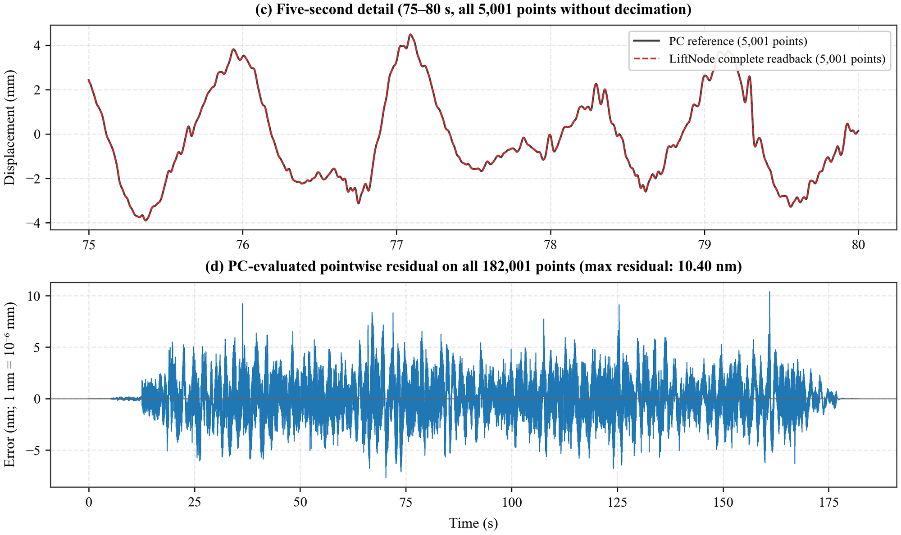{width=100%}

-   :material-file:{ .lg .middle } __Journal Paper - Engineering Structures__

    ---

    **Cui, S.**, Hoang, T., Mechitov, K., Fu, Y.*, & Spencer Jr, B. F. (2025). Adaptive edge intelligence for rapid structural condition assessment using a wireless smart sensor network. Engineering Structures, 326, 119520.

    [:octicons-arrow-right-24: <a href="https://doi.org/10.1016/j.engstruct.2024.119520" target="_blank"> DOI </a>](#)

### __3.3 Multi-Node Collaboration (Learned Coordination)__

**- Learned-Support Collaborative System Identification (LCSI)**

🏷️ SHM Category: Measurement / **System Identification** / Damage Detection / Damage Localization / Damage Evaluation

- Gateway-Learned Spectral Support
- Band Coding
- Equal-Byte Evaluation
- Z24 Bridge

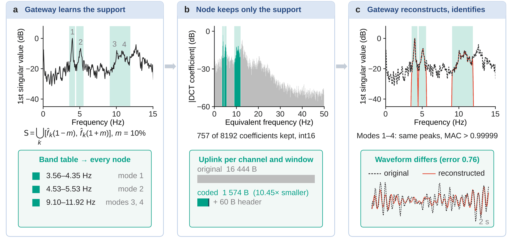{width=100%}

**Coordination:** Learned decision on what each node sends. The gateway learns the spectral support from synchronized records and sends it to the nodes. Paired checks are designed to keep or renew it.

**Key Results**

- Each node sends only the DCT coefficients inside the learned bands: 757 of 8,192, or 10.45× smaller per channel.
- At equal bytes on held-out Z24 records, LCSI preserves 355 of 355 target modal pairs. Three node-chosen codecs preserve 57–65%.
- Leaf uplink falls by 90.4% in steady operation and by 88.3% over a 48-window block that includes one paired check.

!!! note "Scope"
    Pre-damage Z24 records are replayed on one ESP32-S3 in sequence, not on a live multi-node network. Savings are application bytes; energy and latency were not measured. Commissioning costs 9.6% more than raw upload and breaks even at window 14. Support renewal under larger structural change has not been tested.

Equal-byte comparison of LCSI and node-chosen codecs

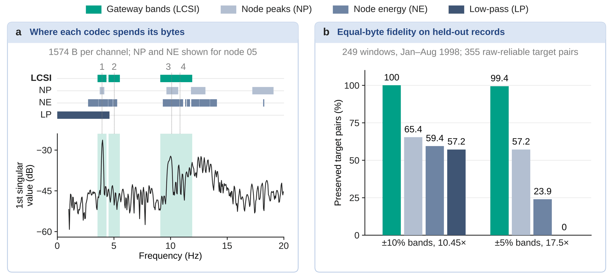{width=100%}

Application bytes on each link for three processing routes

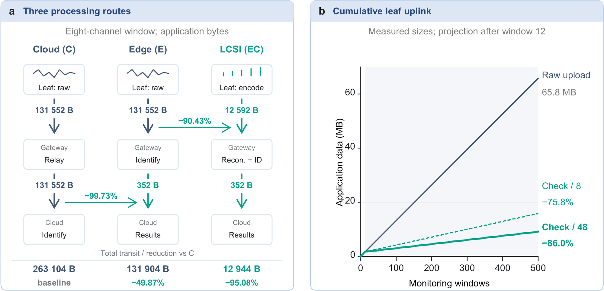{width=100%}

-   :material-file:{ .lg .middle } __Manuscript Under Review__

    ---

    Same manuscript as the on-board modal identification entry in Section 3.1.

**- Manifold Dynamics: A Healthy-Only Diagnostic State for Distributed Monitoring**

🏷️ SHM Category: Measurement / **System Identification** / **Damage Detection** / **Damage Localization** / **Damage Evaluation**

- Healthy-Only Learning
- Latent Flow
- Distance, Direction, Relation and Trend Readouts
- Leaf-Gateway Representation

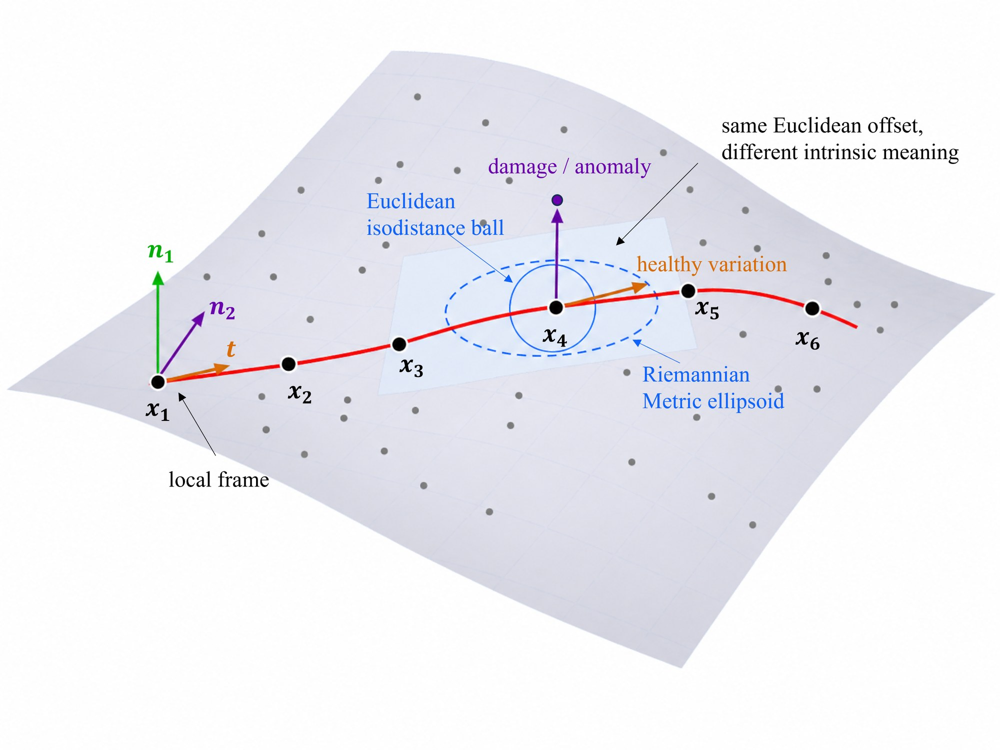{width=100%}

**Coordination:** Learned shared representation. Channel-wise codes are fused at the gateway into one diagnostic state. Information flows one way, from node to gateway, and the models stay frozen after training.

**Key Results**

- One compact state, trained without damage labels, supports identification, prediction, detection, localization and degradation-trend readouts.
- Four-storey frame: all four column-removal scenarios are localized across eight seeds, with window top-1 of 0.731 and a healthy false-alarm rate of 0.112.
- Z24 Stage 02, the earliest recorded departure from the reference state: flow-direction AUROC is 0.810 ± 0.010, against 0.683 for the best static baseline.
- FEMTO bearings: the causal degradation-trend readout reaches a mean monotonicity-trendability score of 0.453. This is not remaining-useful-life prediction.
- One ESP32-S3 reproduces the preloaded-feature, five-channel numerical path in 34.552 ms per state pair, with close agreement to the PC.

!!! note "Scope"
    Unpublished work reported in my Ph.D. thesis. "Distributed" means a proposed leaf-gateway split, evaluated on centrally acquired and benchmark data rather than a live multi-board network. Z24 Stage 02 includes the settlement-system installation and possible environmental change, so it is not confirmed damage detection.

Proposed representation and readout architecture (logical flow, not a measured live multi-board implementation)

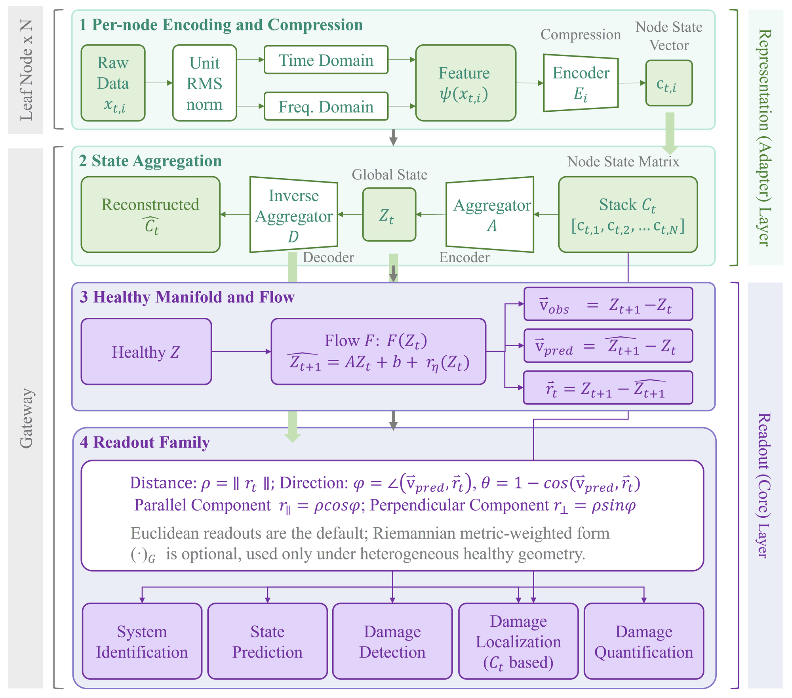{width=100%}

State walks on the three validation systems (visualization only)

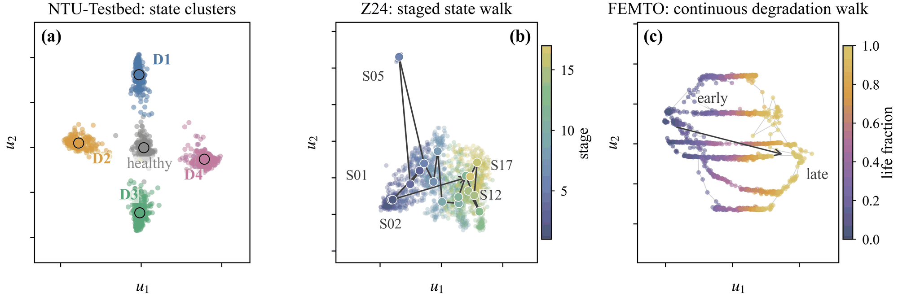{width=100%}

Z24 earliest-stage readouts

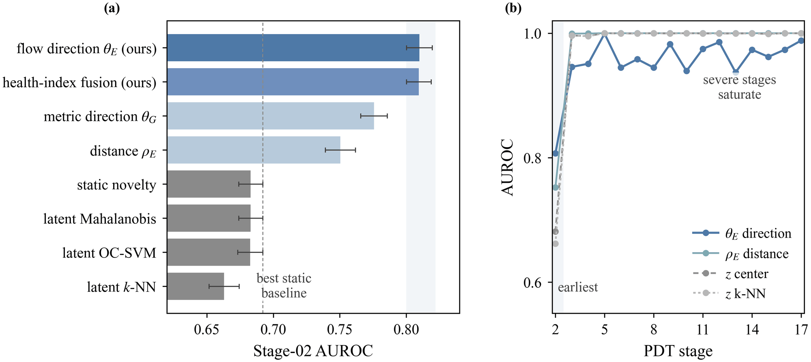{width=100%}

-   :material-file:{ .lg .middle } __Ph.D. Thesis - Chapter 6 (Unpublished)__

    ---

    **Cui, S.** Distributed Edge Intelligence for IoT-Based Wireless Structural Health Monitoring. Ph.D. Thesis, Nanyang Technological University.

## __IV Teaching and Pedagogical Research__

### ArduinoNode

A simple WSN node developed for SHM teaching, based on Arduino UNO R4 WIFI, successfully used in the APESS2025 Summer School held at The Hong Kong Polytechnic University.

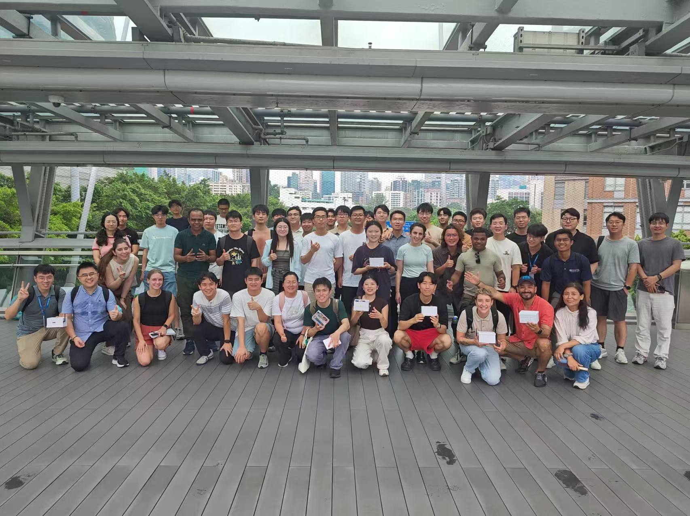

-   :simple-github:{ .lg .middle } __APESS2025_ARDUINONODE__

    ---

    SHM Teaching WSN Node Based on Arduino UNO R4 WIFI

    [:octicons-arrow-right-24: <a href="https://github.com/Shuaiwen-Cui/APESS2025_ArduinoNode.git" target="_blank"> Code </a>](#)

    [:octicons-arrow-right-24: <a href="https://shuaiwen-cui.github.io/APESS2025_ArduinoNode/" target="_blank"> Online Doc </a>](#)

-   :material-file:{ .lg .middle } __Journal Paper - IEEE Transactions on Education__

    ---

    **Cui, S.**, Fu, Y.*, Xia, Y., Zhang Q., & Li, S. (2026). A Class-Lab-Field Pedagogical Framework for Structural Health Monitoring using Ultra-Low-Cost Wireless IoT Prototypes. IEEE Transactions on Education. 

    [:octicons-arrow-right-24: <a href="https://doi.org/10.1109/TE.2026.3717462" target="_blank"> DOI </a>](#)

