# __PH.D. STUDIES__

{width=100%}

## __Research Overview__

!!! info "RESEARCH TOPICS -- PUSHING STRUCTURAL HEALTH MONITORING TO THE EDGE DEVICES"
    My Ph.D. research topic is __Distributed Edge Intelligence Framework for IoT-based Structural Health Monitoring__, with a focus on developing a distributed edge-intelligence enabling framework for resource-constrained, low-cost edge devices, to promote a paradigm shift from cloud to edge and from knowledge-driven to AI-driven (especially agent-driven) approaches, and to apply it to typical IoT-based structural health monitoring applications.

!!! info "KEY TASKS"
    - IoT System Development: Edge Device (MCU Level, Low-cost & Resource-constrained) and Cloud Platform Development
    - Distributed Edge Intelligence Enabling Framework Development: TinySHM (Vector & Matrix Operations / Digital Signal Processing / Machine Learning & Artificial Intelligence Libraries)
    - Structural Health Monitoring Applications: Measurement / System Identification / Damage Detection / Damage Localization / Damage Evaluation

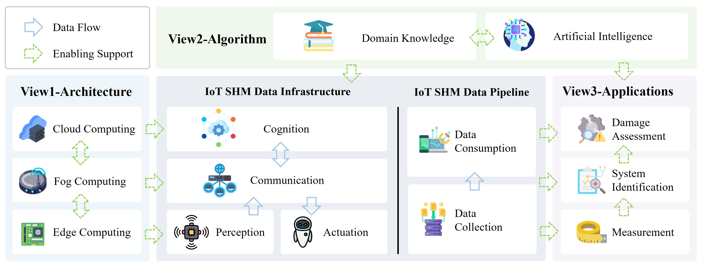{width=100%}

-   :material-file:{ .lg .middle } __Review Paper - Ubiquitous Computing and Intelligence in IoT-based Structural Health Monitoring (From Edge to Cloud)__

    ---

    **Cui, S.**, Fu, Y.*, Fu, H., & Shen, W. (2026). Edge-to-Cloud Computing and Intelligence for IoT-based Structural Health Monitoring: A Comprehensive Review. Advanced Engineering Informatics. 

    [:octicons-arrow-right-24: <a href="https://doi.org/10.1016/j.aei.2025.104300" target="_blank"> DOI </a>](#)

## __I IoT-based SHM System Development__

{width=100%}

### __1.1 Edge Device__

!!! note "Edge Device Development"
    To achieve edge intelligence computing, we have developed two types of MCU nodes, based on STM32 and ESP32. These nodes have high-performance edge computing capabilities and can be used in IoT, smart home, smart city, and other application scenarios. The current development focus is on ESP32.

-   :simple-github:{ .lg .middle } __LiftNode_ESP32🎯🏆__

    ---

    MCU IoT Node with High Performance Edge Computing, Based on ESP32

    <!-- ROLLBACK (github link hidden): [:octicons-arrow-right-24: <a href="https://github.com/Shuaiwen-Cui/LiftNode_ESP32.git" target="_blank"> Code </a>](#) -->

    [:octicons-arrow-right-24: <a href="http://www.cuishuaiwen.com:8100/" target="_blank"> Online Doc (Hosted on Personal Server) </a>](#)

    <!-- ROLLBACK (github link hidden): [:octicons-arrow-right-24: <a href="https://shuaiwen-cui.github.io/LiftNode_ESP32/" target="_blank"> Online Doc (Hosted on Github Pages) </a>](#) -->

<!-- <iframe width="800" height="450" src="https://www.youtube-nocookie.com/embed/O2b3-Bjhhws" frameborder="0" allowfullscreen></iframe> -->

<!-- Main Control Board

{width=100%}

Extension Board

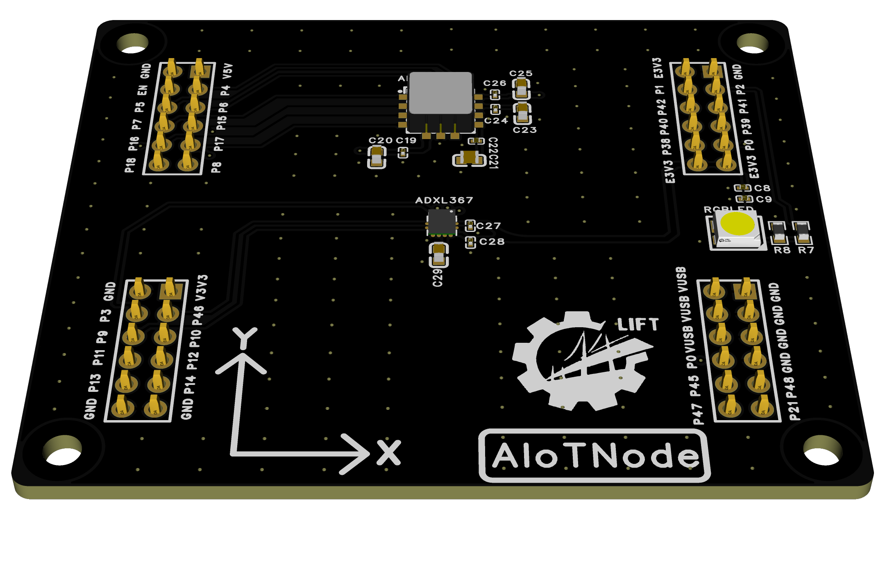{width=100%} -->

Node Design

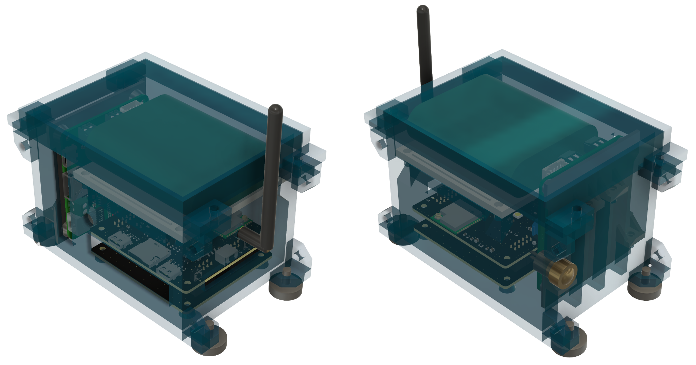{width=100%}

{width=100%}

PCB Design

{width=100%}

Sensor Streaming Demo

<iframe width="800" height="450" src="https://www.youtube-nocookie.com/embed/f1rnn7kyeOM" frameborder="0" allowfullscreen></iframe>

Sensor Synchronization Demo

<iframe width="800" height="450" src="https://www.youtube-nocookie.com/embed/IdZ6cGDO1go" frameborder="0" allowfullscreen></iframe>

### __1.2 Cloud Platform__

-   :simple-github:{ .lg .middle } __LiftHub 🎯🏆__

    ---

    Acts as the server-side to interact with LiftNode, providing data storage and analysis functions.

    <!-- ROLLBACK (github link hidden): [:octicons-arrow-right-24: <a href="https://github.com/Shuaiwen-Cui/LiftHub.git" target="_blank"> Code </a>](#) -->

    [:octicons-arrow-right-24: <a href="http://www.cuishuaiwen.com:8200/" target="_blank"> Online Doc (Hosted on Personal Server) </a>](#)

    <!-- ROLLBACK (github link hidden): [:octicons-arrow-right-24: <a href="https://shuaiwen-cui.github.io/LiftHub/" target="_blank"> Online Doc (Hosted on Github Pages) </a>](#) -->

## __II Distributed Edge Intelligence Framework for Resource-Constrained Devices__

TinySHM is MCU-native middleware between the board drivers and SHM applications. It covers acquisition, signal processing, system identification, damage screening and on-device learning, and runs without Linux or Python.

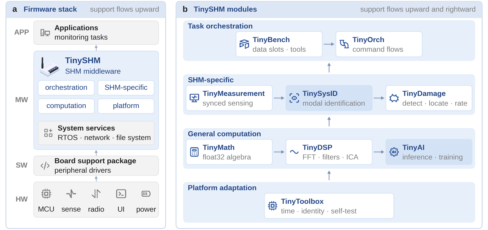{width=100%}

!!! note "Nine Modules"
    - Platform Adaptation: TinyToolbox
    - General Computation: TinyMath / TinyDSP / TinyAI
    - SHM Specific: TinyMeasurement / TinySysID / TinyDamage
    - Task Orchestration: TinyBench / TinyOrch

On-Device Training (TinyAI)

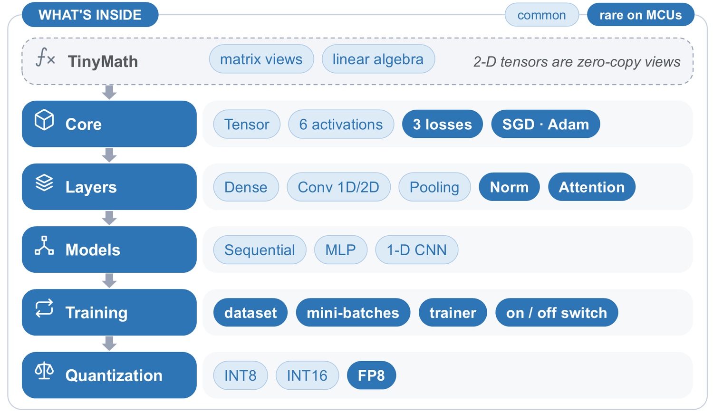{width=100%}

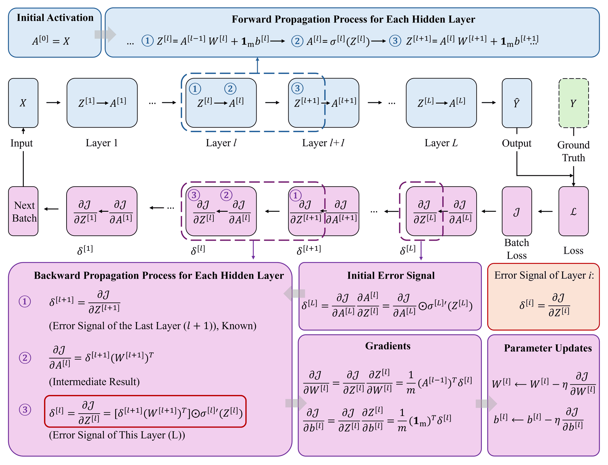{width=100%}

On-Node System Identification (TinySysID)

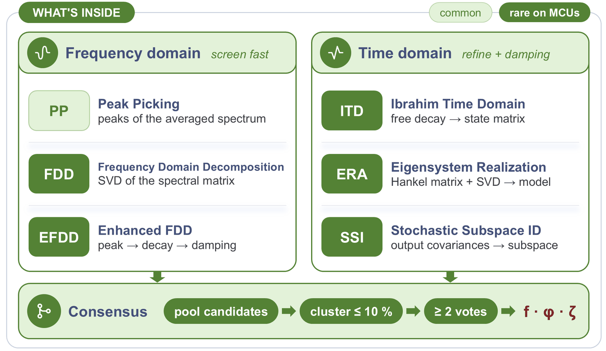{width=100%}

-   :simple-github:{ .lg .middle } __TinySHM🎯🏆__

    ---

    Currently Supported Platforms:

    - ESP32

    <!-- ROLLBACK (github link hidden): [:octicons-arrow-right-24: <a href="https://github.com/Shuaiwen-Cui/TinySHM.git" target="_blank"> Code </a>](#) -->

    [:octicons-arrow-right-24: <a href="http://www.cuishuaiwen.com:8300/" target="_blank"> Online Doc (Hosted on Personal Server) </a>](#)

    <!-- ROLLBACK (github link hidden): [:octicons-arrow-right-24: <a href="https://shuaiwen-cui.github.io/TinySHM/" target="_blank"> Online Doc (Hosted on Github Pages) </a>](#) -->

## __III ML/AI-Powered Algorithms for Structural Health Monitoring__

The algorithms progress from decisions on a single node, to rule-based cooperation across nodes, to coordination learned from data.

### __3.1 Single-Node Intelligence__

#### Smart Adaptive Trigger Sensing Powered by Edge Intelligence and Digital Twin for Energy-Efficient Wireless Structural Health Monitoring

🏷️ SHM Category: **Measurement** / System Identification / Damage Detection / Damage Localization / Damage Evaluation

- Trigger Sensing
- Closed-Loop Feedback Control
- Edge Intelligence
- Bayesian Optimization

-   :material-file:{ .lg .middle } __Conference Paper - 13th International Conference on Structural Health Monitoring of Intelligent Infrastructure (SHMII-13)__

    ---

    **Cui, S.**, Yu, X., & Fu, Y.* (2025). Smart adaptive triggering strategy for edge intelligence enabled energy-efficient sensing. In *Proceedings of the 13th International Conference on Structural Health Monitoring of Intelligent Infrastructure (SHMII-13)*, pp. 609–616. Graz, Austria: Verlag der TU Graz. (🏆 **Best Conference Paper Award** 1st/202)

    [:octicons-arrow-right-24: <a href="https://doi.org/10.3217/978-3-99161-057-1-094" target="_blank"> DOI </a>](#)

-   :material-file:{ .lg .middle } __Journal Paper - Mechanical System and Signal Processing__

    ---

    **Cui, S.**, Fu, Y.*, Fu, H., Yu, X., & Shen, W. (2025). Smart Adaptive Trigger Sensing Powered by Edge Intelligence and Digital Twin for Energy-Efficient Wireless Structural Health Monitoring.  Mechanical Systems and Signal Processing, Volume 241, 2025, 113537.

    [:octicons-arrow-right-24: <a href="https://doi.org/10.1016/j.ymssp.2025.113537" target="_blank"> DOI </a>](#)

-   :material-file:{ .lg .middle } __Singapore Provisional Patent Application - 10202502426R__

    ---

    Adaptive Triggering Mechanism for Time-Series Data Sensing on Edge Devices, Singapore provisional patent application number 10202502426R, 2025

#### On-Board Modal Identification and Learning on a Microcontroller Node

🏷️ SHM Category: **Measurement** / **System Identification** / Damage Detection / Damage Localization / Damage Evaluation

- Operational Modal Analysis
- On-Device Training
- TinySHM

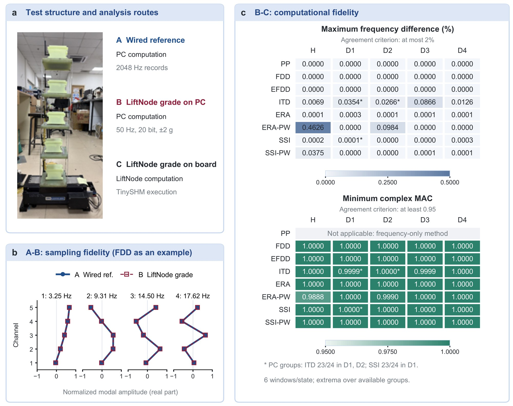{width=100%}

-   :material-file:{ .lg .middle } __Manuscript Under Review__

    ---

    **Cui, S.**, Fu, Y.*, Wang, Y., & Fu, H. Decisions beside data: LiftNode and TinySHM for AIoT-native learning and system identification in infrastructure monitoring. Manuscript under review.

### __3.2 Multi-Node Cooperation (Rule-Based Coordination)__

**- Adaptive edge intelligence for rapid structural condition assessment using a wireless smart sensor network**

🏷️ SHM Category: **Measurement** / System Identification / **Damage Detection** / Damage Localization / Damage Evaluation

- Data-driven Anomaly Detection
- Gaussian Process Regression (GPR)
- Stochastic Process Control (SPC)

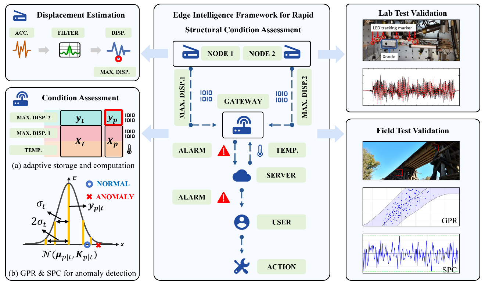{width=100%}

-   :material-file:{ .lg .middle } __Journal Paper - Engineering Structures__

    ---

    **Cui, S.**, Hoang, T., Mechitov, K., Fu, Y.*, & Spencer Jr, B. F. (2025). Adaptive edge intelligence for rapid structural condition assessment using a wireless smart sensor network. Engineering Structures, 326, 119520.

    [:octicons-arrow-right-24: <a href="https://doi.org/10.1016/j.engstruct.2024.119520" target="_blank"> DOI </a>](#)

### __3.3 Multi-Node Collaboration (Learned Coordination)__

**- Learned-Support Collaborative System Identification (LCSI)**

🏷️ SHM Category: Measurement / **System Identification** / Damage Detection / Damage Localization / Damage Evaluation

- Gateway-Node Collaboration
- Communication-Efficient Identification

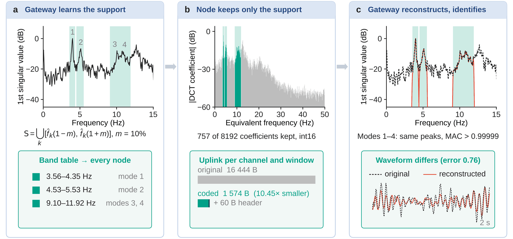{width=100%}

**- Manifold Dynamics**

🏷️ SHM Category: Measurement / **System Identification** / **Damage Detection** / **Damage Localization** / **Damage Evaluation**

- Healthy-Only Learning
- Learned Diagnostic State
- Leaf-Gateway Representation

{width=100%}

State trajectories on three validation systems (visualization only)

{width=100%}

## __IV Teaching and Pedagogical Research__

### ArduinoNode

A simple WSN node developed for SHM teaching, based on Arduino UNO R4 WIFI, successfully used in the APESS2025 Summer School held at The Hong Kong Polytechnic University.

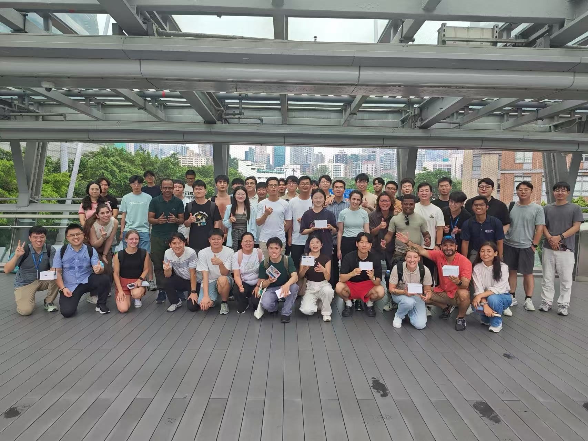

-   :simple-github:{ .lg .middle } __APESS2025_ARDUINONODE__

    ---

    SHM Teaching WSN Node Based on Arduino UNO R4 WIFI

    [:octicons-arrow-right-24: <a href="https://github.com/Shuaiwen-Cui/APESS2025_ArduinoNode.git" target="_blank"> Code </a>](#)

    [:octicons-arrow-right-24: <a href="https://shuaiwen-cui.github.io/APESS2025_ArduinoNode/" target="_blank"> Online Doc </a>](#)

-   :material-file:{ .lg .middle } __Journal Paper - IEEE Transactions on Education__

    ---

    **Cui, S.**, Fu, Y.*, Xia, Y., Zhang Q., & Li, S. (2026). A Class-Lab-Field Pedagogical Framework for Structural Health Monitoring using Ultra-Low-Cost Wireless IoT Prototypes. IEEE Transactions on Education. 

    [:octicons-arrow-right-24: <a href="https://doi.org/10.1109/TE.2026.3717462" target="_blank"> DOI </a>](#)

## __V Field Deployment and Engineering Applications__

### __Flores, Indonesia__

In November 2026, two LiftNodes were deployed at RSUD Aeramo hospital in Flores to support continuous, remote monitoring of aftershocks.

-   [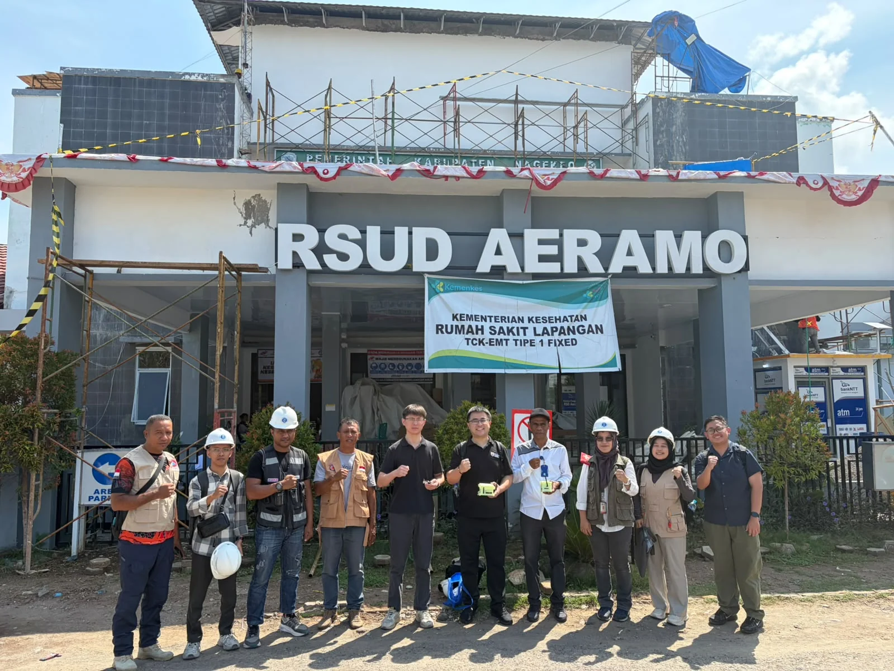{ loading=lazy width=1600 height=1200 }](deployment/liftnode-deployment-team.webp)

    **Deployment team**

-   [{ loading=lazy width=1080 height=1920 }](deployment/liftnode-staircase-two-nodes.webp)

    **Two-node staircase deployment**

-   [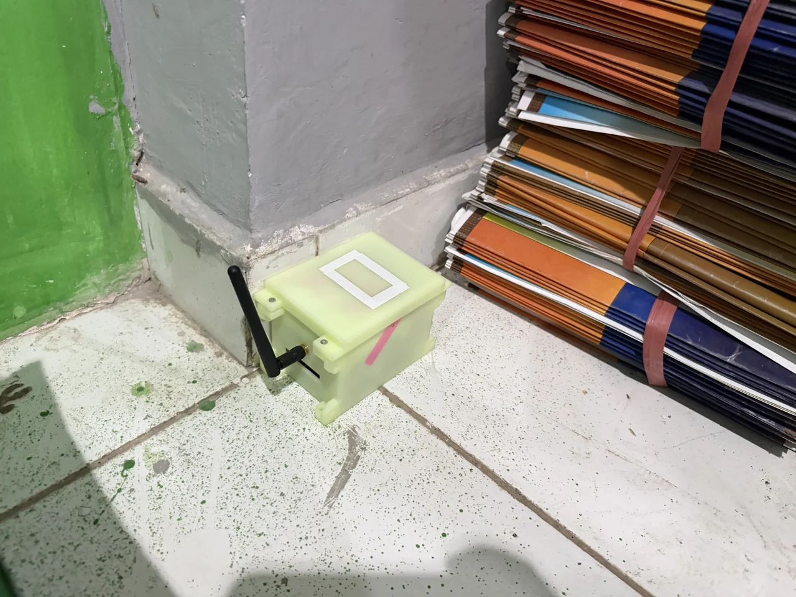{ .deployment-detail loading=lazy width=1280 height=960 }](deployment/liftnode-column.webp)

    **Column location**

-   [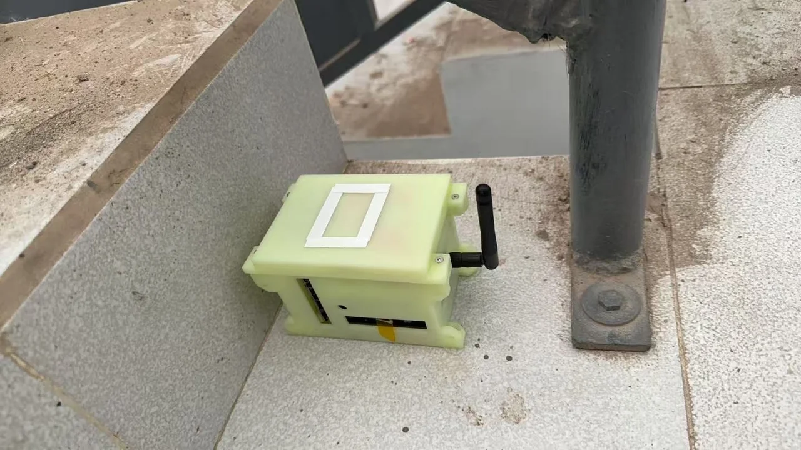{ .deployment-detail loading=lazy width=1280 height=720 }](deployment/liftnode-stair-landing.webp)

    **Stair landing**

<figure markdown="span">
  [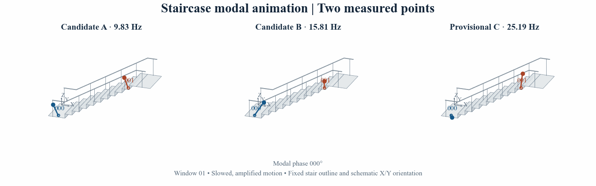{ loading=lazy width=1340 height=420 style="width:100%;height:auto;" }](deployment/flores-staircase-mode-shapes.gif)
  <figcaption>Staircase survey · Two-point candidate mode-shape animation</figcaption>
</figure>

  [:material-newspaper-variant-outline: NTU CEE News · 15 Nov 2026](https://www.ntu.edu.sg/cee/news/ntu-cee-researchers-conduct-field-deployment-in-flores--indonesia){ .md-button }

#### __Field recording near the 18 November 2026 M5.8 earthquake__

On 18 November, the deployed Gateway **000** recorded a decaying, three-axis vibration event at **12:42:07.502 (Flores / Singapore, UTC+8)**. The independent [BMKG bulletin](https://www.bmkg.go.id/gempabumi/20261118114412) reports an **M5.8 earthquake at 10 km depth**, with an origin time of **12:41:32–33** in the same time zone. The [GFZ GEOFON catalogue](https://geofon.gfz.de/eqinfo/) also lists this regional event around 04:41:32 UTC. The catalogue timing and measured response support a candidate association; matching against a nearby reference-station waveform remains pending.

| Independent earthquake information | LiftNode field observation |
| :-- | :-- |
| BMKG origin: 12:41:32–33, UTC+8 | Node trigger: 12:42:07.502, approximately 35 seconds later |
| Initial epicentre: 8.17°S, 120.54°E; updated release: 8.21°S, 120.55°E | RSUD Aeramo hospital, Flores; Gateway 000 |
| Regional M5.8 event, depth 10 km | Three-axis motion with a clear decline in amplitude within the saved window |
| Independently reported by BMKG and GFZ GEOFON | ADXL367 pre-trigger buffer and ADXL355 acquisition preserved in one SD file, then retrieved remotely |

<figure markdown="span" class="field-event-figure">
  [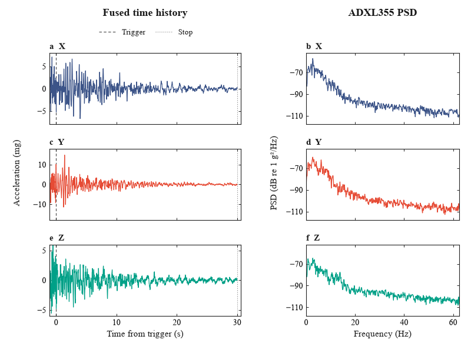{ loading=lazy width=800 height=600 style="width:100%;max-width:800px;height:auto;background:#fff;" }](deployment/flores-20261118-waveform-psd.svg)
  <figcaption>Field record from Gateway 000. Left: fused time histories, including the ADXL367 prefix and ADXL355 body; dashed and dotted lines mark trigger and stop. Right: ADXL355-only Welch PSD in dB. The largest spectral bin is near 2.69 Hz on all three axes; this is a response peak, not an independently identified structural mode.</figcaption>
</figure>

**What this demonstrates.** The field node completed autonomous triggering, pre-trigger buffering, on-device AI inference, local SD retention and subsequent remote recovery of a real vibration record. The **478,248-byte file** contains **3,168 ADXL367 samples and 3,762 ADXL355 samples**. Its SHA-256, both sensor CRCs and pre-buffer CRC passed verification. The on-node experimental model labelled the initial window *earthquake* (score **0.921**); the separate cloud model returned *unknown*. These results are retained as references, not as confirmation of the event identity.

Data processing and interpretation

- The first retained sample is **12:42:06.535**; ADXL355 acquisition runs from **12:42:07.505 to 12:42:37.503**. Only about **0.97 seconds before the trigger** is preserved. The 30-second record length follows the configured minimum duration and is not the earthquake duration. The origin-to-trigger interval is not a picked seismic travel time.
- The time histories use the platform's [Fu et al. adapted fusion method](https://doi.org/10.3390/s18124480), with 100 Hz output, a 40 Hz low-pass and late-record median removal. Axis correspondence is assumed X–X, Y–Y, Z–Z. The overlap check reports an axis mismatch, so this is a **forced same-axis merge**; mounting alignment has not been independently validated.
- PSD uses **ADXL355 only**, with recorded-timestamp resampling, a Hann window and 50% overlap. Four startup samples remain in the native file but are excluded from the plotted fused body and PSD. Two ADXL355 timestamp intervals exceed 12 ms, with a maximum of **16.916 ms**; file integrity does not establish zero dropped ADC samples.
- This example uses node **000**. No simultaneous node-001 record or independent reference-station match is claimed.
- BMKG's initial bulletin gives 11:41:32 WIB; its updated release gives 11:41:33 WIB. Adding one hour gives the Flores / Singapore times above. Agency parameters may be revised.

[Download figure PNG](deployment/flores-20261118-waveform-psd.png) · [Vector SVG](deployment/flores-20261118-waveform-psd.svg) · [Native waveform TXT](deployment/000_20261118T124207502_T.txt)

Waveform SHA-256

`8470de6a621cec303de7170e725bfea6cd122aa68f3d58a76fddab3a883da402`

