# __攻博期间研究__

{width=100%}

## __研究概览__

!!! info "研究主题 -- 将结构健康监测推向边缘设备"
    我的博士研究课题是 __面向物联网无线结构健康监测的分布式边缘智能__，重点是开发一种分布式边缘智能使能框架，面向资源受限的低成本边缘设备，以促进从云到边和从知识驱动到人工智能驱动（特别是智能体驱动）的范式转变，并将其应用于物联网结构健康监测的典型应用。

!!! info "主要任务"
    - 物联网系统开发：边缘设备（MCU级别，低成本和资源受限）和云平台开发
    - 分布式边缘智能使能框架开发：TinySHM (向量、矩阵运算/数字信号处理/机器学习与人工智能算法库)
    - 结构健康监测应用：测量/系统识别/损伤检测/损伤定位/损伤量化

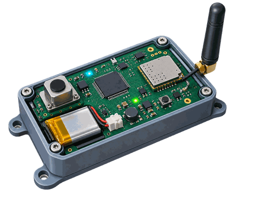

基础

LiftNode + LiftHub

边缘智能运行在哪里

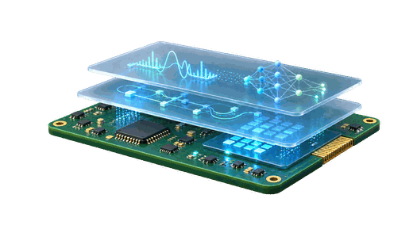

基础

TinySHM

边缘计算如何组织

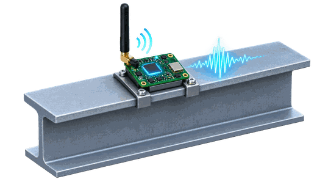

第一层

单节点智能

决策留在单个节点

第二层

多节点协同

规则驱动的协调

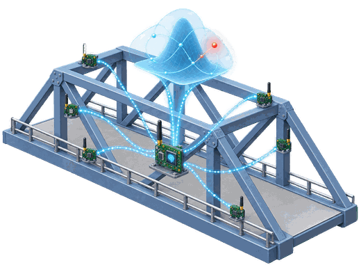

第三层

多节点协作

从数据中学习协调

<figure class="rs-fig" markdown="span">
  [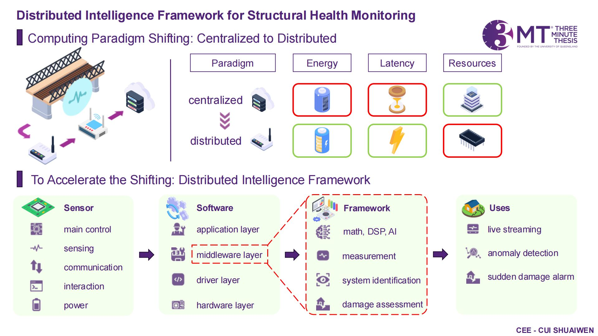](SUMMARY.jpg)
  <figcaption>从集中式计算到分布式计算</figcaption>
</figure>

<figure class="rs-fig" markdown="span">
  [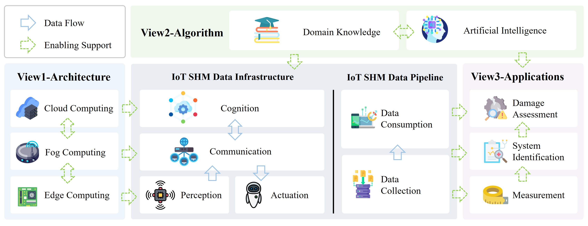](REVIEW-GA.jpg)
  <figcaption>端到云综述的图形摘要</figcaption>
</figure>

-   :material-file:{ .lg .middle } __综述论文-物联网结构健康监测中的泛在计算与智能（从端到云）__

    ---

    **Cui, S.**, Fu, Y.*, Fu, H., & Shen, W. (2026). Edge-to-Cloud Computing and Intelligence for IoT-based Structural Health Monitoring: A Comprehensive Review. Advanced Engineering Informatics. 

    [:octicons-arrow-right-24: <a href="https://doi.org/10.1016/j.aei.2025.104300" target="_blank"> DOI </a>](#)

    [:octicons-arrow-right-24: <a href="https://mp.weixin.qq.com/s/ySQzpHCOhTIcSIN8gqK1bA" target="_blank"> 公众号推送 </a>](#)

## __I SHM物联网系统开发__

平台连接传感节点、云服务和操作者。它是研究原型，开发程度以能够实现和测量边缘智能方法为准。

<figure class="rs-fig" markdown="span">
  [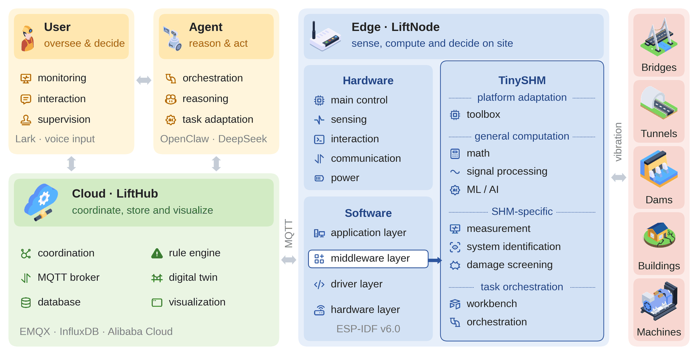](PLATFORM-ARCH.png)
  <figcaption>LiftNode 与 LiftHub 平台架构</figcaption>
</figure>

### __1.1 边缘设备__

LiftNode 将常开的哨兵加速度计与 20 位采集加速度计配对，节点既能低成本等待，又能高质量记录。我们开发过基于 STM32 和 ESP32 的 MCU 节点，目前的开发重点是 ESP32。

  
<b>ESP32-S3</b>双核 240 MHz，FPU，SIMD

  
<b>8 MB</b>PSRAM，另有 16 MB Flash

  
<b>20 位</b>ADXL355，22.5 µg/√Hz

  
<b>0.89 µA</b>ADXL367 哨兵（数据手册值）

  
<b>10.5 Ah</b>3 节 18650，MPPT 太阳能输入

  
<b>约 140 美元</b>单节点物料成本

<figure class="rs-fig" markdown="span">
  [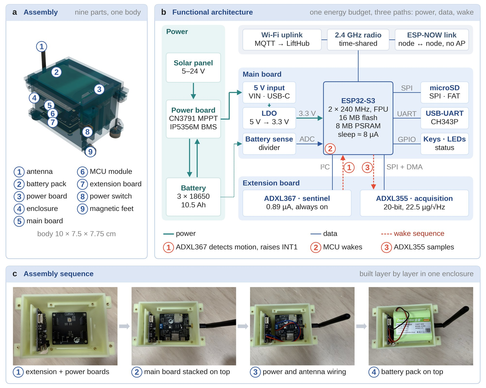](LIFTNODE-PARTS.jpg)
  <figcaption>LiftNode 组成：整机、功能架构和装配顺序</figcaption>
</figure>

<figure class="rs-fig" markdown="span">
  [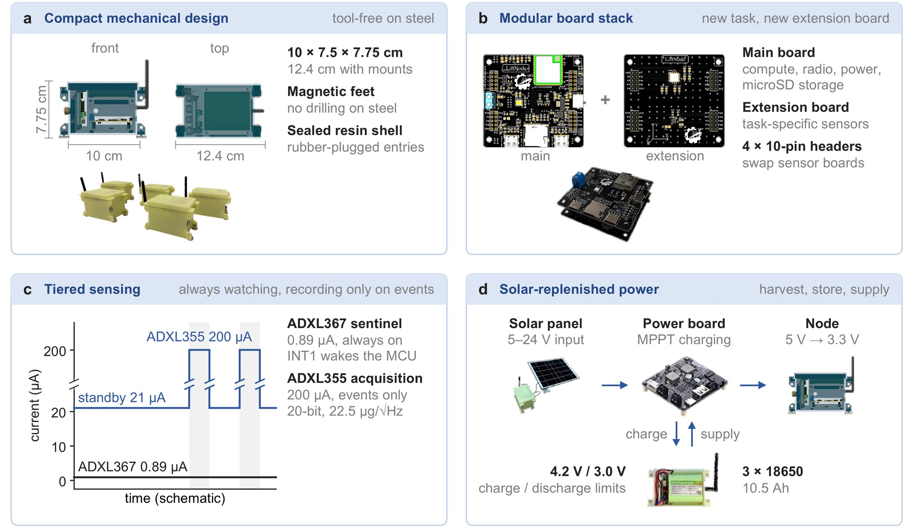](LIFTNODE-FEATURES.jpg)
  <figcaption>设计特点。图 (c) 中的电流为数据手册值，并非整板实测。</figcaption>
</figure>

<figure class="rs-fig" markdown="span">
  [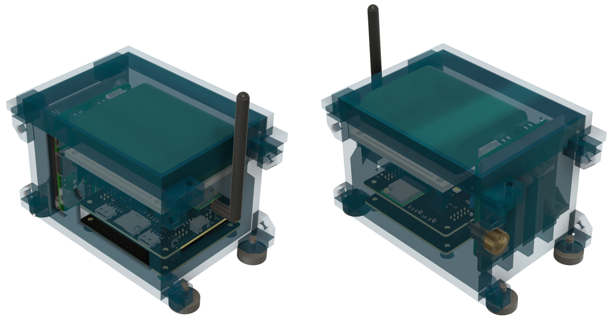](Node-Overview.png)
  <figcaption>节点设计</figcaption>
</figure>

<figure class="rs-fig" markdown="span">
  
  <figcaption>组装完成的节点</figcaption>
</figure>

<figure class="rs-fig" markdown="span">
  [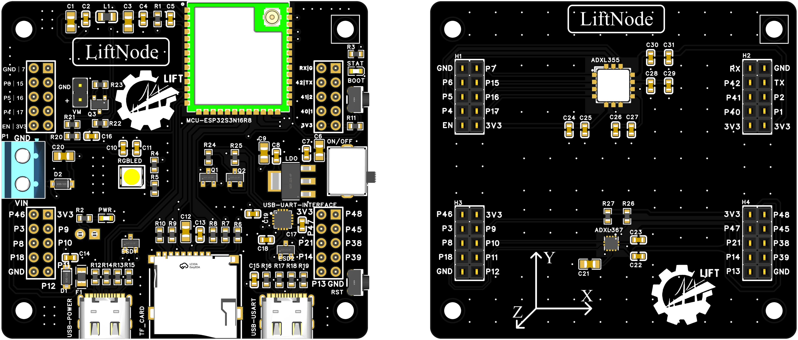](PCB.png)
  <figcaption>PCB 设计</figcaption>
</figure>

<figure class="rs-fig" markdown="span">
  [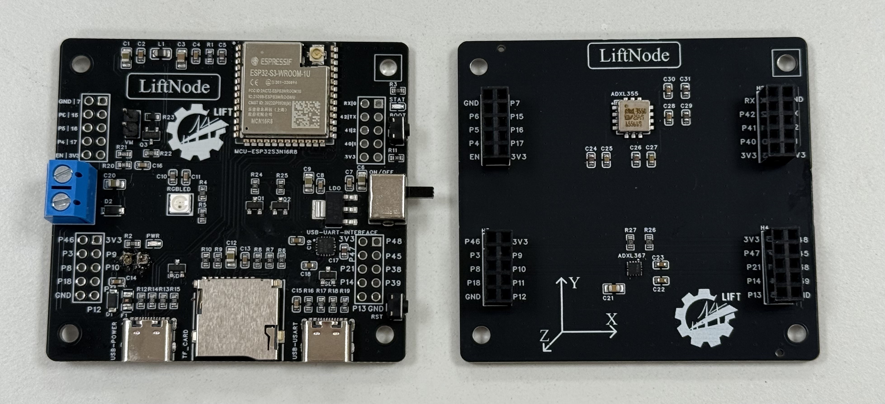](PCB.jpg)
  <figcaption>电路板实物</figcaption>
</figure>

传感器流式采样 Demo

<iframe src="//player.bilibili.com/player.html?bvid=BV1Vm7Y6wEH2&autoplay=0" frameborder="0" allowfullscreen></iframe>

传感器同步 Demo

<iframe src="//player.bilibili.com/player.html?bvid=BV1q75i6qE8r&autoplay=0" frameborder="0" allowfullscreen></iframe>

-   :simple-github:{ .lg .middle } __LiftNode_ESP32🎯🏆__

    ---

    基于 ESP32 的 MCU IoT 节点，具有高性能边缘计算

    <!-- ROLLBACK (github link hidden): [:octicons-arrow-right-24: <a href="https://github.com/Shuaiwen-Cui/LiftNode_ESP32.git" target="_blank"> 代码 </a>](#) -->

    [:octicons-arrow-right-24: <a href="http://www.cuishuaiwen.com:8100/" target="_blank"> 在线文档（个人服务器 托管） </a>](#)

    <!-- ROLLBACK (github link hidden): [:octicons-arrow-right-24: <a href="https://shuaiwen-cui.github.io/LiftNode_ESP32/" target="_blank"> 在线文档（Github 托管） </a>](#) -->

### __1.2 云平台__

LiftHub 负责 MQTT 消息转发、数据存储和数字孪生可视化，并支持通过对话式智能体控制节点。它是支撑研究演示的基础层，研究重点仍在边缘端。

-   :simple-github:{ .lg .middle } __LiftHub 🎯🏆__

    ---

    作为服务器端与LiftNode交互，提供数据存储和分析等功能。

    <!-- ROLLBACK (github link hidden): [:octicons-arrow-right-24: <a href="https://github.com/Shuaiwen-Cui/LiftHub.git" target="_blank"> 代码 </a>](#) -->

    [:octicons-arrow-right-24: <a href="http://www.cuishuaiwen.com:8200/" target="_blank"> 在线文档（个人服务器 托管） </a>](#)

    <!-- ROLLBACK (github link hidden): [:octicons-arrow-right-24: <a href="https://shuaiwen-cui.github.io/LiftHub/" target="_blank"> 在线文档（Github 托管） </a>](#) -->

## __II 资源受限设备分布式边缘智能使能框架__

TinySHM 是运行在 MCU 上的中间件，位于板级驱动和 SHM 应用之间。它不是通用 TinyML 库：学习只是其中一项能力，与采集、识别和损伤筛查并列。它不依赖 Linux 或 Python。

  
<b>9</b>个模块，4 个分组

  
<b>约 410</b>个公开 API 函数

  
<b>约 2.05 万</b>行实现代码

  
<b>165</b>个单元测试函数

  
<b>6 + 2</b>种模态方法 + 成对变体

<figure class="rs-fig" markdown="span">
  [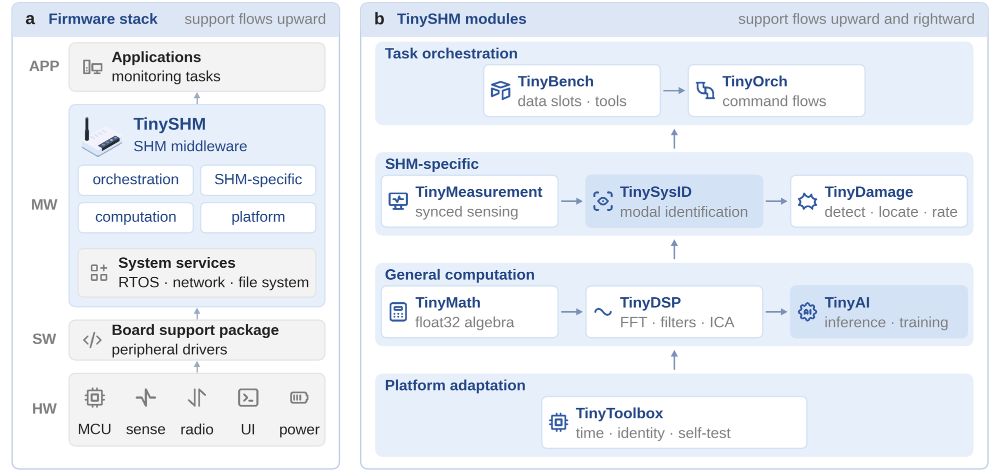](TINYSHM-STACK.png)
  <figcaption>LiftNode 固件栈和 TinySHM 的九个模块</figcaption>
</figure>

-   :material-puzzle-outline:{ .lg .middle } __可组合__

    ---

    每个模块提供可移植的 C/C++ 基线实现，并在条件具备时叠加硬件加速。

-   :material-transit-connection-variant:{ .lg .middle } __端到端__

    ---

    模块覆盖从采集、处理、识别到损伤筛查的完整流程。

-   :material-chip:{ .lg .middle } __MCU 优先__

    ---

    float32 数值、Jacobi SVD 和预推导反向传播，都直接由硬件限制决定。

-   :material-access-point-network:{ .lg .middle } __物联网原生__

    ---

    功能以命令形式通过 ESP-NOW 和 MQTT 开放，节点可在运行时重新配置。

### __2.1 九个模块__

  
任务编排

  

    
<b>TinyBench</b>命名数据槽、类型化工具注册、远程查询

    
<b>TinyOrch</b>由类型化步骤组成的命名流程，按命令运行

  

  
SHM 专用

  

    
<b>TinyMeasurement</b>流式、突发和实时采集；时钟同步

    
<b>TinySysID</b>PP、FDD、EFDD、ITD、ERA、SSI；成对分解；投票

    
<b>TinyDamage</b>损伤指标、COMAC 定位、严重程度

  

  
通用计算

  

    
<b>TinyMath</b>线性代数、矩阵分解、特征值求解

    
<b>TinyDSP</b>FFT、滤波器设计、小波、ICA

    
<b>TinyAI</b>网络层、训练、推理、量化

  

  
平台适配

  

    
<b>TinyToolbox</b>ESP-IDF 适配、节点身份、微秒级时间、启动自检

  

<figure class="rs-fig" markdown="span">
  [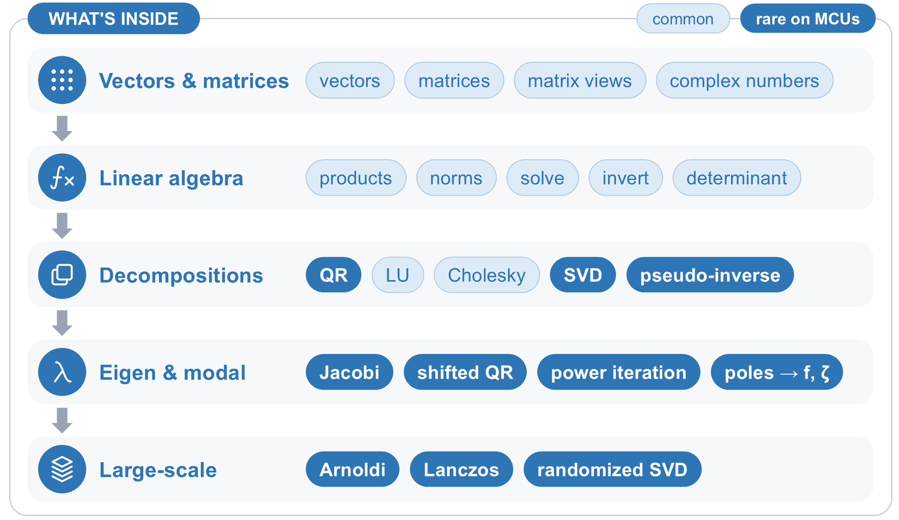](MOD-MATH.png)
  <figcaption><b>TinyMath。</b>LU、Cholesky、QR；Jacobi 与随机 SVD；移位 QR；Arnoldi 与 Lanczos。</figcaption>
</figure>

<figure class="rs-fig" markdown="span">
  [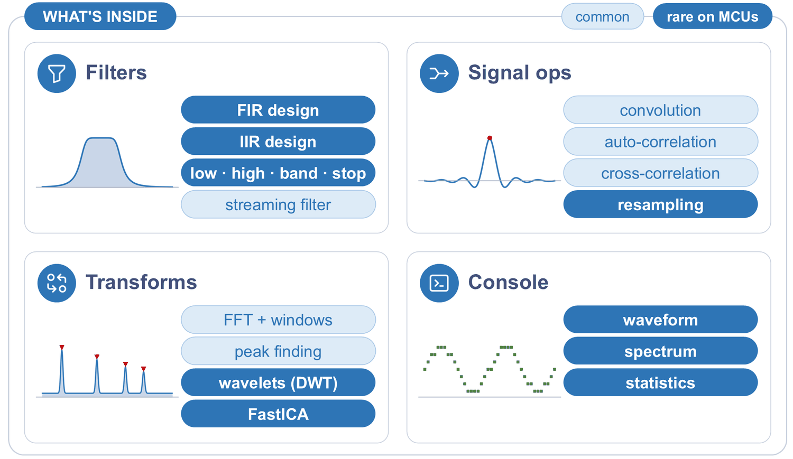](MOD-DSP.png)
  <figcaption><b>TinyDSP。</b>FFT、FIR 与 IIR 设计、相关、重采样、小波和 ICA。</figcaption>
</figure>

<figure class="rs-fig" markdown="span">
  [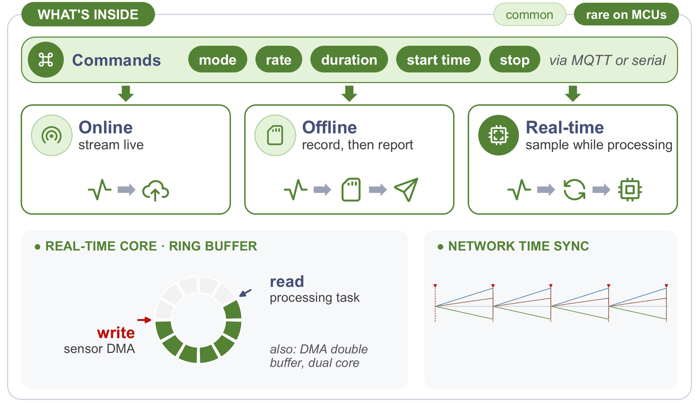](MOD-MEASURE.png)
  <figcaption><b>TinyMeasurement。</b>流式、突发和实时采集，配合网关信标时钟同步。</figcaption>
</figure>

<figure class="rs-fig" markdown="span">
  [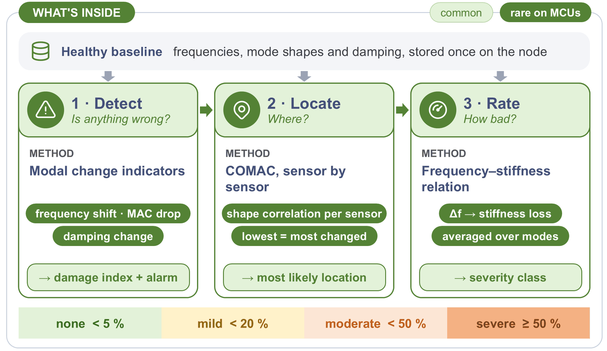](MOD-DAMAGE.png)
  <figcaption><b>TinyDamage。</b>基于健康基线筛查：检测、定位、评级。</figcaption>
</figure>

<figure class="rs-fig" markdown="span">
  [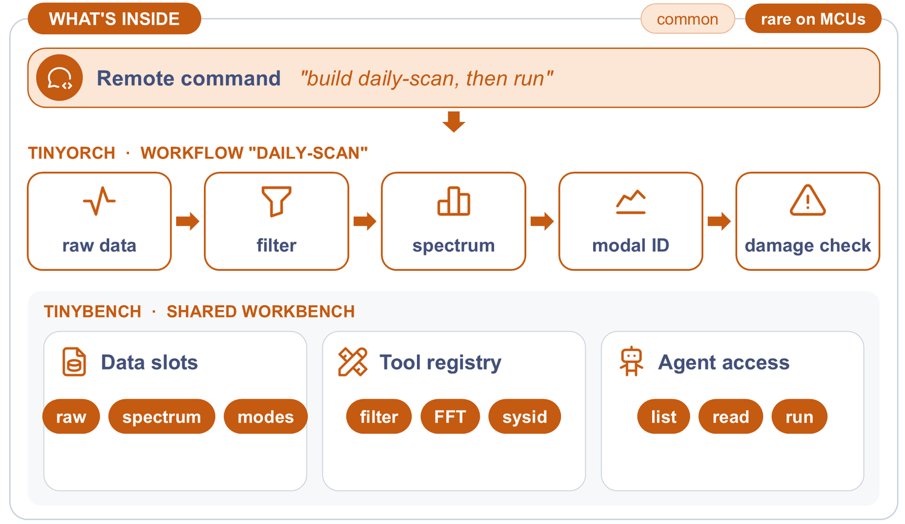](MOD-ORCH.png)
  <figcaption><b>TinyBench + TinyOrch。</b>流程即数据：按命令定义和运行，无需重新烧录。</figcaption>
</figure>

<figure class="rs-fig" markdown="span">
  [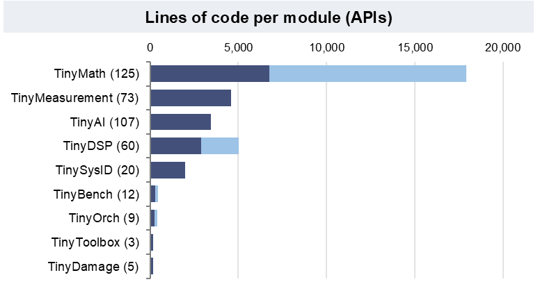](TINYSHM-SCALE.png)
  <figcaption><b>代码规模。</b>根据源码树的近似统计，不含厂商库。</figcaption>
</figure>

### __2.2 设备端训练：TinyAI__

只做推理的 TinyML 把模型维护留在了节点之外。TinyAI 在 MCU 上完成前向传播、损失计算、反向传播和参数更新。每个算子都带有解析推导的反向方法，运行时不需要自动微分图。

<figure class="rs-fig" markdown="span">
  [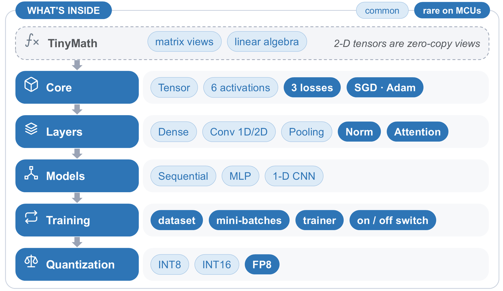](MOD-AI.png)
</figure>

  
<b>0.30 ms</b>前向传播，16-64-8 MLP

  
<b>18.8 ms</b>每轮训练，150 个样本

网络层包括全连接、一维和二维卷积、池化、归一化和多头自注意力。纯推理构建会裁掉反向路径。

<figure class="rs-fig" markdown="span">
  [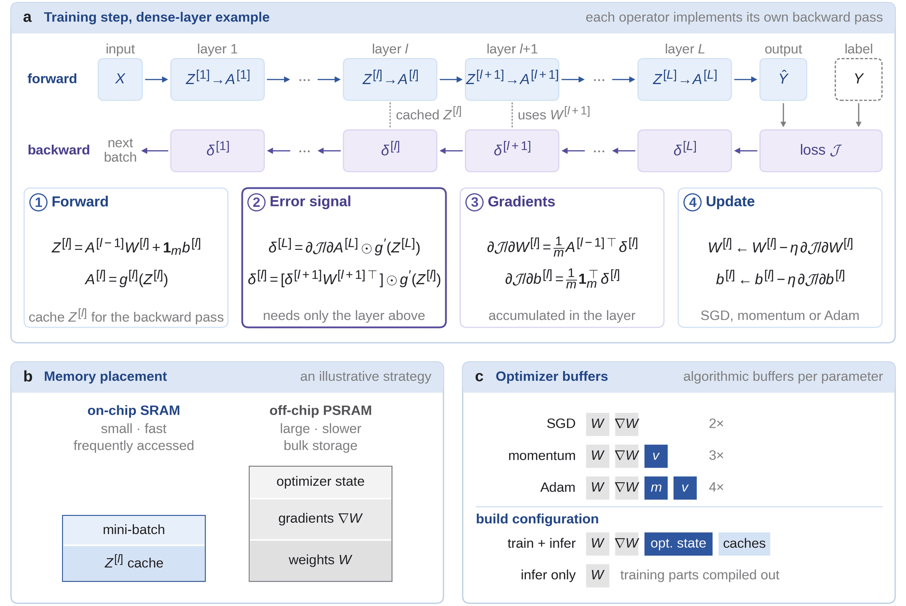](TINYAI-TRAIN.png)
  <figcaption>TinyAI 训练步骤、示意性的 SRAM/PSRAM 布局和优化器缓冲区</figcaption>
</figure>

### __2.3 节点端系统识别：TinySysID__

TinySysID 把输出型运行模态分析搬到 MCU 上。六类方法、八种变体共用一个接口，结果可以直接比较。

<figure class="rs-fig" markdown="span">
  [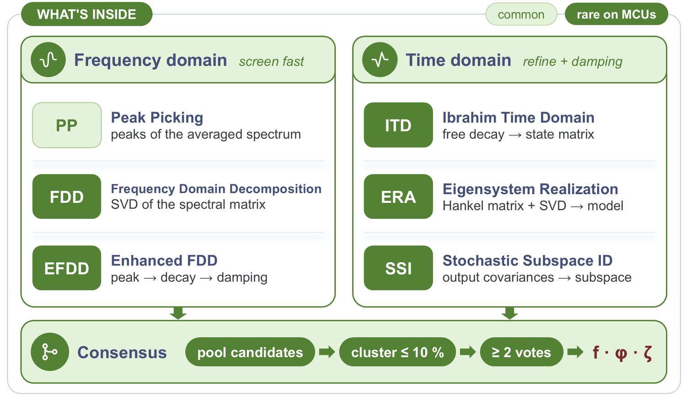](MOD-SYSID.png)
</figure>

  
<b>4–47 KiB</b>各变体片上堆峰值

  
<b>&lt; 0.4–7.0 s</b>单次调用，5 通道，60 s，50 Hz

成对处理按顺序求解各通道对，以降低峰值内存。代价是损失联合空间信息，运行时间也不一定缩短。

<figure class="rs-fig" markdown="span">
  [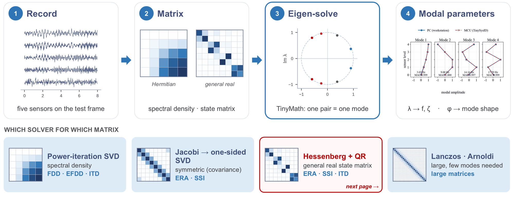](EIGEN-PIPELINE.png)
  <figcaption>模态参数本质上是特征量：TinyMath 针对每类矩阵提供求解器</figcaption>
</figure>

<figure class="rs-fig" markdown="span">
  [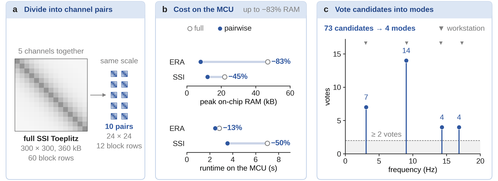](TINYSYSID-PAIRS.png)
  <figcaption>成对分解、资源开销和跨通道对与阶次的投票（特定配置下的库基准）</figcaption>
</figure>

### __2.4 与嵌入式软件对比__

<table>
  <thead>
    <tr><th>软件</th><th>SHM 任务</th><th>范围</th><th>模态识别</th><th>节点端 AI</th><th>流程控制</th></tr>
  </thead>
  <tbody>
    <tr><td>CMSIS-DSP</td><td>不支持</td><td>数值内核</td><td>不支持</td><td>经典推理</td><td>不适用</td></tr>
    <tr><td>ESP-DSP</td><td>不支持</td><td>DSP 内核</td><td>不支持</td><td>不适用</td><td>不适用</td></tr>
    <tr><td>TFLite Micro</td><td>不支持</td><td>神经网络推理</td><td>不支持</td><td>仅推理</td><td>不适用</td></tr>
    <tr><td>ISHMP Toolsuite</td><td>识别、检测</td><td>SHM 服务</td><td>ERA</td><td>不适用</td><td>应用命令</td></tr>
    <tr class="rs-hl"><td>TinySHM</td><td>采集、识别、评估</td><td>SHM 全流程</td><td>六类方法</td><td>推理和训练</td><td>命令定义流程</td></tr>
  </tbody>
</table>

<strong>适用范围。</strong>上表比较的是内置且有文档的功能，不代表精度或成熟度。TinySHM 通过工作负载回放在 ESP32-S3 上评估，大规模网络、长期现场和整板能耗验证尚未确立。SSI 例程采用零滞后分块构造，与标准 SSI-COV 不同。

-   :simple-github:{ .lg .middle } __TinySHM🎯🏆__

    ---

    当前支持平台：

    - ESP32

    <!-- ROLLBACK (github link hidden): [:octicons-arrow-right-24: <a href="https://github.com/Shuaiwen-Cui/TinySHM.git" target="_blank"> 代码 </a>](#) -->

    [:octicons-arrow-right-24: <a href="http://www.cuishuaiwen.com:8300/" target="_blank"> 在线文档（个人服务器 托管） </a>](#)

    <!-- ROLLBACK (github link hidden): [:octicons-arrow-right-24: <a href="https://shuaiwen-cui.github.io/TinySHM/" target="_blank"> 在线文档（Github 托管） </a>](#) -->

## __III 新兴的机器学习/人工智能驱动的典型结构健康监测应用__

应用从单节点决策，推进到多节点间规则驱动的协同，再到从数据中学习的协作。

<table>
  <thead>
    <tr><th>SHM任务</th><th>单节点</th><th>多节点协同（规则驱动）</th><th>多节点协作（数据学习驱动）</th></tr>
  </thead>
  <tbody>
    <tr><td><strong>测量</strong></td><td>自适应触发传感；节点端学习</td><td>-</td><td>-</td></tr>
    <tr><td><strong>系统识别</strong></td><td>板端模态识别</td><td>-</td><td>LCSI</td></tr>
    <tr><td><strong>损伤评估</strong></td><td>-</td><td>结构快速状况评估</td><td>流形动力学</td></tr>
  </tbody>
</table>

### __3.1 单节点智能__

决策所需的证据就在单个节点自己的记录里，决策也就留在这个节点上。

  基于边缘智能与数字孪生的智能自适应触发传感
  已发表

  测量系统识别损伤检测损伤定位损伤量化

  触发传感闭环反馈控制边缘智能贝叶斯优化

简单的阈值加持续时间触发器在值守时保持低开销，需要时由紧凑代理模型和贝叶斯优化重新标定这两个参数。

<figure class="rs-fig" markdown="span">
  [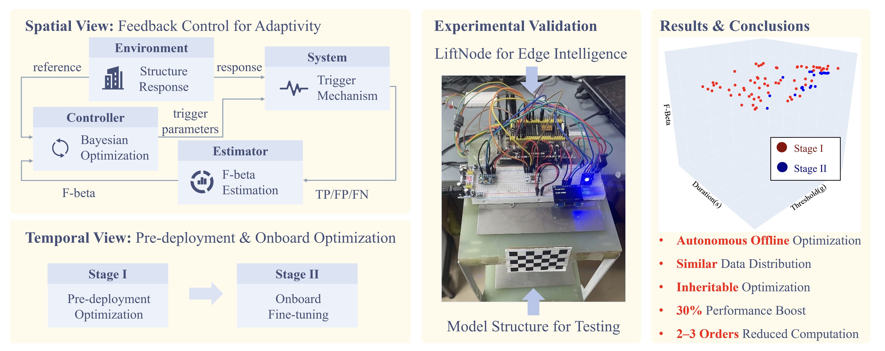](SATM.jpg)
</figure>

<figure class="rs-fig" markdown="span">
  [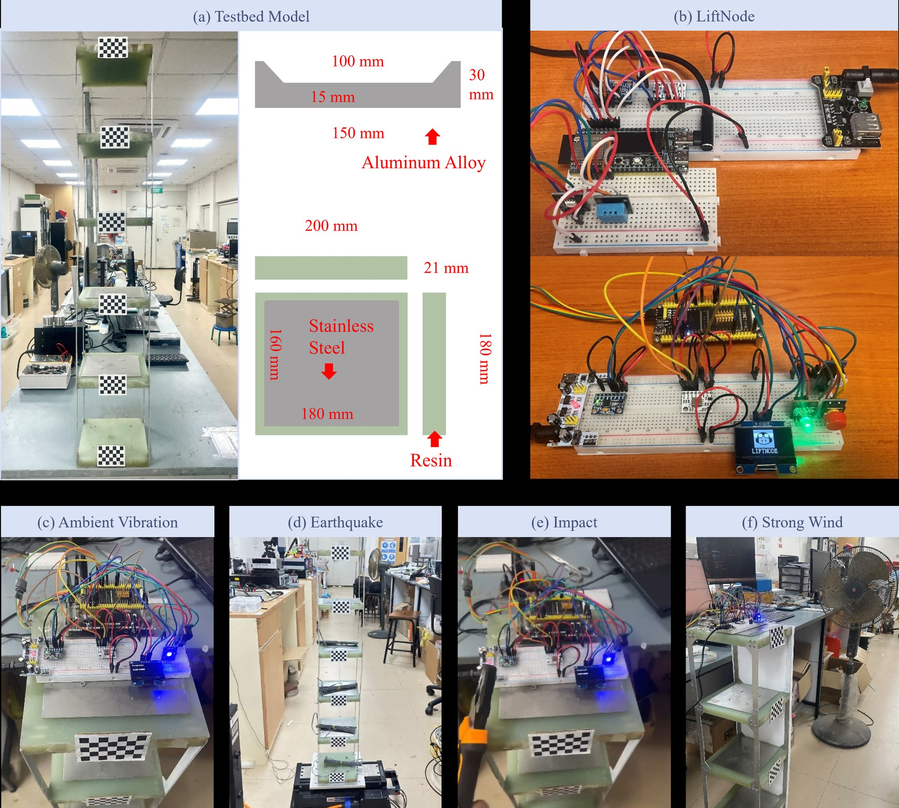](SATM-SETUP.jpg)
  <figcaption>实验台与事件类型</figcaption>
</figure>

  
<b>20</b>第二阶段追加评估次数

  
<b>1,530</b>省去的网格点

  
<b>0.9396</b>代理 F3（网格 0.9351）

<figure class="rs-fig" markdown="span">
  [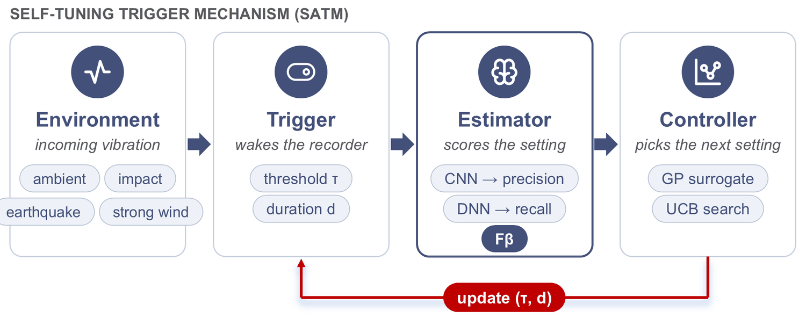](SATM-LOOP.png)
  <figcaption>自适应触发的反馈闭环</figcaption>
</figure>

<strong>适用范围。</strong>在实验室中用单节点、单轴加速度和五层框架模型验证。长期现场验证、净节能效果、完整的 MCU 反馈闭环记录以及现场重新标定的收益均尚未确立。

-   :material-file:{ .lg .middle } __期刊论文 - Mechanical System and Signal Processing__

    ---

    **Cui, S.**, Fu, Y.*, Fu, H., Yu, X., & Shen, W. (2025). Smart Adaptive Trigger Sensing Powered by Edge Intelligence and Digital Twin for Energy-Efficient Wireless Structural Health Monitoring.  Mechanical Systems and Signal Processing, Volume 241, 2025, 113537.

    [:octicons-arrow-right-24: <a href="https://doi.org/10.1016/j.ymssp.2025.113537" target="_blank"> DOI </a>](#)

    [:octicons-arrow-right-24: <a href="https://mp.weixin.qq.com/s/FnFBCZ_S0t8YfapvUsaKeQ" target="_blank"> 公众号推送 </a>](#)

-   :material-file:{ .lg .middle } __会议论文 - SHMII-13__

    ---

    **Cui, S.**, Yu, X., & Fu, Y.* (2025). Smart adaptive triggering strategy for edge intelligence enabled energy-efficient sensing. In *Proceedings of the 13th International Conference on Structural Health Monitoring of Intelligent Infrastructure (SHMII-13)*, pp. 609–616. Graz, Austria: Verlag der TU Graz. (🏆 **最佳会议论文** 1st/202)

    [:octicons-arrow-right-24: <a href="https://doi.org/10.3217/978-3-99161-057-1-094" target="_blank"> DOI </a>](#)

-   :material-file:{ .lg .middle } __新加坡临时专利申请 - 10202502426R__

    ---

    Adaptive Triggering Mechanism for Time-Series Data Sensing on Edge Devices, 新加坡临时专利申请号 10202502426R, 2025

  微控制器节点上的板端模态识别与学习
  在审

  测量系统识别损伤检测损伤定位损伤量化

  运行模态分析设备端训练TinySHMLiftNode

一块 ESP32-S3 同时充当传感器和计算机：它复现工作站的模态识别结果，并训练自己的事件分类器。

<figure class="rs-fig" markdown="span">
  [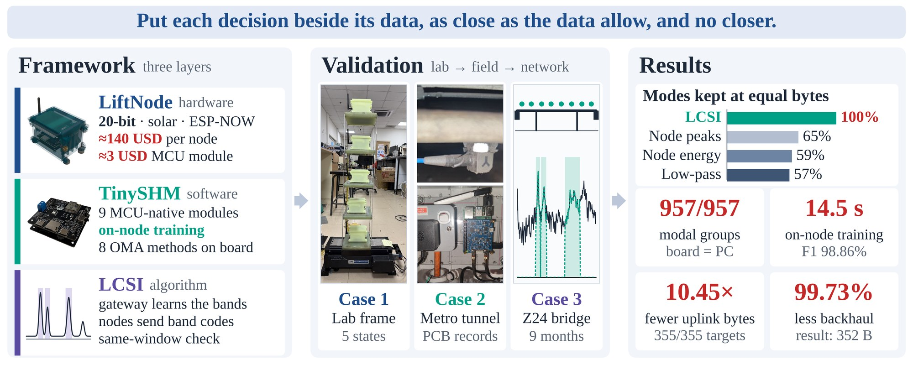](DECISIONS-GA.jpg)
  <figcaption>图中 100% 和 10.45× 对应 Z24 留出数据、±10% 频带下的稳态运行。案例 2 照片来源：Yu et al. (2026), <a href="https://doi.org/10.1016/j.measurement.2025.119308" target="_blank">Measurement</a>。</figcaption>
</figure>

  
<b>957 / 957</b>可比组与 PC 一致

  
<b>14.5 s</b>板端训练，18,000 个窗口

  
<b>98.86%</b>F1（PC 训练 98.78%）

  
<b>2.33 ms</b>每 1 s 窗口特征加推理

<figure class="rs-fig" markdown="span">
  [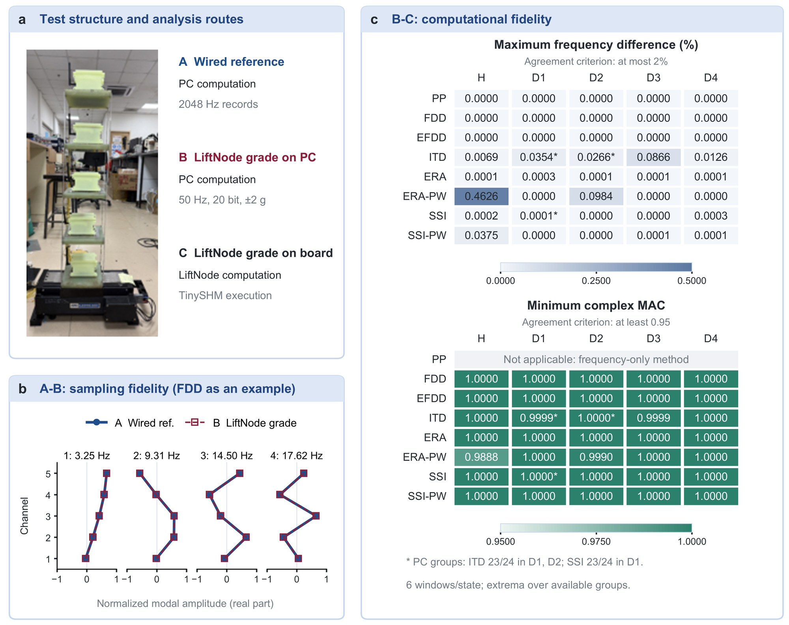](ONBOARD-MODAL.jpg)
</figure>

**模态识别。** 8 种估计方法在板上运行。有 PC 参考的 957 组目标（计划 960 组）全部满足频率差不超过 2%、复数 MAC 不低于 0.95。

**节点端学习。** 一个 66 参数的分类器基于地铁隧道振动记录训练 40 轮，TinyAI 堆峰值 46.7 KiB。

<figure class="rs-fig" markdown="span">
  [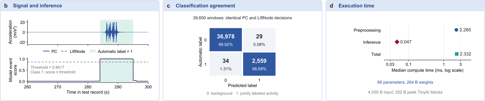](ONBOARD-TUNNEL.png)
  <figcaption>隧道振动记录上的板端推理</figcaption>
</figure>

<strong>适用范围。</strong>两个案例均为已有记录的回放，验证的是板端能复现工作站的计算结果，不代表物理模态精度或现场损伤检测能力。隧道标签来自加速度和音频的自动阈值，并非人工标注的列车事件。

-   :material-file:{ .lg .middle } __在审稿件__

    ---

    **Cui, S.**, Fu, Y.*, Wang, Y., & Fu, H. Decisions beside data: LiftNode and TinySHM for AIoT-native learning and system identification in infrastructure monitoring. Manuscript under review.

### __3.2 多节点协同（规则驱动）__

节点和网关依照预先设计的规则和接口分工。

  基于无线智能传感网络的自适应边缘智能用于结构快速状况评估
  已发表

  测量系统识别损伤检测损伤定位损伤量化

  数据驱动的异常检测高斯过程回归随机过程控制

节点计算位移特征，网关按预先设计的命令流程汇总。

<figure class="rs-fig" markdown="span">
  [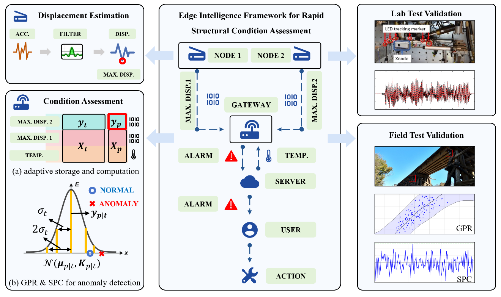](PAPER1.png)
</figure>

<strong>本人贡献。</strong>无参考位移方法来自已有工作。Hoang 的博士研究将其应用于 Xnode，提出 GPR-SPC 评估方法，并采集了铁路桥数据。我的工作是把这些方法适配、优化到微控制器上执行，并组织成节点—网关工作流。

  
<b>8.74 s</b>处理 182.01 s 记录

  
<b>约 10 nm</b>与 PC 的最大差异

  
<b>1.70 ms</b>GPR-SPC 数值核心

  
<b>3,960 B</b>动态工作区

<figure class="rs-fig" markdown="span">
  [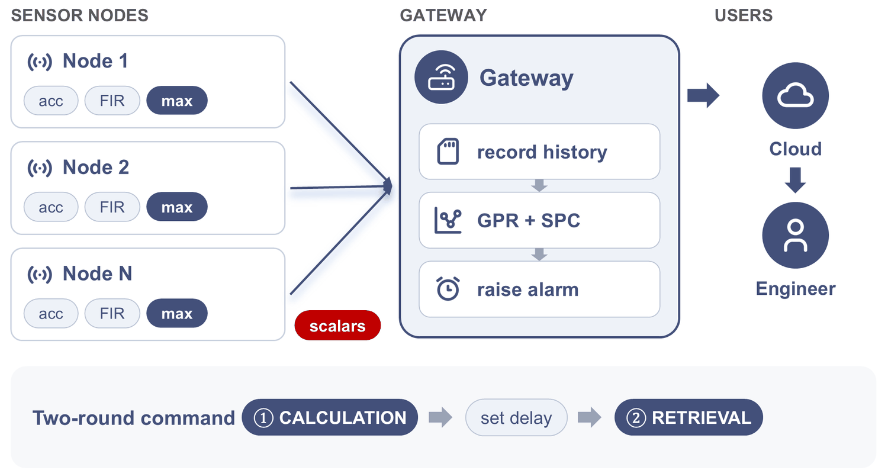](COOP-WORKFLOW.png)
  <figcaption>设计的节点—网关工作流</figcaption>
</figure>

<figure class="rs-fig" markdown="span">
  [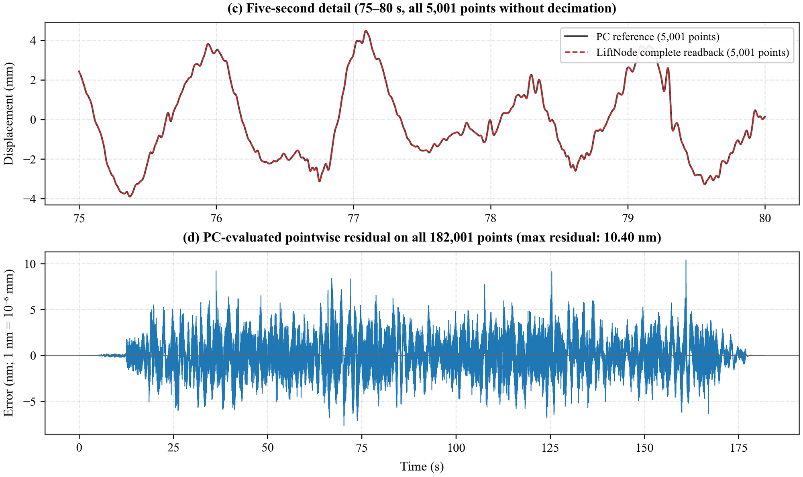](DISPLACEMENT-REPLAY.png)
  <figcaption>LiftNode 位移回放与 PC 参考对比</figcaption>
</figure>

<strong>适用范围。</strong>以上是对已存记录分别进行的回放。桥梁现场工作是 Hoang 等人早期的 Xnode 部署。新的现场部署和端到端无线时延尚未确立。

-   :material-file:{ .lg .middle } __期刊论文 - Engineering Structures__

    ---

    **Cui, S.**, Hoang, T., Mechitov, K., Fu, Y.*, & Spencer Jr, B. F. (2025). Adaptive edge intelligence for rapid structural condition assessment using a wireless smart sensor network. Engineering Structures, 326, 119520.

    [:octicons-arrow-right-24: <a href="https://doi.org/10.1016/j.engstruct.2024.119520" target="_blank"> DOI </a>](#)

    [:octicons-arrow-right-24: <a href="https://mp.weixin.qq.com/s/KHquagqxXvckCuE57ua8YA" target="_blank"> 公众号推送 </a>](#)

### __3.3 多节点协作（数据学习驱动）__

协调方式本身从数据中学习：先学习每个节点该传什么，再学习节点之间共享什么状态。

  学习支撑协同系统识别（LCSI）
  在审

  测量系统识别损伤检测损伤定位损伤量化

  网关学习频谱支撑频带编码等字节评估Z24 桥

网关学习各阶模态占据的频带并下发给节点，每个节点只发送这些频带内的 DCT 系数，配对校验用于决定保留或更新频带。

<figure class="rs-fig" markdown="span">
  [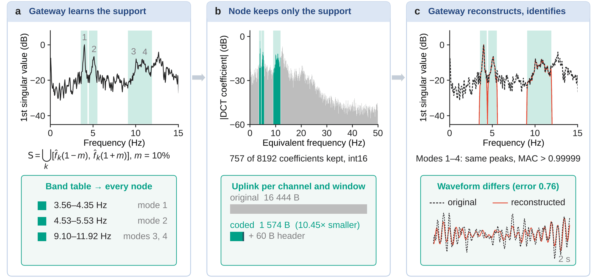](LCSI-PATH.png)
</figure>

  
<b>10.45×</b>单通道缩小（8,192 中保留 757）

  
<b>355 / 355</b>留出数据保留的模态对

  
<b>57–65%</b>等字节下节点自选编码的保留率

  
<b>−90.4%</b>节点上行，稳态（含校验 −88.3%）

<figure class="rs-fig" markdown="span">
  [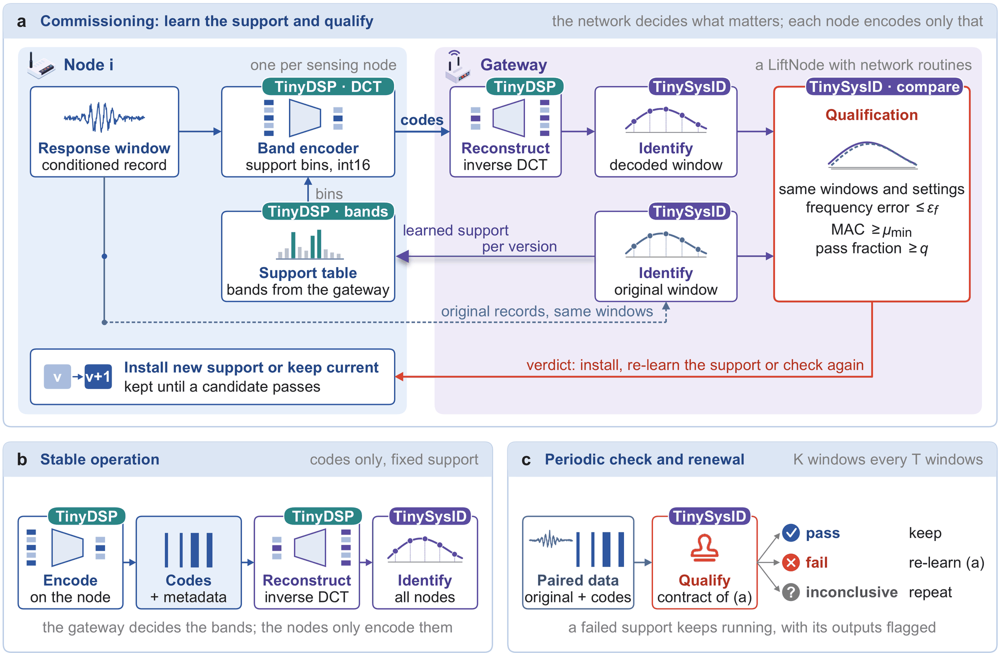](LCSI-CYCLE.png)
  <figcaption>运行周期：调试、稳定运行和周期校验</figcaption>
</figure>

<figure class="rs-fig" markdown="span">
  [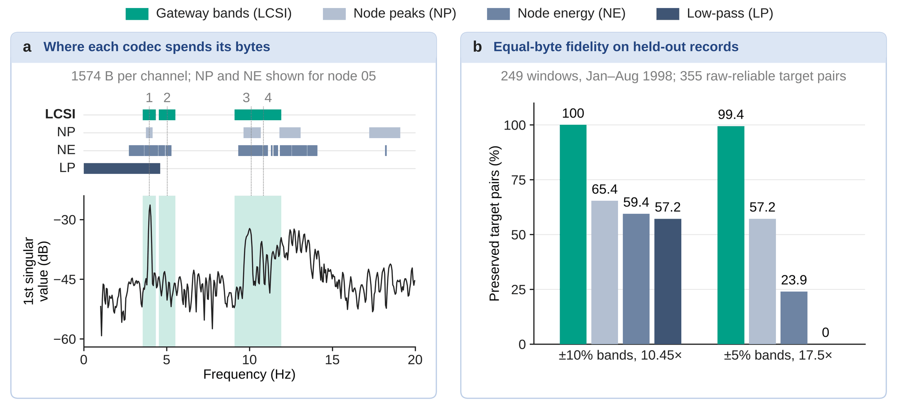](LCSI-EQUAL-BYTES.png)
  <figcaption>与节点自选编码的等字节对比</figcaption>
</figure>

<figure class="rs-fig" markdown="span">
  [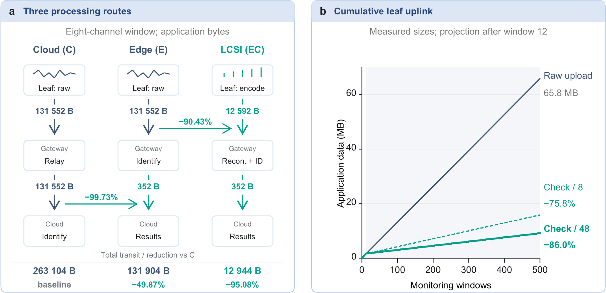](LCSI-TRAFFIC.png)
  <figcaption>各链路上的应用层字节数</figcaption>
</figure>

<strong>适用范围。</strong>Z24 损伤前记录在一块 ESP32-S3 上依次回放，并非实时多节点网络。节省的是应用层字节，未测量能耗和时延。调试阶段比直接上传原始数据多 9.6%，到第 14 个窗口回本。结构发生较大变化时的频带更新尚未测试。

-   :material-file:{ .lg .middle } __在审稿件__

    ---

    与 3.1 节板端模态识别条目为同一稿件。

  流形动力学：面向分布式监测的仅健康数据诊断状态
  博士论文 · 未发表

  测量系统识别损伤检测损伤定位损伤量化

  仅健康数据学习隐空间流距离、方向、关系、趋势叶节点—网关表示

各通道的编码在网关融合成一个诊断状态，训练不依赖损伤标签。识别、预测、检测、定位和退化趋势都成为这个状态的读出。信息单向流动，模型训练后冻结。

<figure class="rs-fig" markdown="span">
  [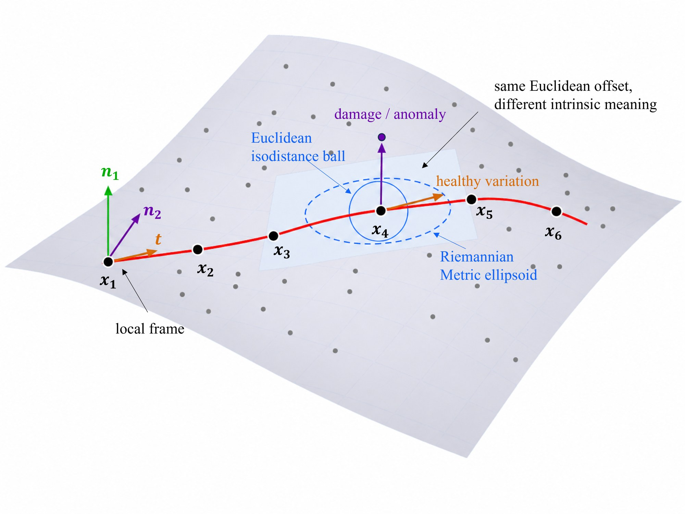](MANIFOLD-CONCEPT.jpg)
  <figcaption>健康状态沿学习到的流形演化</figcaption>
</figure>

<figure class="rs-fig" markdown="span">
  [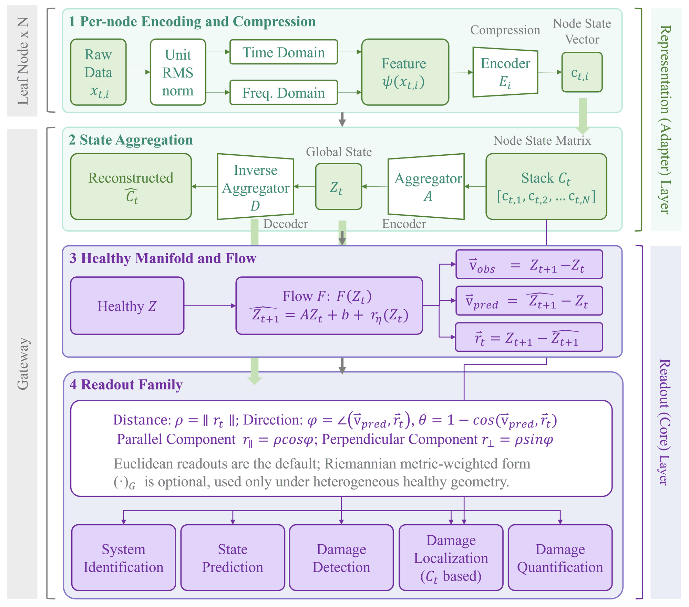](MANIFOLD-FRAMEWORK.png)
  <figcaption>提出的逻辑流程，并非实测的实时多板实现</figcaption>
</figure>

  
<b>4 / 4</b>柱移除工况定位正确

  
<b>0.731</b>窗口 top-1（健康误报 0.112）

  
<b>0.810</b>Z24 Stage 02 AUROC（静态 0.683）

  
<b>34.552 ms</b>每状态对，ESP32-S3 回放

<figure class="rs-fig" markdown="span">
  [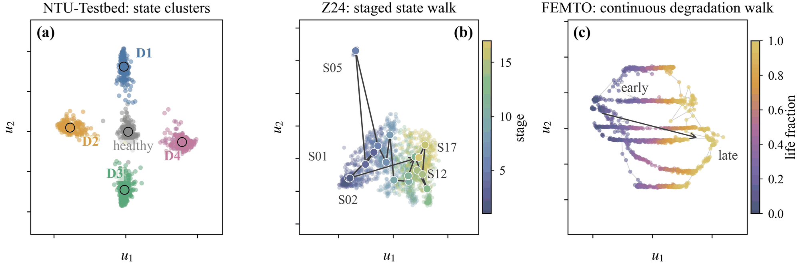](MANIFOLD-STATES.png)
  <figcaption>三个验证系统上的状态轨迹（仅用于可视化）</figcaption>
</figure>

<figure class="rs-fig" markdown="span">
  [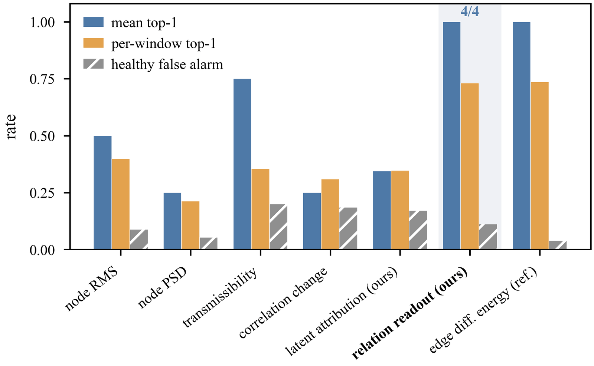](MANIFOLD-NTU.png)
  <figcaption>四层框架：与无标签基线的定位对比</figcaption>
</figure>

<figure class="rs-fig" markdown="span">
  [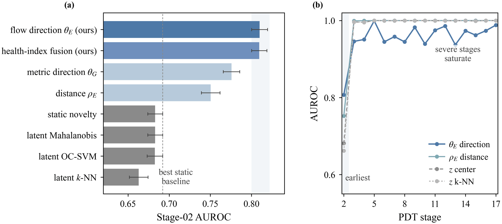](MANIFOLD-Z24.png)
  <figcaption>Z24：最早记录到偏离时的读出结果</figcaption>
</figure>

在 FEMTO 轴承上，因果退化趋势读出的单调性与趋势性平均得分为 0.453，这不是剩余寿命预测。

<strong>适用范围。</strong>未发表工作，见博士论文。“分布式”指提出的叶节点—网关划分，在集中采集数据和公开基准数据上评估，并非实时多板网络。Z24 Stage 02 包含沉降系统安装和可能的环境变化，因此不是确认的损伤检测。板端结果使用预载特征。

-   :material-file:{ .lg .middle } __博士论文 - 第 6 章（未发表）__

    ---

    **Cui, S.** Distributed Edge Intelligence for IoT-Based Wireless Structural Health Monitoring. Ph.D. Thesis, Nanyang Technological University.

## __IV 教研工作__

### ArduinoNode

设计并开发了一个基于 Arduino UNO R4 WIFI 的简单无线智能传感器网络节点，成功应用于香港理工大学举办的 APESS2025 暑期学校的结构健康监测教学中。

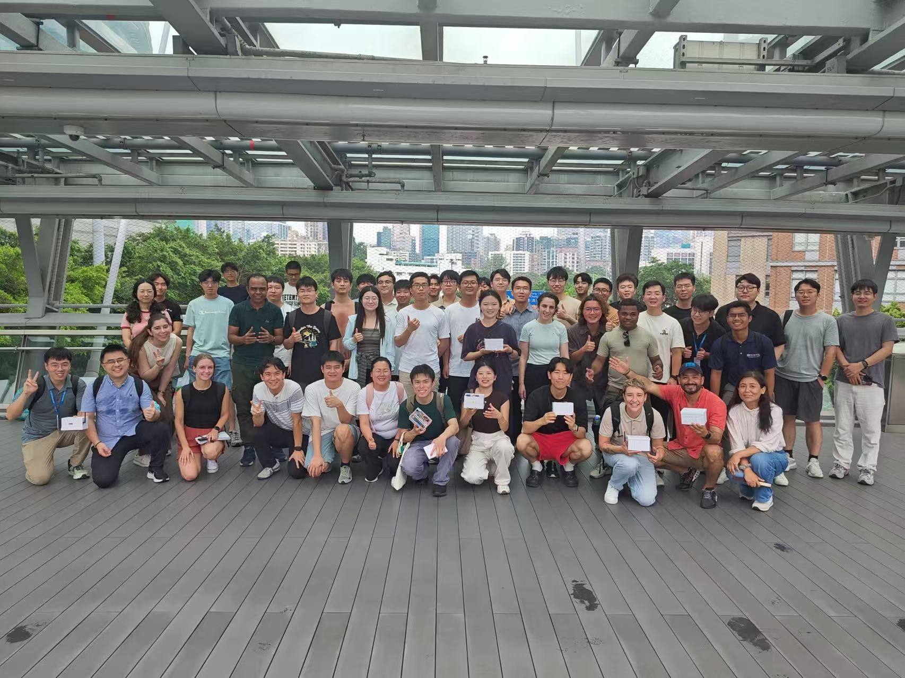

-   :simple-github:{ .lg .middle } __APESS2025_ARDUINONODE__

    ---

    SHM教学用WSN节点--基于Arduino UNO R4 WIFI

    [:octicons-arrow-right-24: <a href="https://github.com/Shuaiwen-Cui/APESS2025_ArduinoNode.git" target="_blank"> 代码 </a>](#)

    [:octicons-arrow-right-24: <a href="https://shuaiwen-cui.github.io/APESS2025_ArduinoNode/" target="_blank"> 在线文档 </a>](#)

-   :material-file:{ .lg .middle } __期刊论文 - IEEE Transactions on Education__

    ---

    **Cui, S.**, Fu, Y.*, Xia, Y., Zhang Q., & Li, S. (2026). A Class-Lab-Field Pedagogical Framework for Structural Health Monitoring using Ultra-Low-Cost Wireless IoT Prototypes. IEEE Transactions on Education. 

    [:octicons-arrow-right-24: <a href="https://doi.org/10.1109/TE.2026.3717462" target="_blank"> DOI </a>](#)

    [:octicons-arrow-right-24: <a href="https://mp.weixin.qq.com/s/d7ucOQSB-XSaVzWxegbzBg?scene=1&click_id=524330546" target="_blank"> 公众号推送 </a>](#)

