# __攻博期间研究__

{width=100%}

## __研究概览__

!!! info "研究主题 -- 将结构健康监测推向边缘设备"
    我的博士研究课题是 __面向物联网无线结构健康监测的分布式边缘智能__，重点是开发一种分布式边缘智能使能框架，面向资源受限的低成本边缘设备，以促进从云到边和从知识驱动到人工智能驱动（特别是智能体驱动）的范式转变，并将其应用于物联网结构健康监测的典型应用。

!!! info "主要任务"
    - 物联网系统开发：边缘设备（MCU级别，低成本和资源受限）和云平台开发
    - 分布式边缘智能使能框架开发：TinySHM (向量、矩阵运算/数字信号处理/机器学习与人工智能算法库)
    - 结构健康监测应用：测量/系统识别/损伤检测/损伤定位/损伤量化

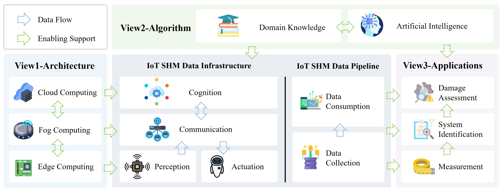{width=100%}

-   :material-file:{ .lg .middle } __综述论文-物联网结构健康监测中的泛在计算与智能（从端到云）__

    ---

    **Cui, S.**, Fu, Y.*, Fu, H., & Shen, W. (2026). Edge-to-Cloud Computing and Intelligence for IoT-based Structural Health Monitoring: A Comprehensive Review. Advanced Engineering Informatics. 

    [:octicons-arrow-right-24: <a href="https://doi.org/10.1016/j.aei.2025.104300" target="_blank"> DOI </a>](#)

    [:octicons-arrow-right-24: <a href="https://mp.weixin.qq.com/s/ySQzpHCOhTIcSIN8gqK1bA" target="_blank"> 公众号推送 </a>](#)

## __I SHM物联网系统开发__

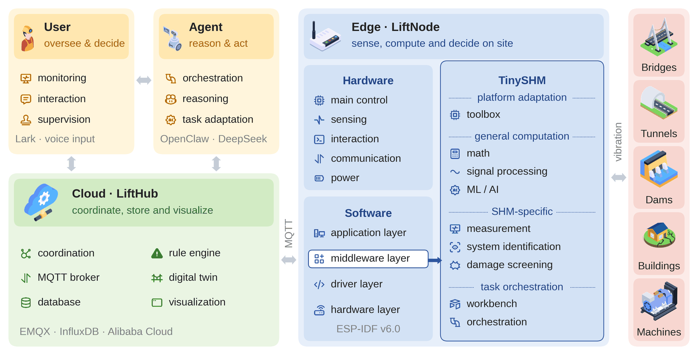{width=100%}

### __1.1 边缘设备__

!!! note "边缘设备开发"
    为实现边缘智能计算，我们开发了两种类型的 MCU 节点，基于 STM32 和 ESP32。这些节点具有高性能的边缘计算能力，可用于物联网、智能家居、智慧城市等应用场景。目前的开发重点是 ESP32。

-   :simple-github:{ .lg .middle } __LiftNode_ESP32🎯🏆__

    ---

    基于 ESP32 的 MCU IoT 节点，具有高性能边缘计算

    <!-- ROLLBACK (github link hidden): [:octicons-arrow-right-24: <a href="https://github.com/Shuaiwen-Cui/LiftNode_ESP32.git" target="_blank"> 代码 </a>](#) -->

    [:octicons-arrow-right-24: <a href="http://www.cuishuaiwen.com:8100/" target="_blank"> 在线文档（个人服务器 托管） </a>](#)

    <!-- ROLLBACK (github link hidden): [:octicons-arrow-right-24: <a href="https://shuaiwen-cui.github.io/LiftNode_ESP32/" target="_blank"> 在线文档（Github 托管） </a>](#) -->

<!-- <iframe width="800" height="450" src="https://www.youtube-nocookie.com/embed/O2b3-Bjhhws" frameborder="0" allowfullscreen></iframe> -->

<!-- 主控板

{width=100%}

扩展板

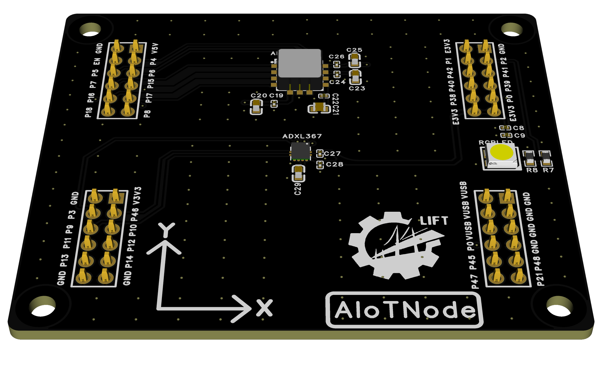{width=100%} -->

节点设计

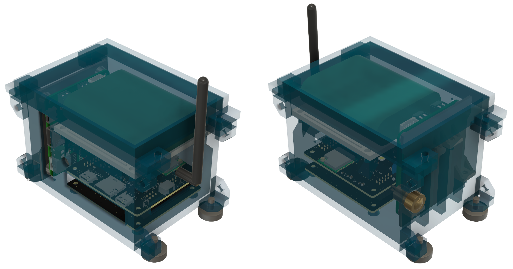{width=100%}

{width=100%}

PCB 设计

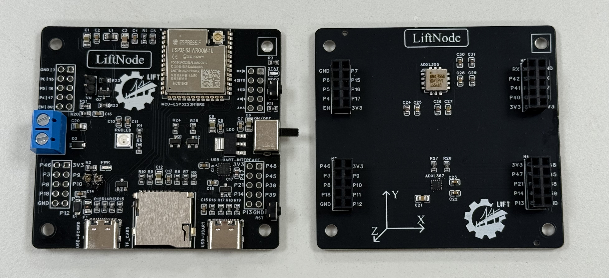{width=100%} 

传感器流式采样Demo

<iframe width="800" height="450" src="//player.bilibili.com/player.html?bvid=BV1Vm7Y6wEH2&autoplay=0" frameborder="0" allowfullscreen></iframe>

传感器同步Demo

<iframe width="800" height="450" src="//player.bilibili.com/player.html?bvid=BV1q75i6qE8r&autoplay=0" frameborder="0" allowfullscreen></iframe>

### __1.2 云平台__

-   :simple-github:{ .lg .middle } __LiftHub 🎯🏆__

    ---

    作为服务器端与LiftNode交互，提供数据存储和分析等功能。

    <!-- ROLLBACK (github link hidden): [:octicons-arrow-right-24: <a href="https://github.com/Shuaiwen-Cui/LiftHub.git" target="_blank"> 代码 </a>](#) -->

    [:octicons-arrow-right-24: <a href="http://www.cuishuaiwen.com:8200/" target="_blank"> 在线文档（个人服务器 托管） </a>](#)

    <!-- ROLLBACK (github link hidden): [:octicons-arrow-right-24: <a href="https://shuaiwen-cui.github.io/LiftHub/" target="_blank"> 在线文档（Github 托管） </a>](#) -->

## __II 资源受限设备分布式边缘智能使能框架__

TinySHM 是运行在 MCU 上的中间件，位于板级驱动和 SHM 应用之间，覆盖采集、信号处理、系统识别、损伤筛查和设备端学习，不依赖 Linux 或 Python。

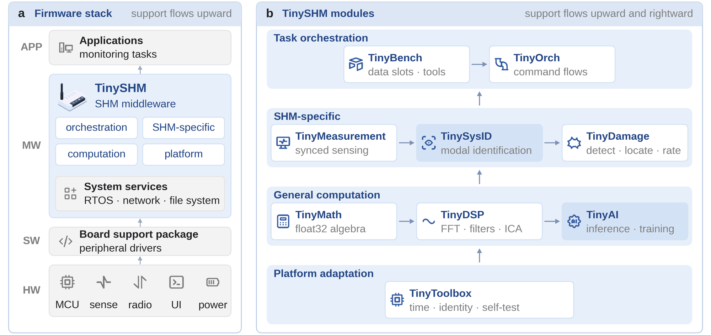{width=100%}

!!! note "九个模块"
    - 平台适配：TinyToolbox
    - 通用计算：TinyMath / TinyDSP / TinyAI
    - SHM 专用：TinyMeasurement / TinySysID / TinyDamage
    - 任务编排：TinyBench / TinyOrch

设备端训练（TinyAI）

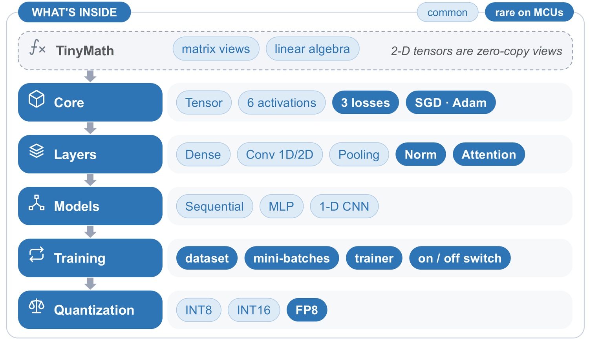{width=100%}

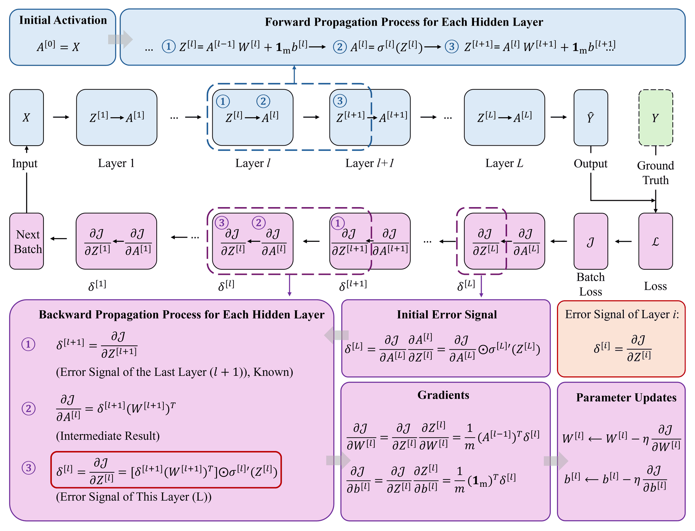{width=100%}

节点端系统识别（TinySysID）

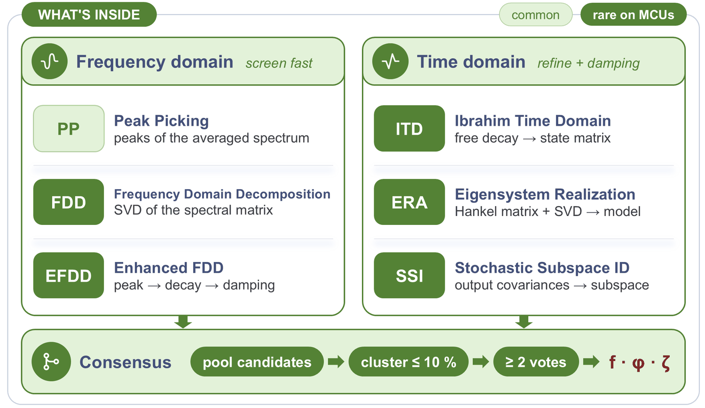{width=100%}

-   :simple-github:{ .lg .middle } __TinySHM🎯🏆__

    ---

    当前支持平台：

    - ESP32

    <!-- ROLLBACK (github link hidden): [:octicons-arrow-right-24: <a href="https://github.com/Shuaiwen-Cui/TinySHM.git" target="_blank"> 代码 </a>](#) -->

    [:octicons-arrow-right-24: <a href="http://www.cuishuaiwen.com:8300/" target="_blank"> 在线文档（个人服务器 托管） </a>](#)

    <!-- ROLLBACK (github link hidden): [:octicons-arrow-right-24: <a href="https://shuaiwen-cui.github.io/TinySHM/" target="_blank"> 在线文档（Github 托管） </a>](#) -->

## __III 面向结构健康监测的机器学习与人工智能算法__

算法从单节点决策，推进到多节点间规则驱动的协同，再到从数据中学习的协作。

### __3.1 单节点智能__

#### 基于边缘智能与数字孪生的智能自适应触发传感用于能源高效的无线结构健康监测

🏷️ SHM分类：**测量**/系统识别/损伤检测/损伤定位/损伤量化

- 触发传感
- 闭环反馈控制
- 边缘智能
- 贝叶斯优化

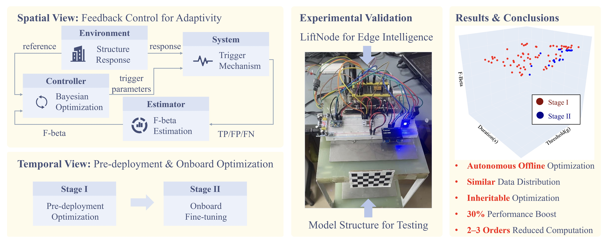

-   :material-file:{ .lg .middle } __会议论文 - 13th International Conference on Structural Health Monitoring of Intelligent Infrastructure (SHMII-13)__

    ---

    **Cui, S.**, Yu, X., & Fu, Y.* (2025). Smart adaptive triggering strategy for edge intelligence enabled energy-efficient sensing. In *Proceedings of the 13th International Conference on Structural Health Monitoring of Intelligent Infrastructure (SHMII-13)*, pp. 609–616. Graz, Austria: Verlag der TU Graz. (🏆 **最佳会议论文** 1st/202)

    [:octicons-arrow-right-24: <a href="https://doi.org/10.3217/978-3-99161-057-1-094" target="_blank"> DOI </a>](#)

-   :material-file:{ .lg .middle } __期刊论文 - Mechanical System and Signal Processing__

    ---

    **Cui, S.**, Fu, Y.*, Fu, H., Yu, X., & Shen, W. (2025). Smart Adaptive Trigger Sensing Powered by Edge Intelligence and Digital Twin for Energy-Efficient Wireless Structural Health Monitoring.  Mechanical Systems and Signal Processing, Volume 241, 2025, 113537.

    [:octicons-arrow-right-24: <a href="https://doi.org/10.1016/j.ymssp.2025.113537" target="_blank"> DOI </a>](#)

    [:octicons-arrow-right-24: <a href="https://mp.weixin.qq.com/s/FnFBCZ_S0t8YfapvUsaKeQ" target="_blank"> 公众号推送 </a>](#)

-   :material-file:{ .lg .middle } __新加坡临时专利申请 - 10202502426R__

    ---

    Adaptive Triggering Mechanism for Time-Series Data Sensing on Edge Devices, 新加坡临时专利申请号 10202502426R, 2025

#### 微控制器节点上的板端模态识别与学习

🏷️ SHM分类：**测量**/**系统识别**/损伤检测/损伤定位/损伤量化

- 运行模态分析
- 设备端训练
- TinySHM

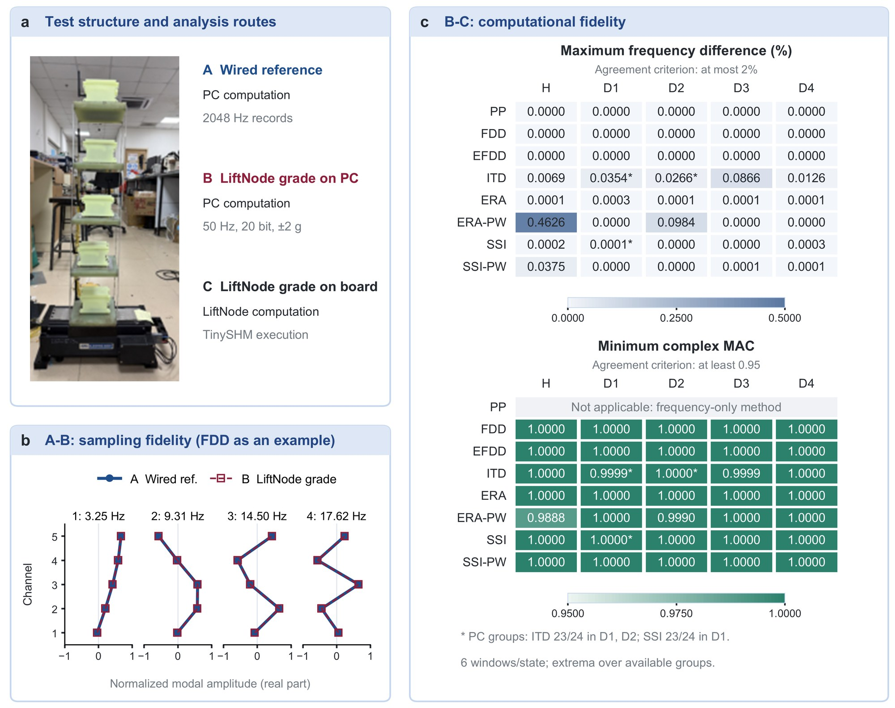{width=100%}

-   :material-file:{ .lg .middle } __在审稿件__

    ---

    **Cui, S.**, Fu, Y.*, Wang, Y., & Fu, H. Decisions beside data: LiftNode and TinySHM for AIoT-native learning and system identification in infrastructure monitoring. Manuscript under review.

### __3.2 多节点协同（规则驱动）__

**- 基于无线智能传感网络的自适应边缘智能用于结构快速状况评估**

🏷️ SHM分类：**测量**/系统识别/**损伤检测**/损伤定位/损伤量化

- 数据驱动的异常检测
- 高斯过程回归
- 随机过程控制

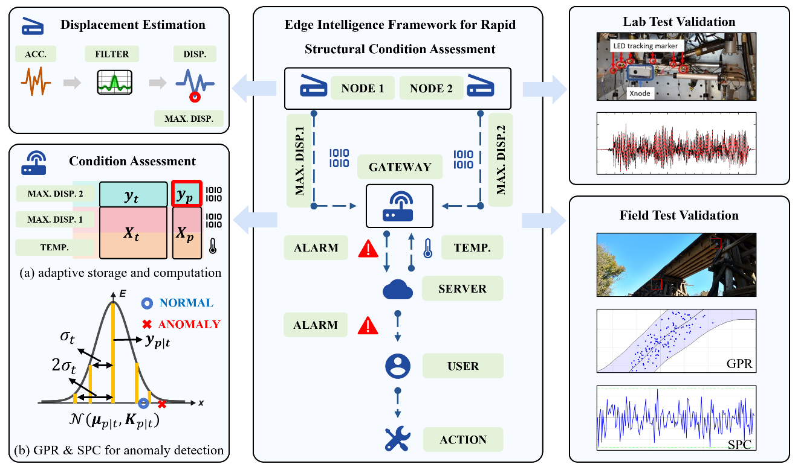{width=100%}

-   :material-file:{ .lg .middle } __期刊论文 - Engineering Structures__

    ---

    **Cui, S.**, Hoang, T., Mechitov, K., Fu, Y.*, & Spencer Jr, B. F. (2025). Adaptive edge intelligence for rapid structural condition assessment using a wireless smart sensor network. Engineering Structures, 326, 119520.

    [:octicons-arrow-right-24: <a href="https://doi.org/10.1016/j.engstruct.2024.119520" target="_blank"> DOI </a>](#)

    [:octicons-arrow-right-24: <a href="https://mp.weixin.qq.com/s/KHquagqxXvckCuE57ua8YA" target="_blank"> 公众号推送 </a>](#)

### __3.3 多节点协作（数据学习驱动）__

**- 学习支撑协同系统识别（LCSI）**

🏷️ SHM分类：测量/**系统识别**/损伤检测/损伤定位/损伤量化

- 网关与节点协作
- 通信高效的系统识别

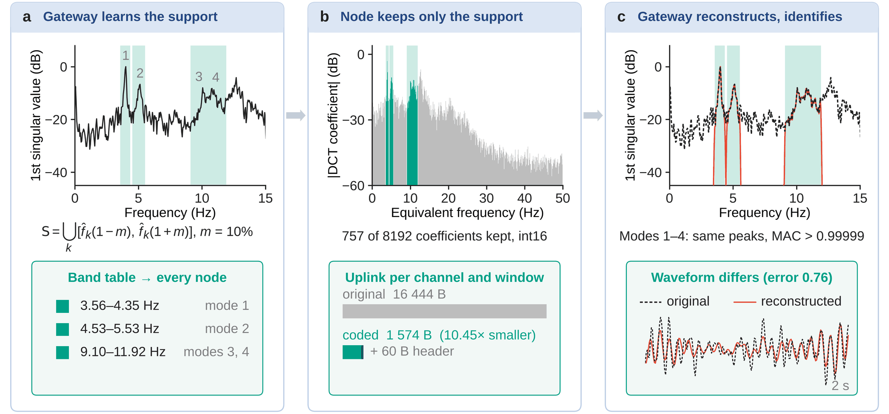{width=100%}

**- 流形动力学**

🏷️ SHM分类：测量/**系统识别**/**损伤检测**/**损伤定位**/**损伤量化**

- 仅健康数据学习
- 学习得到的诊断状态
- 叶节点—网关表示

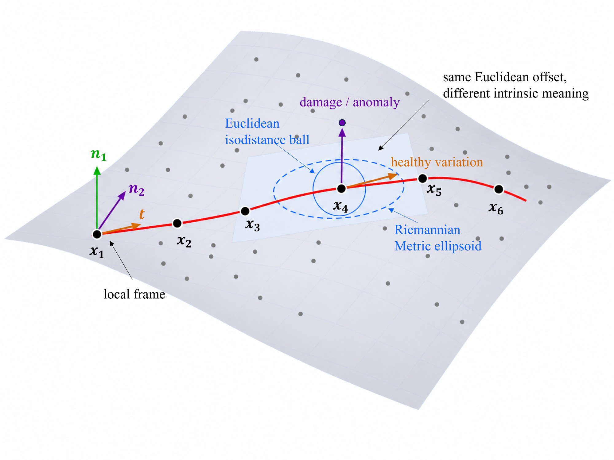{width=100%}

三个验证系统上的状态轨迹（仅用于可视化）

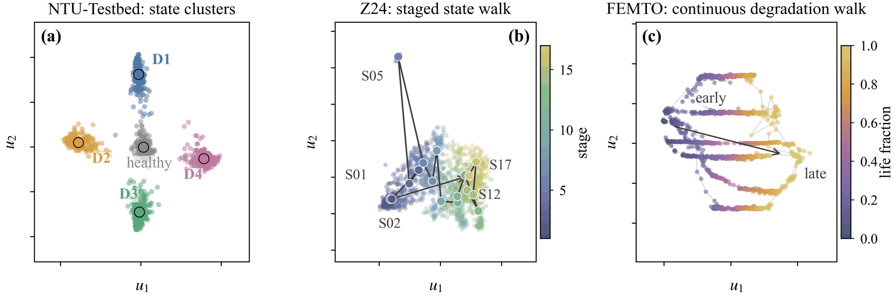{width=100%}

## __IV 教研工作__

### ArduinoNode

设计并开发了一个基于 Arduino UNO R4 WIFI 的简单无线智能传感器网络节点，成功应用于香港理工大学举办的 APESS2025 暑期学校的结构健康监测教学中。

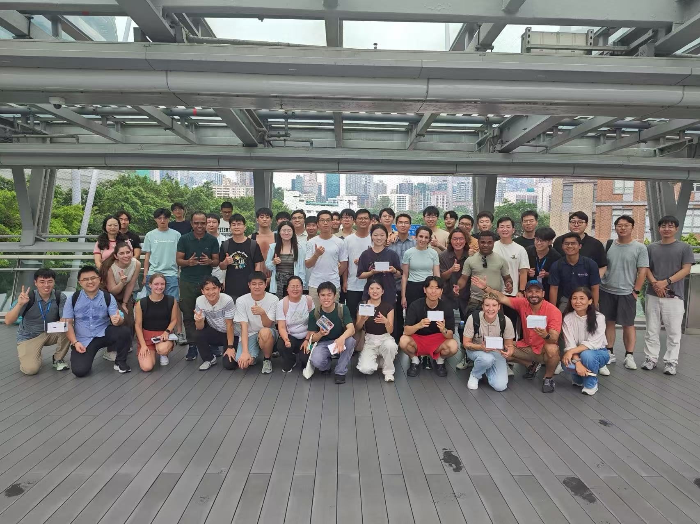

-   :simple-github:{ .lg .middle } __APESS2025_ARDUINONODE__

    ---

    SHM教学用WSN节点--基于Arduino UNO R4 WIFI

    [:octicons-arrow-right-24: <a href="https://github.com/Shuaiwen-Cui/APESS2025_ArduinoNode.git" target="_blank"> 代码 </a>](#)

    [:octicons-arrow-right-24: <a href="https://shuaiwen-cui.github.io/APESS2025_ArduinoNode/" target="_blank"> 在线文档 </a>](#)

-   :material-file:{ .lg .middle } __期刊论文 - IEEE Transactions on Education__

    ---

    **Cui, S.**, Fu, Y.*, Xia, Y., Zhang Q., & Li, S. (2026). A Class-Lab-Field Pedagogical Framework for Structural Health Monitoring using Ultra-Low-Cost Wireless IoT Prototypes. IEEE Transactions on Education. 

    [:octicons-arrow-right-24: <a href="https://doi.org/10.1109/TE.2026.3717462" target="_blank"> DOI </a>](#)

    [:octicons-arrow-right-24: <a href="https://mp.weixin.qq.com/s/d7ucOQSB-XSaVzWxegbzBg?scene=1&click_id=524330546" target="_blank"> 公众号推送 </a>](#)

## __V 实地部署与工程应用__

### __印度尼西亚 Flores__

2026 年 11 月，两台 LiftNode 部署于 Flores 的 RSUD Aeramo 医院，用于支持余震的持续远程监测。

-   [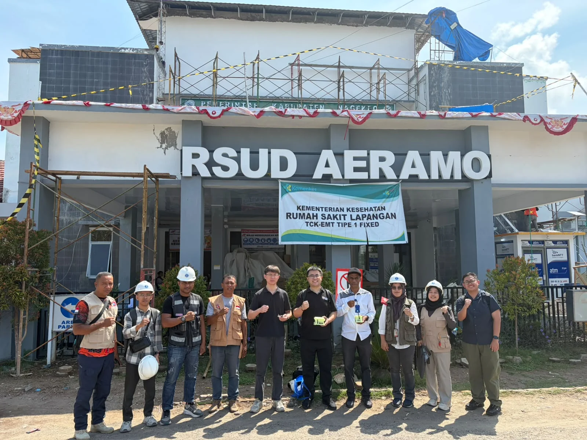{ loading=lazy width=1600 height=1200 }](deployment/liftnode-deployment-team.webp)

    **部署团队合照**

-   [{ loading=lazy width=1080 height=1920 }](deployment/liftnode-staircase-two-nodes.webp)

    **楼梯间双节点布置**

-   [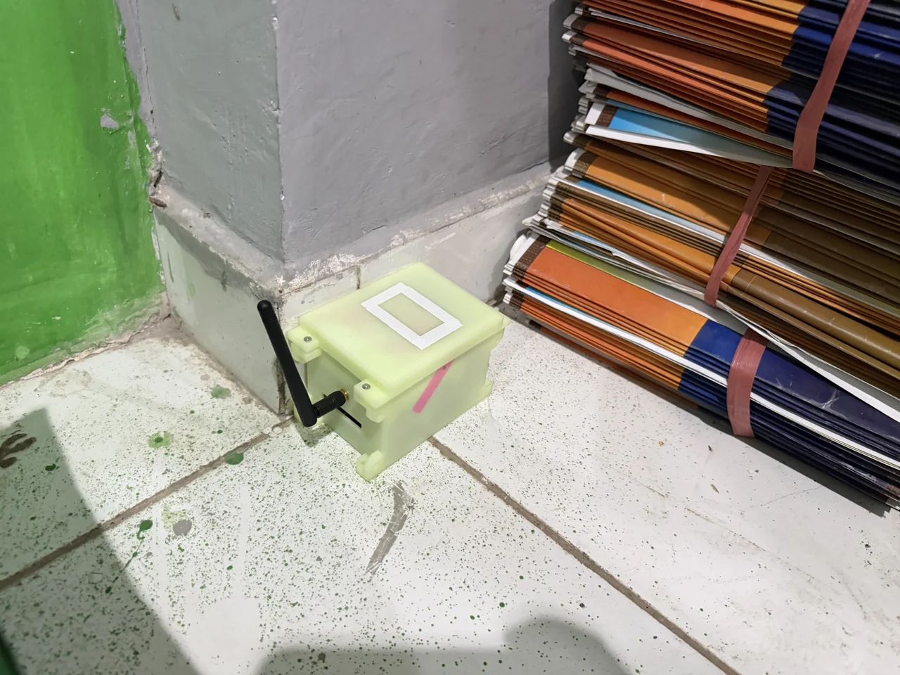{ .deployment-detail loading=lazy width=1280 height=960 }](deployment/liftnode-column.webp)

    **柱脚测点**

-   [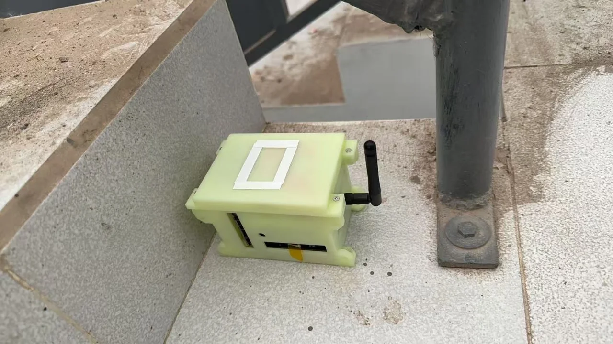{ .deployment-detail loading=lazy width=1280 height=720 }](deployment/liftnode-stair-landing.webp)

    **楼梯平台测点**

<figure markdown="span">
  [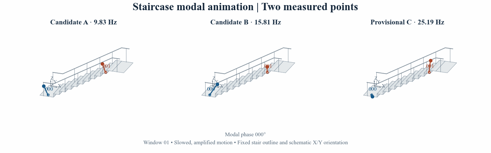{ loading=lazy width=1340 height=420 style="width:100%;height:auto;" }](deployment/flores-staircase-mode-shapes.gif)
  <figcaption>楼梯双测点模态动画 · 候选振型</figcaption>
</figure>

  [微信公众号报道](https://mp.weixin.qq.com/s/XOJi_UTy37Iyz1eL0dx9wg?scene=1&click_id=44321977){ .md-button }
  [NTU 英文报道](https://www.ntu.edu.sg/cee/news/ntu-cee-researchers-conduct-field-deployment-in-flores--indonesia){ .md-button }

#### __实地采集：与官方地震记录相互印证__

<strong>2026 年 11 月 18 日</strong>，部署在 RSUD Aeramo 医院的 <strong>LiftNode 000</strong> 自动捕获并保存了一段清晰的三轴振动波形，随后<strong>成功远程取回数据</strong>。记录时间与印度尼西亚 <strong>BMKG 通报的附近 M5.8 地震</strong>相符，展示了系统在真实现场的工作能力。

<figure markdown="span">
  <h5>官方地震记录</h5>
  [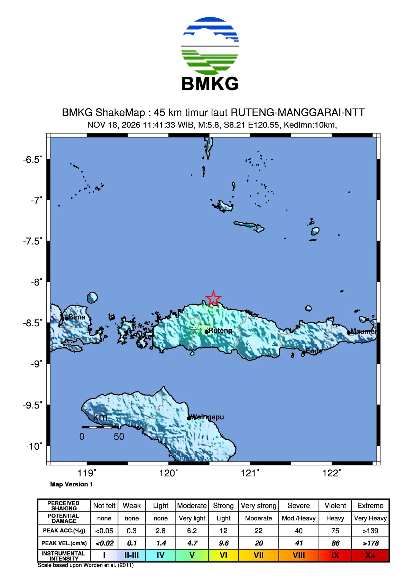{ loading=lazy width=1200 height=1698 }](deployment/flores-20261118-bmkg.jpg)
  <figcaption><strong>M5.8 · 12:41:33</strong> · 发震时刻，UTC+8 官方震动分布图：<a href="https://www.bmkg.go.id/gempabumi/20261118114412" target="_blank" rel="noopener noreferrer">BMKG</a> · 震源深度 10 km</figcaption>
</figure>

<figure markdown="span" class="field-event-figure">
  <h5>我们的节点实测数据</h5>
  [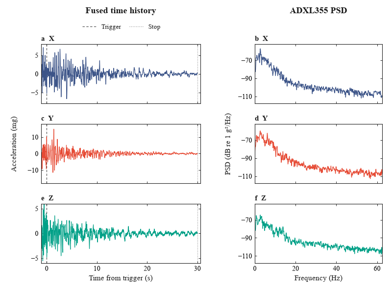{ loading=lazy width=800 height=600 }](deployment/flores-20261118-waveform-psd.svg)
  <figcaption><strong>节点 000 · 12:42:07.502</strong> · 触发时刻，UTC+8 实测波形与频谱 · 点击可放大</figcaption>
</figure>

<strong>为什么晚了约 35 秒？</strong> 医院距离震中约 <strong>100 公里</strong>，地震波传播到测点需要数十秒。这次观测到的时间间隔与该量级相符，其中也包含振动达到节点触发阈值所需的时间。

<strong>这次数据说明了什么？</strong> 三个方向均记录到清晰的振动起伏及随后的衰减，波形可供后续分析。这个现场实例跑通了<strong>自动检测、本地保存、远程取回</strong>的完整流程。官方地震记录从时间和位置上提供了独立佐证；这里尚未进行台站波形的直接比对。

<strong>边缘智能，从论文走向真实现场。</strong> 节点不只是记录振动，还会在本地运行小型神经网络，对已采集的波形进行地震判定，<strong>无需依赖网络或云端推理</strong>。这次事件中，节点端 AI 给出了<strong>“地震”判定，模型分数为 92.1%</strong>。对我而言，这是边缘计算与智能研究首次从论文和实验室进入真实地震监测现场，是一次重要的实战检验。AI 结果随波形保存供后续核对，<strong>仅作实验参考，不决定数据是否保留</strong>。

研究者参考：数据处理与原始文件

- 时域图融合 ADXL367 触发前数据与 ADXL355 采集数据，暂按同名轴直接合并；当前安装方向对应尚未独立验证。频谱<strong>仅使用 ADXL355</strong>，展示 Welch PSD（dB）。
- 原始文件通过校验和及传感器数据完整性检查；ADXL355 仍有两处时间间隔异常，因此不据此宣称零丢样。四个启动样本未用于图中后段波形和频谱，但仍保存在原始文件中。
- 保存窗口约 31 秒，含触发前约 1 秒，不代表完整地震持续时间。发震时刻与阈值触发时刻不是同一种到时观测，两者之差不能直接当作精确传播时间。时间与位置支持事件关联，附近参考台站波形的进一步核对尚待完成。
- BMKG 初报为 12:41:32，更新通报及图中为 12:41:33，均已从 WIB（UTC+7）换算为 Flores／新加坡时间（UTC+8）。正文时间统一采用 UTC+8，医院距震中的距离为近似值。

[BMKG 官方通报](https://www.bmkg.go.id/gempabumi/20261118114412) · [下载 PNG 图片](deployment/flores-20261118-waveform-psd.png) · [SVG 矢量图](deployment/flores-20261118-waveform-psd.svg) · [原始波形 TXT](deployment/000_20261118T124207502_T.txt)

